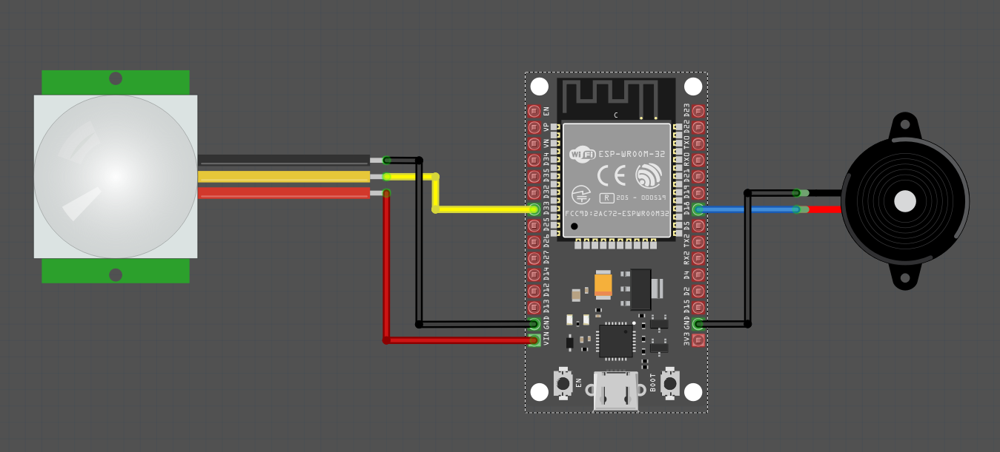

{{#title Простая охранная сигнализация на ESP32, PIR-датчике и Rust}}

# Простая охранная сигнализация на ESP32, PIR-датчике и Rust

Сделаем простую охранную сигнализацию: пищалка включается ненадолго, а затем выключается. Мы также включаем встроенный светодиод, подключённый к GPIO2. Смело меняйте это под свои задачи!

## Аппаратные требования

- Активная пищалка
- PIR-датчик
- Провода-перемычки

## Схема

Подключение PIR-датчика такое же, как раньше (см. [схему](./circuit.md)). Средний выходной вывод датчика подключаем к GPIO 33.

### Подключение вывода пищалки:
<table style="margin-bottom:20px">
  <thead>
    <tr>
      <th>Вывод ESP32</th>
      <th style="width: 250px; margin: 0 auto;">Провод</th>
      <th>Вывод пищалки</th>
    </tr>
  </thead>
  <tbody>
    <tr>
      <td>GPIO 18</td>
      <td style="text-align: center; vertical-align: middle; padding: 0;">
        <div class="wire blue" style="width: 200px; margin: 0 auto;">
          <div class="male-left"></div>
          <div class="male-right"></div>
        </div>
      </td>
      <td>Положительный вывод</td>
    </tr>
    <tr>
      <td>GND</td>
      <td style="text-align: center; vertical-align: middle; padding: 0;">
        <div class="wire black" style="width: 200px; margin: 0 auto;">
          <div class="male-left"></div>
          <div class="male-right"></div>
        </div>
      </td>
      <td>Отрицательный вывод</td>
    </tr>
  </tbody>
</table>




### Создание проекта с помощью esp-generate

Чтобы создать проект, используйте команду `esp-generate`. Выполните:

```sh
esp-generate --chip esp32 burglar-alarm
```

## Выводы пищалки и светодиода

Мы настроим GPIO 18 как выходной вывод с начальным состоянием Low для активной пищалки. Встроенный светодиод, подключённый к GPIO 2, тоже настраивается как выходной вывод с начальным состоянием Low.

```rust
let mut buzzer_pin = Output::new(peripherals.GPIO18, Level::Low, OutputConfig::default());
let mut led = Output::new(peripherals.GPIO2, Level::Low, OutputConfig::default());
```

## Логика

Логика похожа на предыдущий код. Однако теперь, вместо того чтобы просто выводить сообщение при обнаружении движения (то есть когда вывод датчика в состоянии High), мы на короткое время включаем пищалку и светодиод, а затем выключаем их.

```rust
loop {
    if sensor_pin.is_high() {
        buzzer_pin.set_high();
        led.set_high();
        blocking_delay(Duration::from_millis(100));
        buzzer_pin.set_low();
        led.set_low();
    }
    blocking_delay(Duration::from_millis(100));
}
```


## Клонирование существующего проекта
Вы можете клонировать (или посмотреть) созданный мной проект и перейти в папку `burglar-alarm`.

```sh
git clone https://github.com/ImplFerris/esp32-projects
cd esp32-projects/burglar-alarm
```


## Полный код

```rust
#![no_std]
#![no_main]
#![deny(
    clippy::mem_forget,
    reason = "mem::forget is generally not safe to do with esp_hal types, especially those \
    holding buffers for the duration of a data transfer."
)]

use esp_hal::clock::CpuClock;
use esp_hal::gpio::{Input, InputConfig, Level, Output, OutputConfig, Pull};
use esp_hal::main;
use esp_hal::time::{Duration, Instant};

#[panic_handler]
fn panic(_: &core::panic::PanicInfo) -> ! {
    loop {}
}

// Создаёт дескриптор приложения по умолчанию, который требуется загрузчику esp-idf.
// Подробнее см.: <https://docs.espressif.com/projects/esp-idf/en/stable/esp32/api-reference/system/app_image_format.html#application-description>
esp_bootloader_esp_idf::esp_app_desc!();

#[main]
fn main() -> ! {
    // generator version: 1.0.0

    let config = esp_hal::Config::default().with_cpu_clock(CpuClock::max());
    let peripherals = esp_hal::init(config);

    let sensor_pin = Input::new(
        peripherals.GPIO33,
        InputConfig::default().with_pull(Pull::Down),
    );

    let mut buzzer_pin = Output::new(peripherals.GPIO18, Level::Low, OutputConfig::default());
    let mut led = Output::new(peripherals.GPIO2, Level::Low, OutputConfig::default());

    loop {
        if sensor_pin.is_high() {
            buzzer_pin.set_high();
            led.set_high();
            blocking_delay(Duration::from_millis(100));
            buzzer_pin.set_low();
            led.set_low();
        }
        blocking_delay(Duration::from_millis(100));
    }
}

fn blocking_delay(duration: Duration) {
    let delay_start = Instant::now();
    while delay_start.elapsed() < duration {}
}
```
