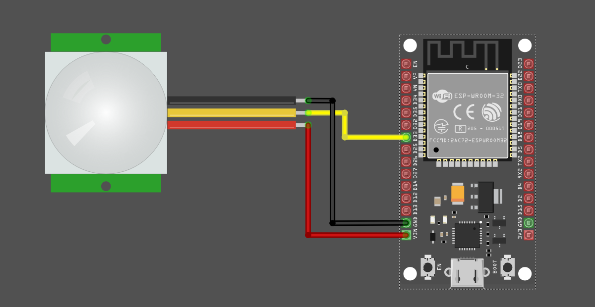

{{#title Распиновка и подключение PIR-датчика к ESP32}}

# Распиновка HC-SR501

Выход легко найти: он находится прямо посередине.

Если вы не уверены, какой вывод — земля (GND), а какой — VCC, можно снять белый купол и проверить. Также VCC можно определить по выводу рядом с защитным диодом.

## Подключение PIR-датчика к ESP32

Датчик работает от 5 В, но выводы GPIO ESP32 допускают только 3,3 В. Модуль PIR-датчика выдаёт 3,3 В при обнаружении движения, поэтому его можно напрямую подключить к GPIO без проблем. В противном случае понадобится делитель напряжения, чтобы снизить напряжение до 3,3 В.  

<table style="margin-bottom:20px">
  <thead>
    <tr>
      <th>Вывод ESP32</th>
      <th style="width: 250px; margin: 0 auto;">Провод</th>
      <th>Вывод PIR-датчика</th>
    </tr>
  </thead>
  <tbody>
    <tr>
      <td>GPIO 33</td>
      <td style="text-align: center; vertical-align: middle; padding: 0;">
        

          

          

        

      </td>
      <td>OUT (средний вывод)</td>
    </tr>
    <tr>
      <td>5V</td>
      <td style="text-align: center; vertical-align: middle; padding: 0;">
        

          

          

        

      </td>
      <td>VCC</td>
    </tr>
    <tr>
      <td>GND</td>
      <td style="text-align: center; vertical-align: middle; padding: 0;">
        

          

          

        

      </td>
      <td>GND</td>
    </tr>
  </tbody>
</table>
 

