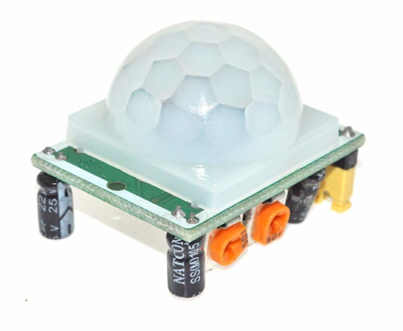

{{#title Создаём проект с PIR-датчиком движения на ESP32 и Rust}}

# PIR-датчик

Вы когда-нибудь заходили в комнату, и свет включался сам? Скорее всего, за этим стоит PIR-датчик.

В одной из предыдущих глав мы использовали [ультразвуковой датчик](../ultrasonic/index.md), чтобы проверять, находится ли рядом человек или объект. Он работает, посылая ультразвуковые волны и измеряя расстояние до объекта. PIR-датчик работает иначе: вместо измерения расстояния он обнаруживает движение.

PIR-датчик называют «пассивным» инфракрасным (passive Infrared), потому что он сам не излучает инфракрасное излучение, а лишь регистрирует изменения инфракрасного излучения в окружающей среде. Он чувствует тепло, которое излучают люди, животные и другие тёплые объекты. Когда движение происходит в зоне обнаружения, датчик фиксирует изменение и посылает сигнал. Поэтому он полезен для автоматического освещения, охранных сигнализаций и других систем обнаружения движения.

## Знакомство с железом

Мы будем использовать PIR-модуль **HC-SR501**. На нём есть встроенный пироэлектрический датчик, который помогает обнаруживать движение, и куполообразная линза Френеля, которая увеличивает дальность обнаружения. Он может работать от питания 5–12 В.

У модуля PIR-датчика три вывода: питание, выход (средний вывод) и земля. Использовать его просто, потому что он выдаёт простой выходной сигнал. По умолчанию сигнал остаётся в LOW, пока движение не обнаружено. Но как только кто-то движется в зоне действия датчика, выход переходит в HIGH, сигнализируя об обнаружении движения.

## Ресурсы

Модуль PIR-датчика построен на базе контроллера BISS0001. Ниже приведены несколько даташитов, связанных с контроллером BISS0001.

- [https://cdn-learn.adafruit.com/assets/assets/000/010/133/original/BISS0001.pdf](https://cdn-learn.adafruit.com/assets/assets/000/010/133/original/BISS0001.pdf)
- [http://www.sc-tech.cn/en/BISS0001.pdf](http://www.sc-tech.cn/en/BISS0001.pdf)

Если хотите узнать, как PIR-датчики устроены внутри, посмотрите это руководство: [How PIRs Work](https://learn.adafruit.com/pir-passive-infrared-proximity-motion-sensor/how-pirs-work). В книге мы этого касаться не будем, так как это выходит за её рамки. Наша задача проще: обнаружить движение и передать сигнал в ESP32.
