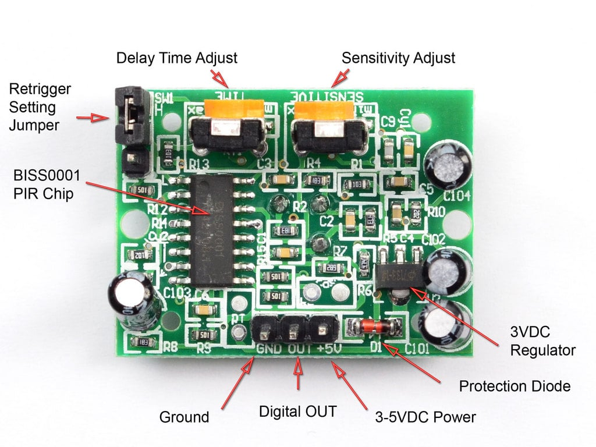
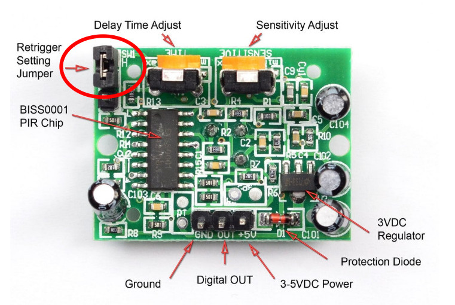

{{#title Настройка PIR-датчика HC-SR501: дальность обнаружения и время задержки}}

# Настройка PIR-датчика

Изображение: <a href="https://learn.adafruit.com/pir-passive-infrared-proximity-motion-sensor/overview">Adafruit</a>

Модуль PIR-датчика имеет два встроенных подстроечных резистора, которые позволяют тонко настроить его работу: время задержки (Delay Time) и чувствительность (Sensitivity). Эти маленькие регулировочные ручки позволяют управлять тем, как датчик реагирует на движение, и делают его более адаптивным к разным условиям и задачам.  

### Время задержки (длительность выходного сигнала)  
Эта настройка определяет, как долго выход датчика остаётся в HIGH после обнаружения движения. Большая задержка полезна в таких задачах, как автоматическое освещение, когда свет нужно оставить включённым какое-то время после движения.  

- **Поверните по часовой стрелке**, чтобы увеличить длительность (до ~200 секунд).  
- **Поверните против часовой стрелки**, чтобы уменьшить длительность (до ~5 секунд).  

### Чувствительность (дальность обнаружения)
Эта настройка определяет, на каком расстоянии датчик может обнаружить движение. Большая чувствительность позволяет регистрировать движение с большего расстояния, а меньшая уменьшает дальность обнаружения, чтобы не допускать ложных срабатываний на небольшой площади.  

- **Поверните по часовой стрелке**, чтобы увеличить дальность (до ~7 метров).  
- **Поверните против часовой стрелки**, чтобы уменьшить дальность (до ~3 метров).  

**Примечание:**

Честно говоря, код, который мы сейчас напишем, очень простой. Самым сложным для меня было разобраться с направлением. Я знал, что нужно крутить по часовой и против часовой стрелки, но не был уверен, должен ли датчик смотреть вверх или вниз. Ключевой момент: держите датчик куполом вверх и затем следуйте инструкциям по часовой и против часовой стрелки.

## Настройка перемычками

Помимо ручек, есть и перемычки. Они позволяют переключаться между двумя режимами: с повторным запуском (Retriggering) и без повторного запуска (Non-Retriggering).

### Режим с повторным запуском (H)
В этом режиме выход остаётся в HIGH, пока обнаруживается движение. Если движение происходит до окончания таймера, он сбрасывается. Этот режим идеален для ситуаций, когда свет включается, как только кто-то заходит в комнату, и остаётся включённым, пока есть движение.

### Режим без повторного запуска (L)
Здесь выход переходит в HIGH после обнаружения движения, но не сработает снова, пока не истечёт время задержки. Подходит, например, для подсчёта людей, проходящих через дверь, когда каждое срабатывание должно считаться отдельным событием.

### Как установить перемычку
Чтобы переключить режим, переставьте перемычку (небольшой чёрно-жёлтый элемент; да, её можно снять и поставить между двумя контактами) на контакты H для режима с повторным запуском или на контакты L для режима без повторного запуска.
