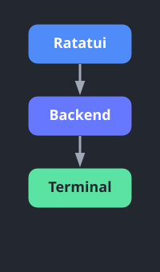
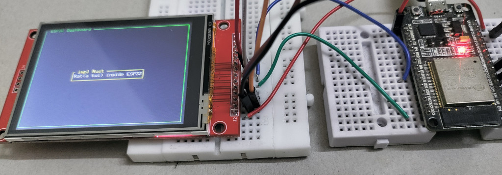

{{#title Ваше первое приложение Ratatui на ESP32 с Rust}}

# Привет, Rat

В этой главе мы напишем простую программу, чтобы начать работать с Ratatui. Здесь покажем только основы, чтобы понять, как это работает.

## Предварительные требования

- Для этой главы понадобится TFT-дисплей. Если вы ещё не прошли [главу о TFT-дисплее](../../tft-display/index.md), рекомендую сначала закончить её, а затем вернуться сюда. Поскольку схема подключения TFT-дисплея к ESP32 уже описана там, здесь мы не будем повторять эти инструкции.​

- У Ratatui есть хороший [учебник для начала](https://ratatui.rs/tutorials/hello-ratatui/) по созданию TUI-приложений. Если вы уже знаете Ratatui, это упражнение довольно простое: нужно просто соединить части вместе. Если вы новичок, позже изучите официальные руководства Ratatui, чтобы освоить основы и создавать более удобные интерфейсы.


## Создание проекта с помощью esp-generate

Чтобы создать проект, используйте команду `esp-generate`. Выполните:

```sh
esp-generate --chip esp32 hello-rat
```

Откроется экран с вопросом о выборе опций. Ratatui требует выделения памяти в куче (heap), поэтому включим возможности «unstable» и «alloc».

- Сначала выберите опцию «Enable unstable HAL features.»
- Выберите опцию «Enable allocations via the esp-alloc crate.»

По желанию можно также включить логирование.

- Прокрутите список до пункта «Flashing, logging and debugging (espflash)» и нажмите Enter.
- Затем выберите «Use defmt to print messages».

Сохраните настройки, нажав на клавиатуре «s».

## Зависимости

Сначала обновим файл Cargo.toml зависимостями, которые нужны для управления TFT-дисплеем. Мы уже рассматривали их в разделе о TFT-дисплее.

```toml
embedded-hal-bus = { version = "0.3" }
display-interface-spi = "0.5"
ili9341 = "0.6.0"
embedded-graphics = "0.8.1"
```

> [!Tip]
> Хотя в этом примере для работы с TFT-дисплеем используется крейт `ili9341`, вы можете применять `mousefood` с любым крейтом драйвера дисплея, который реализует трейты embedded-graphics.

Теперь добавим крейты ratatui и mousefood, которые позволяют использовать ratatui во встраиваемой среде.

```toml
mousefood = { git = "https://github.com/j-g00da/mousefood", rev = "cc9f8fe372f09342537bc31a1355f77f2693d70b", default-features = false, features = [
  "fonts",
] }
ratatui = { version = "0.30.0-alpha.5", default-features = false }
```

Для поддержки no_std пока нужен самый свежий код mousefood с GitHub и совместимая альфа-версия ratatui.

## Импорты

Подключим все необходимые крейты и модули для настройки и управления TFT-дисплеем. Мы импортируем всё для отрисовки графики через `embedded-graphics`, SPI-связь через `esp-hal` и драйвер дисплея `ili9341`. Наконец, добавим импорты, связанные с ratatui.

```rust
// Связанное с embedded-graphics
use embedded_graphics::pixelcolor::Rgb565;
use embedded_graphics::prelude::*;

// Мост между SPI ESP32 и драйвером дисплея
use esp_hal::delay::Delay;
use esp_hal::spi::master::Config as SpiConfig;
use esp_hal::spi::master::Spi;
use esp_hal::spi::Mode as SpiMode;
use esp_hal::time::Rate; // Для задания частоты SPI
use display_interface_spi::SPIInterface;
use embedded_hal_bus::spi::ExclusiveDevice;
use ili9341::{DisplaySize240x320, Ili9341, Orientation};

// Для управления состоянием GPIO
use esp_hal::gpio::{Level, Output, OutputConfig};

// Для ratatui
use mousefood::{EmbeddedBackend, EmbeddedBackendConfig};
use ratatui::layout::{Constraint, Flex, Layout};
use ratatui::widgets::{Block, Paragraph, Wrap};
use ratatui::{style::*, Frame, Terminal};
```

## Инициализация драйвера TFT-дисплея

Инициализируем TFT-дисплей: сначала настроим интерфейс SPI, затем создадим и сконфигурируем экземпляр дисплея.

```rust
// Инициализируем SPI
  let spi = Spi::new(
      peripherals.SPI2,
      SpiConfig::default()
          .with_frequency(Rate::from_mhz(60))
          .with_mode(SpiMode::_0),
  )
  .unwrap()
  //CLK
  .with_sck(peripherals.GPIO18)
  //DIN
  .with_mosi(peripherals.GPIO23);
  let cs = Output::new(peripherals.GPIO15, Level::Low, OutputConfig::default());
  let dc = Output::new(peripherals.GPIO2, Level::Low, OutputConfig::default());
  let reset = Output::new(peripherals.GPIO4, Level::Low, OutputConfig::default());

  let spi_dev = ExclusiveDevice::new_no_delay(spi, cs).unwrap();
  let interface = SPIInterface::new(spi_dev, dc);

  let mut display = Ili9341::new(
      interface,
      reset,
      &mut Delay::new(),
      Orientation::Landscape,
      DisplaySize240x320,
  )
  .unwrap();
  display.clear(Rgb565::BLACK).unwrap();
```

## Бэкенды в Ratatui

Ratatui не общается с экраном напрямую. Вместо этого он использует посредника, который называется «бэкенд» и занимается всеми низкоуровневыми операциями терминала. Представьте бэкенд как переводчика между высокоуровневыми командами отрисовки Ratatui и реальным терминалом или аппаратным обеспечением дисплея.

Ratatui поддерживает разные бэкенды, благодаря чему его можно использовать в разных окружениях. По умолчанию он использует Crossterm как бэкенд для обычных эмуляторов терминала. Однако для встраиваемых систем это не подходит. Нам нужен бэкенд, который работает во встраиваемых окружениях. Здесь на помощь приходит крейт mousefood, который предоставляет встраиваемый бэкенд (Embedded Backend).

Этот бэкенд позволяет Ratatui выводить изображение на ЖК-экраны микроконтроллеров, e-ink дисплеи, небольшие OLED-экраны и любое другое аппаратное обеспечение дисплеев, которое поддерживает библиотеку embedded-graphics.



Подробнее о бэкендах Ratatui см. [здесь](https://ratatui.rs/concepts/backends/).

Чтобы Ratatui использовал встраиваемый бэкенд mousefood, сначала инициализируем `EmbeddedBackend`, передав ему изменяемую ссылку на дисплей и конфигурацию по умолчанию:

```rust
let backend = EmbeddedBackend::new(&mut display, EmbeddedBackendConfig::default());
```

Затем создадим терминал Ratatui с этим бэкендом:

```rust
let mut terminal = Terminal::new(backend).unwrap();
```

## Функция отрисовки

Определим функцию `draw`, которая задаёт макет и визуальные элементы нашего интерфейса. Сначала создадим внешний блок с зелёной рамкой и заголовком «ESP32 Dashboard», который окружает весь интерфейс. Внутри этого блока организуем макет сначала по вертикали, затем по горизонтали, чтобы задать области для содержимого.

Затем создадим виджет-параграф с текстом «Rat(a tui) inside ESP32». Заключим его в блок с жёлтой рамкой и заголовком « impl Rust » и выведем в центре, который задали с помощью макета.

```rust
fn draw(frame: &mut Frame) {

    let outer_block = Block::bordered()
        .border_style(Style::new().green())
        .title(" ESP32 Dashboard ");
    frame.render_widget(outer_block, frame.area());

    let vertical_layout = Layout::vertical([Constraint::Length(3)])
        .flex(Flex::Center)
        .split(frame.area());

    let horizontal_layout = Layout::horizontal([Constraint::Length(25)])
        .flex(Flex::Center)
        .split(vertical_layout[0]);

    let text = "Rat(a tui) inside ESP32";
    let paragraph = Paragraph::new(text.dark_gray())
        .wrap(Wrap { trim: true })
        .centered();

    let bordered_block = Block::bordered()
        .border_style(Style::new().yellow())
        .title(" impl Rust ");

    frame.render_widget(paragraph.block(bordered_block), horizontal_layout[0]);
}
```

## Отрисовка

Наконец, вызываем метод отрисовки Ratatui, передавая нашу функцию `draw`, чтобы вывести интерфейс на дисплей.

```rust
loop {
  terminal.draw(draw).unwrap();
}
```

## Полный код

```rust
#![no_std]
#![no_main]
#![deny(
    clippy::mem_forget,
    reason = "mem::forget is generally not safe to do with esp_hal types, especially those \
    holding buffers for the duration of a data transfer."
)]

use esp_hal::clock::CpuClock;
use esp_hal::main;
use esp_println as _;

// Связанное с embedded-graphics
use embedded_graphics::pixelcolor::Rgb565;
use embedded_graphics::prelude::*;

// Мост между SPI ESP32 и драйвером дисплея
use display_interface_spi::SPIInterface;
use embedded_hal_bus::spi::ExclusiveDevice;
use esp_hal::delay::Delay;
use esp_hal::spi::Mode as SpiMode;
use esp_hal::spi::master::Config as SpiConfig;
use esp_hal::spi::master::Spi;
use esp_hal::time::Rate; // Для задания частоты SPI
use ili9341::{DisplaySize240x320, Ili9341, Orientation};

// Для управления состоянием GPIO
use esp_hal::gpio::{Level, Output, OutputConfig};

// Для ratatui
use mousefood::{EmbeddedBackend, EmbeddedBackendConfig};
use ratatui::layout::{Constraint, Flex, Layout};
use ratatui::widgets::{Block, Paragraph, Wrap};
use ratatui::{Frame, Terminal, style::*};

#[panic_handler]
fn panic(_: &core::panic::PanicInfo) -> ! {
    loop {}
}

extern crate alloc;

// Создаёт дескриптор приложения по умолчанию, который требуется загрузчику esp-idf.
// Подробнее см.: <https://docs.espressif.com/projects/esp-idf/en/stable/esp32/api-reference/system/app_image_format.html#application-description>
esp_bootloader_esp_idf::esp_app_desc!();

#[main]
fn main() -> ! {
    // generator version: 1.0.0

    let config = esp_hal::Config::default().with_cpu_clock(CpuClock::max());
    let peripherals = esp_hal::init(config);

    esp_alloc::heap_allocator!(#[unsafe(link_section = ".dram2_uninit")] size: 98767);

    // Инициализируем SPI
    let spi = Spi::new(
        peripherals.SPI2,
        SpiConfig::default()
            .with_frequency(Rate::from_mhz(60))
            .with_mode(SpiMode::_0),
    )
    .unwrap()
    //CLK
    .with_sck(peripherals.GPIO18)
    //DIN
    .with_mosi(peripherals.GPIO23);
    let cs = Output::new(peripherals.GPIO15, Level::Low, OutputConfig::default());
    let dc = Output::new(peripherals.GPIO2, Level::Low, OutputConfig::default());
    let reset = Output::new(peripherals.GPIO4, Level::Low, OutputConfig::default());

    let spi_dev = ExclusiveDevice::new_no_delay(spi, cs).unwrap();
    let interface = SPIInterface::new(spi_dev, dc);

    let mut display = Ili9341::new(
        interface,
        reset,
        &mut Delay::new(),
        Orientation::Landscape,
        DisplaySize240x320,
    )
    .unwrap();
    display.clear(Rgb565::BLACK).unwrap();

    let backend = EmbeddedBackend::new(&mut display, EmbeddedBackendConfig::default());

    let mut terminal = Terminal::new(backend).unwrap();
    loop {
        terminal.draw(draw).unwrap();
    }
}

fn draw(frame: &mut Frame) {
    let outer_block = Block::bordered()
        .border_style(Style::new().green())
        .title(" ESP32 Dashboard ");
    frame.render_widget(outer_block, frame.area());

    let vertical_layout = Layout::vertical([Constraint::Length(3)])
        .flex(Flex::Center)
        .split(frame.area());

    let horizontal_layout = Layout::horizontal([Constraint::Length(25)])
        .flex(Flex::Center)
        .split(vertical_layout[0]);

    let text = "Rat(a tui) inside ESP32";
    let paragraph = Paragraph::new(text.dark_gray())
        .wrap(Wrap { trim: true })
        .centered();

    let bordered_block = Block::bordered()
        .border_style(Style::new().yellow())
        .title(" impl Rust ");

    frame.render_widget(paragraph.block(bordered_block), horizontal_layout[0]);
}
```


## Клонирование существующего проекта
Вы также можете клонировать (или посмотреть) созданный мной проект и перейти в папку `hello-rat`.

```sh
git clone https://github.com/ImplFerris/esp32-projects
cd esp32-projects/hello-rat/
```

## Прошивка программы

Выполните следующую команду из папки проекта, чтобы собрать программу и прошить её в ESP32:

```rust
cargo run --release
```

Теперь на дисплее должен появиться интерфейс Ratatui.




Если хотите использовать крейт `mipidsi` вместо `ili9341`, посмотрите следующее [руководство](./using-mipidsi.md).
