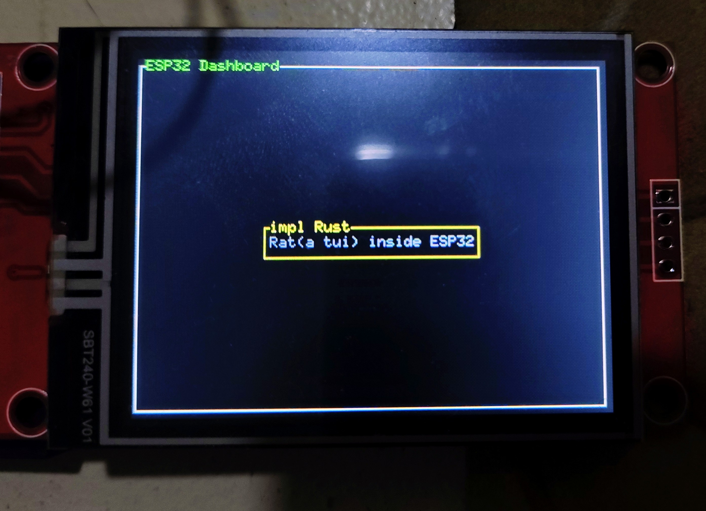

{{#title Создаём дашборд Ratatui на ESP32 на embedded Rust}}

# Использование крейта `mipidsi`

Это руководство показывает, как использовать более новый крейт `mipidsi` с TFT-дисплеем и ESP32.

Крейт `mipidsi` — универсальный крейт для нескольких дисплеев; он также поддерживает `ili9341`.

## Настройка

Настройка такая же, как в предыдущей программе, за исключением нескольких изменений в `Cargo.toml`.

### Зависимости в `Cargo.toml`

```toml
embedded-hal-bus = "0.3.0"
embedded-graphics = "0.8.1"
mipidsi = "0.9.0"
static_cell = "2.1.1"
```

Крейт `static_cell` предоставляет безопасный способ выделить память или управлять динамической памятью.

Это важно, потому что буфер SPI должен существовать всё время работы программы, но его нельзя инициализировать раньше времени выполнения, когда настраивается периферия.


#### `mousefood` и `ratatui`

Добавьте в `Cargo.toml` следующие версии `mousefood` и `ratatui`:

```toml
mousefood = { git = "https://github.com/j-g00da/mousefood", rev = "cc9f8fe372f09342537bc31a1355f77f2693d70b", default-features = false, features = [
  "fonts",
] }
ratatui = { version = "0.30.0-alpha.5", default-features = false }

```

## Импорты

```rust
use static_cell::StaticCell;
use embedded_hal_bus::spi::ExclusiveDevice;

// Всё для ESP
use esp_hal::{
  delay::Delay,
  spi::{
    master::{
      Config as SpiConfig,
      Spi
    },
    Mode as SpiMode,
  },
  time::Rate,
  gpio::{
    Level,
    Output,
    OutputConfig
  },
  clock::CpuClock,
  main
};

// Всё для embedded-graphics
use embedded_graphics::pixelcolor::Rgb565;
use embedded_graphics::prelude::*;

// Всё для TFT-экрана
use mipidsi::{Builder, models::ILI9342CRgb565, interface::SpiInterface, options::{Orientation, Rotation}};

// Всё для mousefood
use mousefood::{EmbeddedBackend, EmbeddedBackendConfig};
use ratatui::{layout::{Constraint, Flex, Layout}, widgets::{Block, Paragraph, Wrap}};
use ratatui::{style::*, Frame, Terminal};
```

Здесь используется несколько переменных конфигурации. Этот код идёт после импортов:

```rust
static SPI_BUFFER: StaticCell<[u8; 512]> = StaticCell::new();
```

## Инициализация драйвера TFT-дисплея

```rust
let spi = Spi::new(
  peripherals.SPI2,
  SpiConfig::default()
    .with_frequency(Rate::from_mhz(60))
    .with_mode(SpiMode::_0)
)
  .unwrap()
  .with_sck(peripherals.GPIO18)
  .with_mosi(peripherals.GPIO23);

let cs = Output::new(peripherals.GPIO5, Level::Low, OutputConfig::default());
let dc = Output::new(peripherals.GPIO2, Level::Low, OutputConfig::default());
let reset = Output::new(peripherals.GPIO4, Level::Low, OutputConfig::default());

let buffer = SPI_BUFFER.init([0; 512]);

let spi_dev = ExclusiveDevice::new_no_delay(spi, cs).unwrap();
let interface = SpiInterface::new(spi_dev, dc, buffer);

let mut display = Builder::new(
  ILI9342CRgb565,
  interface
)
  .reset_pin(reset)
  .init(&mut Delay::new())
  .unwrap();

// ВАЖНО: задаём ориентацию ДО очистки и создания бэкенда
display.set_orientation(
  Orientation::default().rotate(Rotation::Deg270)
).unwrap();

// Очищаем с новой ориентацией
display.clear(Rgb565::BLACK).unwrap();
```

> Здесь вместо драйвера `ili9341` используется `ILI9342CRgb565` из-за проблем совместимости.
> Если возникнут проблемы с дисплеем, можно заменить `ILI9342CRgb565` на `ILI9341Rgb565`.

## Создание бэкенда

Чтобы создать бэкенд, используем встраиваемый бэкенд `mousefood`:

```rust
let backend = EmbeddedBackend::new(&mut display, EmbeddedBackendConfig::default());
```

Затем создаём терминал `ratatui`, который использует этот бэкенд:

```rust
let mut terminal = Terminal::new(backend).unwrap();
```

## Функция отрисовки

Эта функция рисует визуальные элементы TUI.


```rust
fn draw(frame: &mut Frame) {
    let outer_block = Block::bordered()
        .title_style(Style::new().green())
        .title("ESP32 Dashboard");

    frame.render_widget(outer_block, frame.area());

    let vertical_layout = Layout::vertical([Constraint::Length(3)])
        .flex(Flex::Center)
        .split(frame.area());

    let horizontal_layout = Layout::horizontal([Constraint::Length(25)])
        .flex(Flex::Center)
        .split(vertical_layout[0]);

    let text = "Rat(a tui) inside ESP32";
    let paragraph = Paragraph::new(text.dark_gray())
        .wrap(Wrap { trim: true })
        .centered();

    let bordered_block = Block::bordered()
        .border_style(Style::new().yellow())
        .title("impl rust");

    frame.render_widget(paragraph.block(bordered_block), horizontal_layout[0]);

}
```

## Отрисовка

В функции `main`, после создания `terminal`:

```rust
loop {
  terminal.draw(draw).unwrap();
}
```


## Полный код

```rust
#![no_std]
#![no_main]
#![deny(
    clippy::mem_forget,
    reason = "mem::forget is generally not safe to do with esp_hal types, especially those \
    holding buffers for the duration of a data transfer."
)]

use esp_hal::clock::CpuClock;
use esp_hal::main;
use esp_println as _;

// Связанное с embedded-graphics
use embedded_graphics::pixelcolor::Rgb565;
use embedded_graphics::prelude::*;

// Мост между SPI ESP32 и драйвером дисплея
use embedded_hal_bus::spi::ExclusiveDevice;
use esp_hal::delay::Delay;
use esp_hal::spi::Mode as SpiMode;
use esp_hal::spi::master::Config as SpiConfig;
use esp_hal::spi::master::Spi;
use esp_hal::time::Rate; // Для задания частоты SPI

use static_cell::StaticCell;

// Для TFT-экрана
use mipidsi::{
    Builder,
    interface::SpiInterface,
    models::ILI9342CRgb565,
    options::{Orientation, Rotation},
};

// Для управления состоянием GPIO
use esp_hal::gpio::{Level, Output, OutputConfig};

// Для ratatui
use mousefood::{EmbeddedBackend, EmbeddedBackendConfig};
use ratatui::layout::{Constraint, Flex, Layout};
use ratatui::widgets::{Block, Paragraph, Wrap};
use ratatui::{Frame, Terminal, style::*};

#[panic_handler]
fn panic(_: &core::panic::PanicInfo) -> ! {
    loop {}
}

extern crate alloc;

// Создаёт дескриптор приложения по умолчанию, который требуется загрузчику esp-idf.
// Подробнее см.: <https://docs.espressif.com/projects/esp-idf/en/stable/esp32/api-reference/system/app_image_format.html#application-description>
esp_bootloader_esp_idf::esp_app_desc!();

static SPI_BUFFER: StaticCell<[u8; 512]> = StaticCell::new();

#[main]
fn main() -> ! {
    // generator version: 1.0.0

    let config = esp_hal::Config::default().with_cpu_clock(CpuClock::max());
    let peripherals = esp_hal::init(config);

    esp_alloc::heap_allocator!(#[unsafe(link_section = ".dram2_uninit")] size: 98767);

    // Инициализируем SPI
    let spi = Spi::new(
        peripherals.SPI2,
        SpiConfig::default()
            .with_frequency(Rate::from_mhz(60))
            .with_mode(SpiMode::_0),
    )
    .unwrap()
    //CLK
    .with_sck(peripherals.GPIO18)
    //DIN
    .with_mosi(peripherals.GPIO23);
    let cs = Output::new(peripherals.GPIO15, Level::Low, OutputConfig::default());
    let dc = Output::new(peripherals.GPIO2, Level::Low, OutputConfig::default());
    let reset = Output::new(peripherals.GPIO4, Level::Low, OutputConfig::default());

    let buffer = SPI_BUFFER.init([0; 512]);

    let spi_dev = ExclusiveDevice::new_no_delay(spi, cs).unwrap();
    let interface = SpiInterface::new(spi_dev, dc, buffer);

    let mut display = Builder::new(ILI9342CRgb565, interface)
        .reset_pin(reset)
        .init(&mut Delay::new())
        .unwrap();

    // ВАЖНО: задаём ориентацию ДО очистки и создания бэкенда
    display
        .set_orientation(Orientation::default().rotate(Rotation::Deg270))
        .unwrap();

    // Очищаем с новой ориентацией
    display.clear(Rgb565::BLACK).unwrap();

    let backend = EmbeddedBackend::new(&mut display, EmbeddedBackendConfig::default());

    let mut terminal = Terminal::new(backend).unwrap();
    loop {
        terminal.draw(draw).unwrap();
    }
}

fn draw(frame: &mut Frame) {
    let outer_block = Block::bordered()
        .border_style(Style::new().green())
        .title(" ESP32 Dashboard ");
    frame.render_widget(outer_block, frame.area());

    let vertical_layout = Layout::vertical([Constraint::Length(3)])
        .flex(Flex::Center)
        .split(frame.area());

    let horizontal_layout = Layout::horizontal([Constraint::Length(25)])
        .flex(Flex::Center)
        .split(vertical_layout[0]);

    let text = "Rat(a tui) inside ESP32";
    let paragraph = Paragraph::new(text.dark_gray())
        .wrap(Wrap { trim: true })
        .centered();

    let bordered_block = Block::bordered()
        .border_style(Style::new().yellow())
        .title(" impl Rust ");

    frame.render_widget(paragraph.block(bordered_block), horizontal_layout[0]);
}
```


## Клонирование существующего проекта
Вы также можете клонировать (или посмотреть) созданный мной проект и перейти в папку `hello-rat-2`.

```bash
git clone https://github.com/ImplFerris/esp32-projects
cd esp32-projects/hello-rat-2/
```

## Прошивка программы

Выполните следующую команду из папки проекта (с `Cargo.toml`), чтобы прошить программу в ESP32:

```bash
cargo run --release
```



