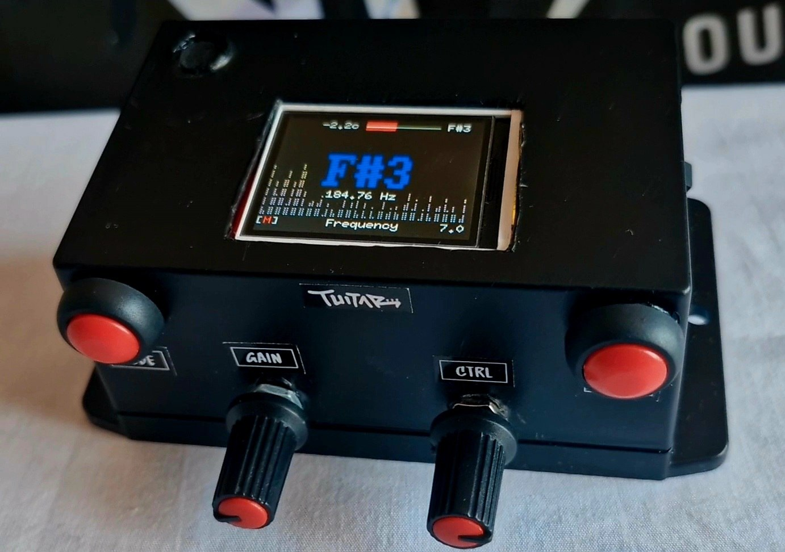
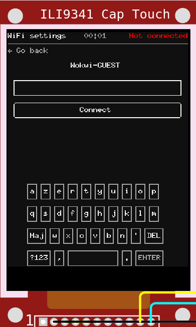
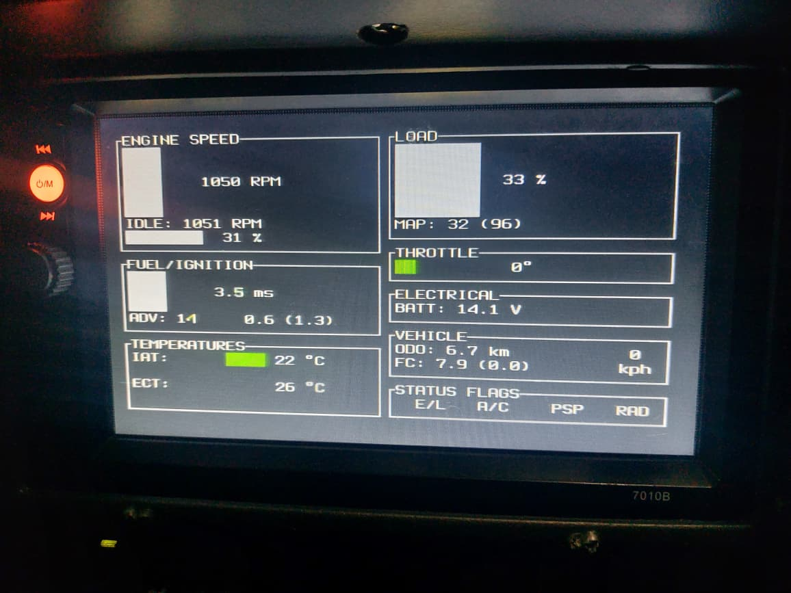

{{#title Ratatui на дисплеях ESP32 с embedded Rust}}

# Ratatui

Вероятно, вы знакомы с Ratatui — популярной библиотекой Rust для создания текстовых пользовательских интерфейсов (TUI). Многие разработчики создают с этим крейтом впечатляющие TUI-приложения. Но вы можете спросить, зачем мы обсуждаем библиотеку TUI в книге о встраиваемом Rust.

Ответ — [Mousefood](https://github.com/j-g00da/mousefood). Это бэкенд для embedded-graphics, который приносит Ratatui на микроконтроллеры. Это значит, что Ratatui можно запускать везде, где вы можете использовать embedded-graphics (например, на TFT-дисплеях, e-paper и других дисплеях).

## Зачем использовать Ratatui во встраиваемых системах?

Ratatui значительно упрощает и ускоряет создание интерфейсов для встраиваемых устройств по сравнению с написанием всего с нуля. Вы получаете готовые виджеты, например диаграммы, таблицы и индикаторы прогресса, без сложного кода отрисовки.

## Основы Ratatui

Если вы только начинаете работать с Ratatui, загляните на официальный сайт [https://ratatui.rs/](https://ratatui.rs/). Там есть понятная документация и руководства для новичков, которые помогут создать простые TUI-приложения, например JSON-редактор. Понимание базовых концепций Ratatui поможет адаптировать их для встраиваемых дисплеев.

## Проекты с Ratatui во встраиваемых системах

Вот несколько интересных проектов, которые используют Ratatui во встраиваемых системах:

### [Tuitar](https://github.com/orhun/tuitar)

Tuitar — это инструмент для обучения игре на гитаре, созданный [Орханом Пармаксызом](https://github.com/orhun/). Он работает автономно на оборудовании ESP32 и показывает визуализацию в реальном времени по аудиовходу, помогая настраивать гитару и другие инструменты.

Tuitar может отслеживать ноты, которые вы играете на гитаре, в реальном времени и показывать их на виртуальном грифе.

### [Современная телефонная ОС для ESP32 CYD](https://github.com/Julien-cpsn/Phone-OS)

### [Дисплей автомобиля: просмотрщик Suzuki Serial Data Line (SDL) на Rust](https://github.com/thatdevsherry/suzui-rs)

Примечание: этот проект не использует крейт mousefood и не является настоящим встраиваемым Ratatui. Код работает на Raspberry Pi в обычной среде Linux.

