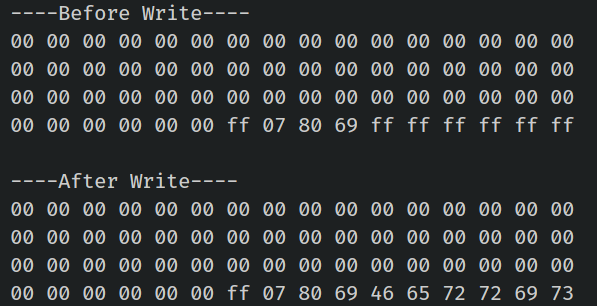

{{#title Смена ключа аутентификации MIFARE на ESP32 с Rust}}

# Смена ключа аутентификации

Давайте изменим ключ аутентификации (ключ A) для сектора 1. По умолчанию он равен `FF FF FF FF FF FF`. Мы поменяем его на `52 75 73 74 65 64`, что в hex означает «Rusted». Для этого нужно изменить блок трейлера (блок 3) сектора 1, не трогая остальную часть сектора.

Прежде чем продолжить, полезно проверить текущее содержимое этого блока. Запустите программу [Дамп памяти](./dump-memory.md) или [Чтение данных](./read-data.md), чтобы проверить.

> [!Note]
> Карта MIFARE Classic 1K по умолчанию настроена на ключ FF FF FF FF FF FF для KeyA и KeyB. При чтении блока трейлера значение KeyA возвращается как нулевое (00 00 00 00 00 00), а KeyB возвращается как есть.

Мы также изменим содержимое ключа B, чтобы проверить, что запись прошла успешно. Установим ключ B в hex-байты «Ferris» (46 65 72 72 69 73).

Перед записью байты доступа и значения ключа B в вашем блоке должны в основном совпадать с тем, что у меня, но перепроверить всегда надёжнее, чем гадать.

План такой:
1. В программе мы зашиваем ключ по умолчанию (`FF FF FF FF FF FF`) в переменную `current_key`.
2. Задаём `new_key` как `Rusted` (в hex-байтах). Это нужно, чтобы вывести содержимое блока после записи; иначе мы получим ошибку аутентификации.
3. Программа выведет содержимое блока до и после записи.

Как только ключ обновлён, поднесите метку к считывателю снова. Скорее всего, вы увидите ошибку «Auth failed». Если вы уже догадались почему — поздравляю! Новый ключ успешно записан, поэтому зашитый в код `current_key` больше не работает. Чтобы проверить, измените программу `read-data` так, чтобы она использовала новый ключ (`Rusted`), и попробуйте снова.

### Ключ и данные
Массив `DATA` содержит новый ключ A («Rusted» в hex), биты доступа и ключ B («Ferris» в hex). `current_key` задан значением по умолчанию `FF FF FF FF FF FF`, а `new_key` — первыми 6 байтами `DATA`, то есть «Rusted».

```rust
let target_sector = 1;
let rel_block = 3; // относительный блок внутри сектора (4-й блок сектора 1)
const DATA: [u8; 16] = [
    0x52, 0x75, 0x73, 0x74, 0x65, 0x64, // Ключ A: "Rusted"
    0xFF, 0x07, 0x80, 0x69, // Биты доступа и байт трейлера
    0x46, 0x65, 0x72, 0x72, 0x69, 0x73, // Ключ B: "Ferris"
];
let current_key = &[0xFF; 6];
let new_key: &[u8; 6] = &DATA[..6].try_into().unwrap(); // Первые 6 байт блока

```

### Функция write_block
Мы немного изменили функцию `write_block`, чтобы она принимала ключ как аргумент.

```rust
fn write_block<E, COMM: mfrc522::comm::Interface<Error = E>>(
    uid: &mfrc522::Uid,
    sector: u8,
    rel_block: u8,
    data: [u8; 16],
    rfid: &mut Mfrc522<COMM, mfrc522::Initialized>,
    auth_key: &[u8; 6], // дополнительный аргумент: ключ аутентификации
) {
    let block_offset = sector * 4;
    let abs_block = block_offset + rel_block;

    rfid.mf_authenticate(uid, block_offset, auth_key)
        .map_err(|_| "Auth failed")
        .unwrap();

    rfid.mf_write(abs_block, data)
        .map_err(|_| "Write failed")
        .unwrap();
}
```

### Функция read_sector
Для функции `read_sector` мы сделали аналогичное изменение.

```rust
fn read_sector<E, COMM: mfrc522::comm::Interface<Error = E>>(
    uid: &mfrc522::Uid,
    sector: u8,
    rfid: &mut Mfrc522<COMM, mfrc522::Initialized>,
    auth_key: &[u8; 6], // дополнительный аргумент: ключ аутентификации
) {
    let block_offset = sector * 4;
    rfid.mf_authenticate(uid, block_offset, auth_key)
        .map_err(|_| "Auth failed")
        .unwrap();

    for abs_block in block_offset..block_offset + 4 {
        let data = rfid.mf_read(abs_block).map_err(|_| "Read failed").unwrap();
        print_hex_bytes(&data);
    }
}
```

### Главный цикл
В главном цикле ничего нового нет. Все функции чтения и записи вам уже знакомы. Мы просто выводим содержимое сектора до и после смены ключа.

```rust
loop {
    if let Ok(atqa) = rfid.reqa() {
        println!("Got atqa");
        Timer::after(Duration::from_millis(50)).await;
        if let Ok(uid) = rfid.select(&atqa) {
            println!("\r\n----Before Write----");
            read_sector(&uid, target_sector, &mut rfid, current_key);

            write_block(&uid, target_sector, rel_block, DATA, &mut rfid, current_key);

            println!("\r\n----After Write----");
            read_sector(&uid, target_sector, &mut rfid, new_key);
            rfid.hlta().unwrap();
            rfid.stop_crypto1().unwrap();
        }
    }
}
```


## Клонирование существующего проекта
Вы также можете клонировать (или посмотреть) созданный мной проект и перейти в папку `rfid-change-key`.

```sh
git clone https://github.com/ImplFerris/esp32-projects
cd esp32-projects/rfid-change-key
```

## Вывод
Как видно в выводе, при запуске программа покажет содержимое целевого блока до и после записи. После смены ключа, когда метка снова поднесётся к считывателю, появится сообщение «auth failed», потому что `current_key` изменился. Новый ключ — 52 75 73 74 65 64 (Rusted).
 


Вы также можете изменить программу чтения данных, которую мы использовали ранее, и подставить новый ключ, чтобы проверить это.

**Примечание:** если интересно, почему ключ A не выводится: как мы объясняли ранее, ключ A нельзя прочитать, если он используется для аутентификации. Подробнее см. главу [Биты доступа](./access-bits.md).


## Полный код

```rust
#![no_std]
#![no_main]
#![deny(
    clippy::mem_forget,
    reason = "mem::forget is generally not safe to do with esp_hal types, especially those \
    holding buffers for the duration of a data transfer."
)]

use defmt::info;
use embassy_executor::Spawner;
use embassy_time::{Duration, Timer};
use esp_hal::clock::CpuClock;
use esp_hal::timer::timg::TimerGroup;
use esp_println as _;

// SPI
use esp_hal::gpio::{Level, Output, OutputConfig};
use esp_hal::spi;
use esp_hal::spi::master::Spi;
use esp_hal::time::Rate;

// RFID-считыватель
use embedded_hal_bus::spi::ExclusiveDevice;
use esp_hal::delay::Delay;
use mfrc522::Mfrc522;
use mfrc522::comm::blocking::spi::SpiInterface;

use esp_println::{self as _, print, println};

#[panic_handler]
fn panic(_: &core::panic::PanicInfo) -> ! {
    loop {}
}

// Создаёт дескриптор приложения по умолчанию, который требуется загрузчику esp-idf.
// Подробнее см.: <https://docs.espressif.com/projects/esp-idf/en/stable/esp32/api-reference/system/app_image_format.html#application-description>
esp_bootloader_esp_idf::esp_app_desc!();

#[esp_rtos::main]
async fn main(spawner: Spawner) -> ! {
    // generator version: 1.0.0

    let config = esp_hal::Config::default().with_cpu_clock(CpuClock::max());
    let peripherals = esp_hal::init(config);

    let timg0 = TimerGroup::new(peripherals.TIMG0);
    esp_rtos::start(timg0.timer0);

    info!("Embassy initialized!");

    let _ = spawner;

    let spi_bus = Spi::new(
        peripherals.SPI2,
        spi::master::Config::default()
            .with_frequency(Rate::from_mhz(5))
            .with_mode(spi::Mode::_0),
    )
    .unwrap()
    .with_sck(peripherals.GPIO18)
    .with_mosi(peripherals.GPIO23)
    .with_miso(peripherals.GPIO19)
    .into_async();

    let sd_cs = Output::new(peripherals.GPIO5, Level::High, OutputConfig::default());

    let delay = Delay::new();
    let spi_dev = ExclusiveDevice::new(spi_bus, sd_cs, delay).unwrap();

    let spi_interface = SpiInterface::new(spi_dev);
    let mut rfid = Mfrc522::new(spi_interface).init().unwrap();

    let target_sector = 1;
    let rel_block = 3; // относительный блок внутри сектора (4-й блок сектора 1)
    const DATA: [u8; 16] = [
        0x52, 0x75, 0x73, 0x74, 0x65, 0x64, // Ключ A: "Rusted"
        0xFF, 0x07, 0x80, 0x69, // Биты доступа и байт трейлера
        0x46, 0x65, 0x72, 0x72, 0x69, 0x73, // Ключ B: "Ferris"
    ];
    let current_key = &[0xFF; 6];
    // при желании вернуть всё к 0xFF
    // const DATA: [u8; 16] = [
    //     0xFF, 0xFF, 0xFF, 0xFF, 0xFF, 0xFF, // Ключ A
    //     0xFF, 0x07, 0x80, 0x69, // Биты доступа и байт трейлера
    //     0xFF, 0xFF, 0xFF, 0xFF, 0xFF, 0xFF, // Ключ B
    // ];
    // let current_key = &[0x52, 0x75, 0x73, 0x74, 0x65, 0x64];
    let new_key: &[u8; 6] = &DATA[..6].try_into().unwrap(); // Первые 6 байт блока

    loop {
        if let Ok(atqa) = rfid.reqa() {
            println!("Got atqa");
            Timer::after(Duration::from_millis(50)).await;
            if let Ok(uid) = rfid.select(&atqa) {
                println!("\r\n----Before Write----");
                read_sector(&uid, target_sector, &mut rfid, current_key);

                write_block(&uid, target_sector, rel_block, DATA, &mut rfid, current_key);

                println!("\r\n----After Write----");
                read_sector(&uid, target_sector, &mut rfid, new_key);
                rfid.hlta().unwrap();
                rfid.stop_crypto1().unwrap();
            }
        }
    }
}

fn write_block<E, COMM: mfrc522::comm::Interface<Error = E>>(
    uid: &mfrc522::Uid,
    sector: u8,
    rel_block: u8,
    data: [u8; 16],
    rfid: &mut Mfrc522<COMM, mfrc522::Initialized>,
    auth_key: &[u8; 6], // дополнительный аргумент: ключ аутентификации
) {
    let block_offset = sector * 4;
    let abs_block = block_offset + rel_block;

    rfid.mf_authenticate(uid, block_offset, auth_key)
        .map_err(|_| "Auth failed")
        .unwrap();

    rfid.mf_write(abs_block, data)
        .map_err(|_| "Write failed")
        .unwrap();
}

fn read_sector<E, COMM: mfrc522::comm::Interface<Error = E>>(
    uid: &mfrc522::Uid,
    sector: u8,
    rfid: &mut Mfrc522<COMM, mfrc522::Initialized>,
    auth_key: &[u8; 6], // дополнительный аргумент: ключ аутентификации
) {
    let block_offset = sector * 4;
    rfid.mf_authenticate(uid, block_offset, auth_key)
        .map_err(|_| "Auth failed")
        .unwrap();

    for abs_block in block_offset..block_offset + 4 {
        let data = rfid.mf_read(abs_block).map_err(|_| "Read failed").unwrap();
        print_hex_bytes(&data);
    }
}

fn print_hex_bytes(data: &[u8]) {
    for &b in data.iter() {
        print!("{:02x} ", b);
    }
    println!("");
}
```
