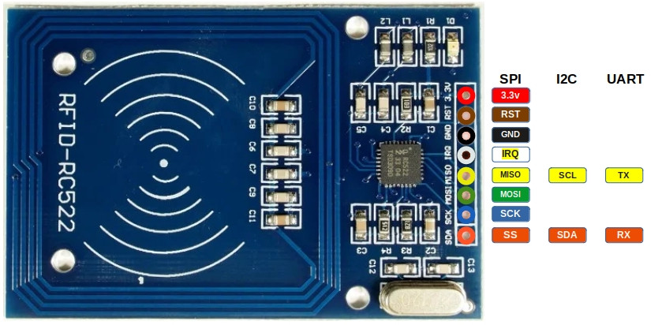
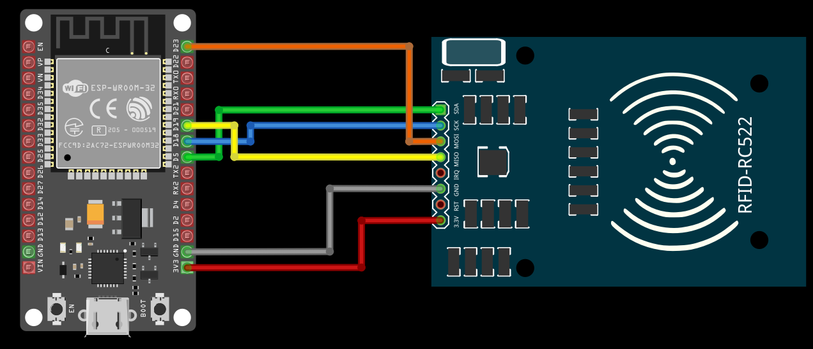

{{#title Подключение RC522 к ESP32 по SPI | impl Rust}}

# Подключение RC522 к ESP32 

## Распиновка RC522
В RFID-модуле RC522 восемь выводов.

<table style="border-collapse: collapse; width: 100%; border: 1px solid black;">
  <tr style="border: 1px solid black;">
    <th style="background-color: #009B77; border: 1px solid black;">Вывод</th>
    <th style="border: 1px solid black;">Функция SPI</th>
    <th style="border: 1px solid black;">Функция I²C</th>
    <th style="border: 1px solid black;">Функция UART</th>
    <th style="border: 1px solid black;">Описание</th>
  </tr>
  <tr style="border: 1px solid black;">
    <td style="background-color: #ff0000; color: white; border: 1px solid black;">3.3V</td>
    <td style="border: 1px solid black;">Питание</td>
    <td style="border: 1px solid black;">Питание</td>
    <td style="border: 1px solid black;">Питание</td>
    <td style="border: 1px solid black;">Питание (3,3 В).</td>
  </tr>
  <tr style="border: 1px solid black;">
    <td style="background-color: #000; color: white; border: 1px solid black;">GND</td>
    <td style="border: 1px solid black;">Земля</td>
    <td style="border: 1px solid black;">Земля</td>
    <td style="border: 1px solid black;">Земля</td>
    <td style="border: 1px solid black;">Подключение к земле.</td>
  </tr>
  <tr style="border: 1px solid black;">
    <td style="background-color: #7B3F00; color: white; border: 1px solid black;">RST</td>
    <td style="border: 1px solid black;">Сброс</td>
    <td style="border: 1px solid black;">Сброс</td>
    <td style="border: 1px solid black;">Сброс</td>
    <td style="border: 1px solid black;">Сброс модуля.</td>
  </tr>
  <tr style="border: 1px solid black;">
    <td style="background-color: #EFEFEF; border: 1px solid black;color:black;">IRQ</td>
    <td style="border: 1px solid black;">Прерывание (необязательно)</td>
    <td style="border: 1px solid black;">Прерывание (необязательно)</td>
    <td style="border: 1px solid black;">Прерывание (необязательно)</td>
    <td style="border: 1px solid black;">Запрос прерывания (IRQ) сообщает микроконтроллеру, когда обнаружена RFID-метка. Без использования IRQ микроконтроллеру пришлось бы постоянно опрашивать модуль.</td>
  </tr>
  <tr style="border: 1px solid black;">
    <td style="background-color: #FFC000; color: black; border: 1px solid black;">MISO</td>
    <td style="border: 1px solid black;">Master-In-Slave-Out</td>
    <td style="border: 1px solid black;">SCL</td>
    <td style="border: 1px solid black;">TX</td>
    <td style="border: 1px solid black;">В режиме SPI работает как Master-In-Slave-Out (MISO). В режиме I²C выполняет функцию линии тактирования (SCL). В режиме UART работает как вывод передачи (TX).</td>
  </tr>
  <tr style="border: 1px solid black;">
    <td style="background-color: #008000; color: white; border: 1px solid black;">MOSI</td>
    <td style="border: 1px solid black;">Master-Out-Slave-In</td>
    <td style="border: 1px solid black;">-</td>
    <td style="border: 1px solid black;">-</td>
    <td style="border: 1px solid black;">В режиме SPI работает как Master-Out-Slave-In (MOSI).</td>
  </tr>
  <tr style="border: 1px solid black;">
    <td style="background-color: #0F52BA; color: white; border: 1px solid black;">SCK</td>
    <td style="border: 1px solid black;">Serial Clock</td>
    <td style="border: 1px solid black;">-</td>
    <td style="border: 1px solid black;">-</td>
    <td style="border: 1px solid black;">В режиме SPI работает как линия тактирования, которая синхронизирует передачу данных.</td>
  </tr>
  <tr style="border: 1px solid black;">
    <td style="background-color: #FF5F1F; color: white; border: 1px solid black;">SDA</td>
    <td style="border: 1px solid black;">CS (или SS)</td>
    <td style="border: 1px solid black;">SDA</td>
    <td style="border: 1px solid black;">RX</td>
    <td style="border: 1px solid black;">В режиме SPI работает как выбор микросхемы (CS, также называется Slave Select). В режиме I²C служит линией данных (SDA). В режиме UART работает как вывод приёма (RX).</td>
  </tr>
</table>

## Подключение RFID-считывателя к ESP32
Для обмена данными между ESP32 и RFID-считывателем мы будем использовать протокол SPI (Serial Peripheral Interface, последовательный периферийный интерфейс). Интерфейс SPI может работать на скорости до 10 Мбит/с. Выводы RST и IRQ пока использовать не будем.

<table>
  <thead>
    <tr>
      <th>Вывод ESP32</th>
      <th style="width: 250px; margin: 0 auto;">Провод</th>
      <th>Вывод RFID-считывателя</th>
    </tr>
  </thead>
  <tbody>
    <tr>
      <td>3.3V</td>
      <td style="text-align: center; vertical-align: middle; padding: 0;">
        

          

          

        

      </td>
      <td>3.3V</td>
    </tr>
    <tr>
      <td>GND</td>
      <td style="text-align: center; vertical-align: middle; padding: 0;">
        

          

          

        

      </td>
      <td>GND</td>
    </tr>
    <tr>
      <td>GPIO 5</td>
      <td style="text-align: center; vertical-align: middle; padding: 0;">
        

          

          

        

      </td>
      <td>Помечен как SDA, при использовании SPI работает как вывод CS.</td>
    </tr>
    <tr>
      <td>GPIO 18</td>
      <td style="text-align: center; vertical-align: middle; padding: 0;">
        

          

          

        

      </td>
      <td>SCK</td>
    </tr>
    <tr>
      <td>GPIO 19</td>
      <td style="text-align: center; vertical-align: middle; padding: 0;">
        

          

          

        

      </td>
      <td>MISO</td>
    </tr>
    <tr>
      <td>GPIO 23</td>
      <td style="text-align: center; vertical-align: middle; padding: 0;">
        

          

          

        

      </td>
      <td>MOSI</td>
    </tr>
  </tbody>
</table>

