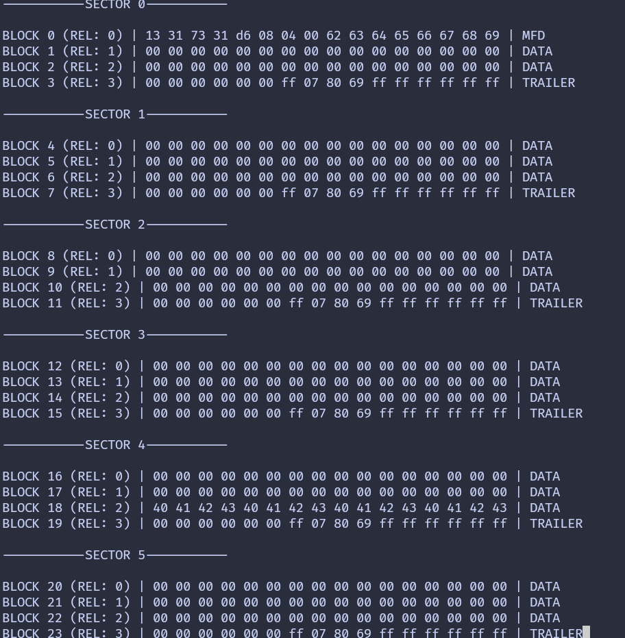

{{#title Код на Rust для чтения секторов и блоков RFID-меток на ESP32 с MFRC522}}

# Дамп всей памяти

Вы уже научились читать данные из каждого блока первого сектора (сектора 0), пройдя аутентификацию. Теперь мы переберём все секторы. Повторная аутентификация требуется каждый раз при переходе к новому сектору. Для каждого сектора мы выведем 16 байт данных из каждого из 4 блоков.

Чтобы было понятнее, мы добавим форматирование и подписи, которые указывают, о каком секторе и блоке идёт речь (абсолютные и относительные номера блоков внутри сектора), а также является ли блок трейлером сектора или блоком данных.

> Можно либо работать над тем же проектом, который мы создали в предыдущей главе, либо создать новый, выполнить те же шаги и затем следовать этим инструкциям.

### Перебор секторов

Мы создадим отдельную функцию, которая перебирает все 16 секторов (с 0 по 15), читает все блоки внутри каждого сектора и выводит их данные.

```rust
fn dump_memory<E, COMM: mfrc522::comm::Interface<Error = E>>(
    uid: &mfrc522::Uid,
    rfid: &mut Mfrc522<COMM, mfrc522::Initialized>,
) {
    for sector in 0..16 {
        // Вывод номера сектора
        println!("\n\n-----------SECTOR {}-----------", sector);
        read_sector(uid, sector, rfid);
    }
}
```

### Подписи

Функция `read_sector` работает по той же логике, что и раньше, но с добавленным форматированием и подписями. Теперь она выводит абсолютный номер блока, номер блока относительно сектора, а также подписи для блока производителя (MFD) и блоков трейлера сектора.

```rust
fn read_sector<E, COMM: mfrc522::comm::Interface<Error = E>>(
    uid: &mfrc522::Uid,
    sector: u8,
    rfid: &mut Mfrc522<COMM, mfrc522::Initialized>,
) {
    const AUTH_KEY: [u8; 6] = [0xFF; 6];

    let block_offset = sector * 4;
    rfid.mf_authenticate(uid, block_offset, &AUTH_KEY)
        .map_err(|_| "Auth failed")
        .unwrap();

    for abs_block in block_offset..block_offset + 4 {
        let rel_block = abs_block - block_offset;
        let data = rfid.mf_read(abs_block).map_err(|_| "Read failed").unwrap();

        // Вывод абсолютного и относительного номеров блока
        print!("\nBLOCK {} (REL: {}) | ", abs_block, rel_block);
        print_hex_bytes(&data);

        // Вывод типа блока
        let block_type = get_block_type(sector, rel_block);
        print!("| {} ", block_type);
    }
}
```

Для определения типа блока по номеру сектора и относительному номеру блока мы создадим небольшую вспомогательную функцию.
```rust
const fn get_block_type(sector: u8, rel_block: u8) -> &'static str {
    match rel_block {
        0 if sector == 0 => "MFD",
        3 => "TRAILER",
        _ => "DATA",
    }
}
```

### Главный цикл
В главном цикле почти ничего не меняется. Мы просто вызываем функцию `dump_memory` вместо `read_sector`.

```rust
loop {
    if let Ok(atqa) = rfid.reqa() {
        println!("Got atqa");
        Timer::after(Duration::from_millis(50)).await;
        if let Ok(uid) = rfid.select(&atqa) {
            dump_memory(&uid, &mut rfid);
            rfid.hlta().unwrap();
            rfid.stop_crypto1().unwrap();
        }
    }
}
```


## Клонирование существующего проекта
Вы также можете клонировать (или посмотреть) созданный мной проект и перейти в папку `rfid-dump`.

```sh
git clone https://github.com/ImplFerris/esp32-projects
cd esp32-projects/rfid-dump
```


## Дамп
Когда вы запустите программу и поднесёте метку или брелок к считывателю, вы увидите вывод примерно такого вида. Если вы заметили байты 0x40..0x43 в блоке 18 (блок 2 сектора 4) и задались вопросом, откуда они, — отличное замечание! Это пользовательские данные, которые я записал на метку.



На изображении показаны только первые 5 секторов. Когда вы запустите программу, вы увидите данные всех 16 секторов.

## Полный код

```rust
#![no_std]
#![no_main]
#![deny(
    clippy::mem_forget,
    reason = "mem::forget is generally not safe to do with esp_hal types, especially those \
    holding buffers for the duration of a data transfer."
)]

use defmt::info;
use embassy_executor::Spawner;
use embassy_time::{Duration, Timer};
use esp_hal::clock::CpuClock;
use esp_hal::timer::timg::TimerGroup;
use esp_println as _;

// SPI
use esp_hal::gpio::{Level, Output, OutputConfig};
use esp_hal::spi;
use esp_hal::spi::master::Spi;
use esp_hal::time::Rate;

// RFID-считыватель
use embedded_hal_bus::spi::ExclusiveDevice;
use esp_hal::delay::Delay;
use mfrc522::Mfrc522;
use mfrc522::comm::blocking::spi::SpiInterface;

use esp_println::{self as _, print, println};

#[panic_handler]
fn panic(_: &core::panic::PanicInfo) -> ! {
    loop {}
}

// Создаёт дескриптор приложения по умолчанию, который требуется загрузчику esp-idf.
// Подробнее см.: <https://docs.espressif.com/projects/esp-idf/en/stable/esp32/api-reference/system/app_image_format.html#application-description>
esp_bootloader_esp_idf::esp_app_desc!();

#[esp_rtos::main]
async fn main(spawner: Spawner) -> ! {
    // generator version: 1.0.0

    let config = esp_hal::Config::default().with_cpu_clock(CpuClock::max());
    let peripherals = esp_hal::init(config);

    let timg0 = TimerGroup::new(peripherals.TIMG0);
    esp_rtos::start(timg0.timer0);

    info!("Embassy initialized!");

    let _ = spawner;

    let spi_bus = Spi::new(
        peripherals.SPI2,
        spi::master::Config::default()
            .with_frequency(Rate::from_mhz(5))
            .with_mode(spi::Mode::_0),
    )
    .unwrap()
    .with_sck(peripherals.GPIO18)
    .with_mosi(peripherals.GPIO23)
    .with_miso(peripherals.GPIO19)
    .into_async();

    let sd_cs = Output::new(peripherals.GPIO5, Level::High, OutputConfig::default());

    let delay = Delay::new();
    let spi_dev = ExclusiveDevice::new(spi_bus, sd_cs, delay).unwrap();

    let spi_interface = SpiInterface::new(spi_dev);
    let mut rfid = Mfrc522::new(spi_interface).init().unwrap();

    loop {
        if let Ok(atqa) = rfid.reqa() {
            println!("Got atqa");
            Timer::after(Duration::from_millis(50)).await;
            if let Ok(uid) = rfid.select(&atqa) {
                dump_memory(&uid, &mut rfid);
                rfid.hlta().unwrap();
                rfid.stop_crypto1().unwrap();
            }
        }
    }
}

fn read_sector<E, COMM: mfrc522::comm::Interface<Error = E>>(
    uid: &mfrc522::Uid,
    sector: u8,
    rfid: &mut Mfrc522<COMM, mfrc522::Initialized>,
) {
    const AUTH_KEY: [u8; 6] = [0xFF; 6];

    let block_offset = sector * 4;
    rfid.mf_authenticate(uid, block_offset, &AUTH_KEY)
        .map_err(|_| "Auth failed")
        .unwrap();

    for abs_block in block_offset..block_offset + 4 {
        let rel_block = abs_block - block_offset;
        let data = rfid.mf_read(abs_block).map_err(|_| "Read failed").unwrap();

        // Вывод абсолютного и относительного номеров блока
        print!("\nBLOCK {} (REL: {}) | ", abs_block, rel_block);
        print_hex_bytes(&data);

        // Вывод типа блока
        let block_type = get_block_type(sector, rel_block);
        print!("| {} ", block_type);
    }
}

fn print_hex_bytes(data: &[u8]) {
    for &b in data.iter() {
        print!("{:02x} ", b);
    }
}

const fn get_block_type(sector: u8, rel_block: u8) -> &'static str {
    match rel_block {
        0 if sector == 0 => "MFD",
        3 => "TRAILER",
        _ => "DATA",
    }
}

fn dump_memory<E, COMM: mfrc522::comm::Interface<Error = E>>(
    uid: &mfrc522::Uid,
    rfid: &mut Mfrc522<COMM, mfrc522::Initialized>,
) {
    for sector in 0..16 {
        // Вывод номера сектора
        println!("\n\n-----------SECTOR {}-----------", sector);

        read_sector(uid, sector, rfid);
    }
}
```
