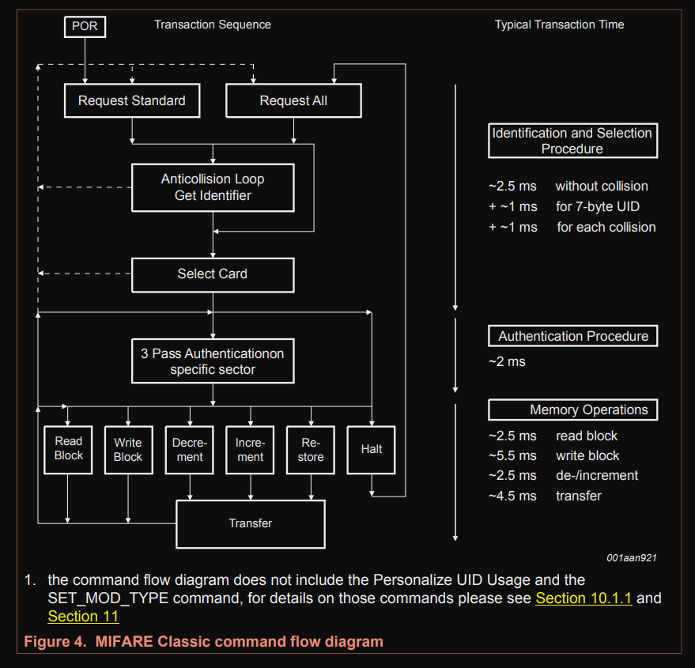

{{#title Последовательность обмена RFID и состояния карты MIFARE}}

# Последовательность работы

Когда вы подносите метку к считывателю, она переходит в состояние ожидания команды REQA (запрос) или WUPA (пробуждение).

Чтобы проверить, есть ли поблизости метка, мы отправляем команду REQA в цикле. Если метка рядом, она отвечает ATQA (ответ на запрос).

Получив ответ, мы выбираем карту, и она отправляет свой UID (полные технические подробности этого процесса мы разбирать не будем). После этого аутентифицируем сектор, из которого хотим читать или в который хотим писать. Когда операция завершена, отправляем команду HLTA, чтобы перевести карту в состояние HALT.

Примечание: когда карта находится в состоянии HALT, её может разбудить только команда WUPA, и тогда можно выполнять дальнейшие операции.

