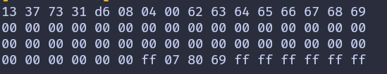

{{#title Чтение блоков данных RFID-метки с RC522 и ESP32 на Rust}}

# Чтение данных

В этом разделе мы прочитаем все блоки первого сектора (сектора 0). Как мы говорили ранее, чтобы читать или записывать конкретный блок на RFID-метке, сначала нужно пройти аутентификацию для соответствующего сектора.

## Создание проекта

Выполните те же шаги, что и раньше: добавьте зависимости и выполните базовую настройку для RFID-компонента. На этот раз мы изменим код, чтобы читать данные.


## Аутентификация

Большинство меток поставляются с ключом по умолчанию, обычно 0xFF, повторённым шесть раз. Возможно, стоит посмотреть документацию, чтобы найти ключ по умолчанию, или попробовать другие распространённые ключи. Для нашего RFID-считывателя ключ по умолчанию — 0xFF, повторённый шесть раз.

Для аутентификации нам нужны:
- UID метки (получаем с помощью команд REQA и Select).
- Номер блока внутри сектора.
- Ключ (в данном случае зашит в коде).

## Чтение блока

Прежде чем читать данные из блока, нужно сначала пройти аутентификацию для блока. Если операция чтения успешна, функция возвращает 16 байт данных из блока. Первый сектор (сектор 0) состоит из 4 блоков с абсолютными номерами от 0 до 3. Для следующих секторов абсолютные номера блоков увеличиваются соответственно (например, для сектора 1 это блоки 4, 5, 6, 7).

```rust
fn read_sector<E, COMM: mfrc522::comm::Interface<Error = E>>(
    uid: &mfrc522::Uid,
    sector: u8,
    rfid: &mut Mfrc522<COMM, mfrc522::Initialized>,
) {
    const AUTH_KEY: [u8; 6] = [0xFF; 6];

    let block_offset = sector * 4;
    rfid.mf_authenticate(uid, block_offset, &AUTH_KEY)
        .map_err(|_| "Auth failed")
        .unwrap();

    for abs_block in block_offset..block_offset + 4 {
        let data = rfid.mf_read(abs_block).map_err(|_| "Read failed").unwrap();
        print_hex_bytes(&data);
    }
}
```
В этой функции мы зашиваем ключ аутентификации в код в виде массива байтов со значениями 0xFF. Затем вычисляем смещение блока, умножая номер выбранного сектора на 4. Например, если выбран сектор 2, умножение на 4 даёт смещение блока 8. Затем передаём UID, смещение блока и ключ аутентификации, чтобы авторизовать доступ к сектору.

Когда аутентификация прошла успешно, мы проходим по 4 блокам внутри сектора, начиная со смещения блока. Для каждого блока читаем данные и выводим их содержимое в виде hex-строки.

 
## Главный цикл

В главном цикле, после того как RFID-метка обнаружена (получен ATQA) и выбрана для дальнейшего обмена, мы вызываем функцию `read_sector`. Здесь указываем сектор 0 для чтения. Когда данные блоков прочитаны, отправляем команды HLTA и `stop_crypto1`, чтобы перевести карту в состояние HALT.

```rust
let sector_num = 0;
loop {
    if let Ok(atqa) = rfid.reqa() {
        println!("Got atqa");
        Timer::after(Duration::from_millis(50)).await;
        if let Ok(uid) = rfid.select(&atqa) {
            println!("Reading sector: {}", sector_num);
            read_sector(&uid, sector_num, &mut rfid);
            rfid.hlta().unwrap();
            rfid.stop_crypto1().unwrap();
        }
    }
}
```


## Клонирование существующего проекта
Вы также можете клонировать (или посмотреть) созданный мной проект и перейти в папку `rfid-read`.

```sh
git clone https://github.com/ImplFerris/esp32-projects
cd esp32-projects/rfid-read
```

## Вывод первого сектора
Поднесите RFID-метку к считывателю, и в системной консоли появятся байты данных из блоков первого сектора (сектора 0).



Там, где видно «13 73 73 31», будет выведен UID вашей RFID-метки.


## Полный код

```rust
#![no_std]
#![no_main]
#![deny(
    clippy::mem_forget,
    reason = "mem::forget is generally not safe to do with esp_hal types, especially those \
    holding buffers for the duration of a data transfer."
)]

use defmt::info;
use embassy_executor::Spawner;
use embassy_time::{Duration, Timer};
use esp_hal::clock::CpuClock;
use esp_hal::timer::timg::TimerGroup;
use esp_println as _;

// SPI
use esp_hal::gpio::{Level, Output, OutputConfig};
use esp_hal::spi;
use esp_hal::spi::master::Spi;
use esp_hal::time::Rate;

// RFID-считыватель
use embedded_hal_bus::spi::ExclusiveDevice;
use esp_hal::delay::Delay;
use mfrc522::Mfrc522;
use mfrc522::comm::blocking::spi::SpiInterface;

use esp_println::{self as _, print, println};

#[panic_handler]
fn panic(_: &core::panic::PanicInfo) -> ! {
    loop {}
}

// Создаёт дескриптор приложения по умолчанию, который требуется загрузчику esp-idf.
// Подробнее см.: <https://docs.espressif.com/projects/esp-idf/en/stable/esp32/api-reference/system/app_image_format.html#application-description>
esp_bootloader_esp_idf::esp_app_desc!();

#[esp_rtos::main]
async fn main(spawner: Spawner) -> ! {
    // generator version: 1.0.0

    let config = esp_hal::Config::default().with_cpu_clock(CpuClock::max());
    let peripherals = esp_hal::init(config);

    let timg0 = TimerGroup::new(peripherals.TIMG0);
    esp_rtos::start(timg0.timer0);

    info!("Embassy initialized!");

    let _ = spawner;

    let spi_bus = Spi::new(
        peripherals.SPI2,
        spi::master::Config::default()
            .with_frequency(Rate::from_mhz(5))
            .with_mode(spi::Mode::_0),
    )
    .unwrap()
    .with_sck(peripherals.GPIO18)
    .with_mosi(peripherals.GPIO23)
    .with_miso(peripherals.GPIO19)
    .into_async();

    let sd_cs = Output::new(peripherals.GPIO5, Level::High, OutputConfig::default());

    let delay = Delay::new();
    let spi_dev = ExclusiveDevice::new(spi_bus, sd_cs, delay).unwrap();

    let spi_interface = SpiInterface::new(spi_dev);
    let mut rfid = Mfrc522::new(spi_interface).init().unwrap();

    let sector_num = 0;
    loop {
        if let Ok(atqa) = rfid.reqa() {
            println!("Got atqa");
            Timer::after(Duration::from_millis(50)).await;
            if let Ok(uid) = rfid.select(&atqa) {
                println!("Reading sector: {}", sector_num);
                read_sector(&uid, sector_num, &mut rfid);
                rfid.hlta().unwrap();
                rfid.stop_crypto1().unwrap();
            }
        }
    }
}

fn read_sector<E, COMM: mfrc522::comm::Interface<Error = E>>(
    uid: &mfrc522::Uid,
    sector: u8,
    rfid: &mut Mfrc522<COMM, mfrc522::Initialized>,
) {
    const AUTH_KEY: [u8; 6] = [0xFF; 6];

    let block_offset = sector * 4;
    rfid.mf_authenticate(uid, block_offset, &AUTH_KEY)
        .map_err(|_| "Auth failed")
        .unwrap();

    for abs_block in block_offset..block_offset + 4 {
        let data = rfid.mf_read(abs_block).map_err(|_| "Read failed").unwrap();
        print_hex_bytes(&data);
    }
}

fn print_hex_bytes(data: &[u8]) {
    for &b in data.iter() {
        print!("{:02x} ", b);
    }
    println!("");
}
```
