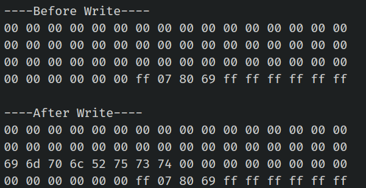

{{#title Запись данных на RFID-карты MIFARE Classic с ESP32 на Rust}}

# Запись данных

Мы запишем данные в блок 2 сектора 4. Сначала выведем содержимое блока до записи, а затем снова — после. Для записи используем функцию `mf_write` из крейта mfrc522.

> [!Caution]
> Если случайно записать данные не в тот блок и перезаписать блок трейлера, можно изменить ключ аутентификации или биты доступа, и сектор станет недоступным.


## Создание проекта

Выполните те же шаги, что и раньше: добавьте зависимости и завершите базовую настройку для RFID-компонента. На этот раз мы изменим код, чтобы записывать данные.


## Функция записи

Как обычно, мы зашиваем ключ аутентификации в код, вычисляем смещение блока по номеру сектора и затем определяем абсолютный номер блока, в который хотим записать данные. Проходим аутентификацию для блока и записываем данные.

```rust
fn write_block<E, COMM: mfrc522::comm::Interface<Error = E>>(
    uid: &mfrc522::Uid,
    sector: u8,
    rel_block: u8,
    data: [u8; 16],
    rfid: &mut Mfrc522<COMM, mfrc522::Initialized>,
) {
    const AUTH_KEY: [u8; 6] = [0xFF; 6];

    let block_offset = sector * 4;
    let abs_block = block_offset + rel_block;

    rfid.mf_authenticate(uid, block_offset, &AUTH_KEY)
        .map_err(|_| "Auth failed")
        .unwrap();

    rfid.mf_write(abs_block, data)
        .map_err(|_| "Write failed")
        .unwrap();
}
```

## Главный цикл
Мы запишем данные в 3-й блок 4-го сектора (это соответствует абсолютному блоку 18, вычисляемому как 4×4 = 16 + 2 = 18). В этот блок будут записаны данные «implRust». Поскольку блок имеет 16 байт, оставшиеся неиспользуемые байты дополняем нулевыми байтами (0x00).

Перед обновлением содержимого блока и после него выводим содержимое в цикле.

```rust
let target_sector = 4;
let rel_block = 2; // относительный блок внутри сектора (3-й блок в секторе)
const DATA: [u8; 16] = [
    b'i', b'm', b'p', b'l', b'R', b'u', b's', b't', // "implRust"
    0x00, 0x00, 0x00, 0x00, 0x00, 0x00, 0x00, 0x00, // Остальные байты — 0x00
];

loop {
    if let Ok(atqa) = rfid.reqa() {
        println!("Got atqa");
        Timer::after(Duration::from_millis(50)).await;
        if let Ok(uid) = rfid.select(&atqa) {
            println!("\r\n----Before Write----");
            read_sector(&uid, target_sector, &mut rfid);

            write_block(&uid, target_sector, rel_block, DATA, &mut rfid);

            println!("\r\n----After Write----");
            read_sector(&uid, target_sector, &mut rfid);
            rfid.hlta().unwrap();
            rfid.stop_crypto1().unwrap();
        }
    }
}
```


## Клонирование существующего проекта
Вы также можете клонировать (или посмотреть) созданный мной проект и перейти в папку `rfid-write`.

```sh
git clone https://github.com/ImplFerris/esp32-projects
cd esp32-projects/rfid-write
```

## Вывод
Когда вы запустите программу, в выводе будет показано шестнадцатеричное представление «implRust» в третьей строке.


## Полный код

```rust
#![no_std]
#![no_main]
#![deny(
    clippy::mem_forget,
    reason = "mem::forget is generally not safe to do with esp_hal types, especially those \
    holding buffers for the duration of a data transfer."
)]

use defmt::info;
use embassy_executor::Spawner;
use embassy_time::{Duration, Timer};
use esp_hal::clock::CpuClock;
use esp_hal::timer::timg::TimerGroup;
use esp_println as _;

// SPI
use esp_hal::gpio::{Level, Output, OutputConfig};
use esp_hal::spi;
use esp_hal::spi::master::Spi;
use esp_hal::time::Rate;

// RFID-считыватель
use embedded_hal_bus::spi::ExclusiveDevice;
use esp_hal::delay::Delay;
use mfrc522::Mfrc522;
use mfrc522::comm::blocking::spi::SpiInterface;

use esp_println::{self as _, print, println};

#[panic_handler]
fn panic(_: &core::panic::PanicInfo) -> ! {
    loop {}
}

// Создаёт дескриптор приложения по умолчанию, который требуется загрузчику esp-idf.
// Подробнее см.: <https://docs.espressif.com/projects/esp-idf/en/stable/esp32/api-reference/system/app_image_format.html#application-description>
esp_bootloader_esp_idf::esp_app_desc!();

#[esp_rtos::main]
async fn main(spawner: Spawner) -> ! {
    // generator version: 1.0.0

    let config = esp_hal::Config::default().with_cpu_clock(CpuClock::max());
    let peripherals = esp_hal::init(config);

    let timg0 = TimerGroup::new(peripherals.TIMG0);
    esp_rtos::start(timg0.timer0);

    info!("Embassy initialized!");

    let _ = spawner;

    let spi_bus = Spi::new(
        peripherals.SPI2,
        spi::master::Config::default()
            .with_frequency(Rate::from_mhz(5))
            .with_mode(spi::Mode::_0),
    )
    .unwrap()
    .with_sck(peripherals.GPIO18)
    .with_mosi(peripherals.GPIO23)
    .with_miso(peripherals.GPIO19)
    .into_async();

    let sd_cs = Output::new(peripherals.GPIO5, Level::High, OutputConfig::default());

    let delay = Delay::new();
    let spi_dev = ExclusiveDevice::new(spi_bus, sd_cs, delay).unwrap();

    let spi_interface = SpiInterface::new(spi_dev);
    let mut rfid = Mfrc522::new(spi_interface).init().unwrap();

    let target_sector = 4;
    let rel_block = 2; // относительный блок внутри сектора
    const DATA: [u8; 16] = [
        b'i', b'm', b'p', b'l', b'R', b'u', b's', b't', // "implRust"
        0x00, 0x00, 0x00, 0x00, 0x00, 0x00, 0x00, 0x00, // Остальные байты — 0x00
    ];

    loop {
        if let Ok(atqa) = rfid.reqa() {
            println!("Got atqa");
            Timer::after(Duration::from_millis(50)).await;
            if let Ok(uid) = rfid.select(&atqa) {
                println!("\r\n----Before Write----");
                read_sector(&uid, target_sector, &mut rfid);

                write_block(&uid, target_sector, rel_block, DATA, &mut rfid);

                println!("\r\n----After Write----");
                read_sector(&uid, target_sector, &mut rfid);
                rfid.hlta().unwrap();
                rfid.stop_crypto1().unwrap();
            }
        }
    }
}

fn write_block<E, COMM: mfrc522::comm::Interface<Error = E>>(
    uid: &mfrc522::Uid,
    sector: u8,
    rel_block: u8,
    data: [u8; 16],
    rfid: &mut Mfrc522<COMM, mfrc522::Initialized>,
) {
    const AUTH_KEY: [u8; 6] = [0xFF; 6];

    let block_offset = sector * 4;
    let abs_block = block_offset + rel_block;

    rfid.mf_authenticate(uid, block_offset, &AUTH_KEY)
        .map_err(|_| "Auth failed")
        .unwrap();

    rfid.mf_write(abs_block, data)
        .map_err(|_| "Write failed")
        .unwrap();
}

fn read_sector<E, COMM: mfrc522::comm::Interface<Error = E>>(
    uid: &mfrc522::Uid,
    sector: u8,
    rfid: &mut Mfrc522<COMM, mfrc522::Initialized>,
) {
    const AUTH_KEY: [u8; 6] = [0xFF; 6];

    let block_offset = sector * 4;
    rfid.mf_authenticate(uid, block_offset, &AUTH_KEY)
        .map_err(|_| "Auth failed")
        .unwrap();

    for abs_block in block_offset..block_offset + 4 {
        let data = rfid.mf_read(abs_block).map_err(|_| "Read failed").unwrap();
        print_hex_bytes(&data);
    }
}

fn print_hex_bytes(data: &[u8]) {
    for &b in data.iter() {
        print!("{:02x} ", b);
    }
    println!("");
}
```
