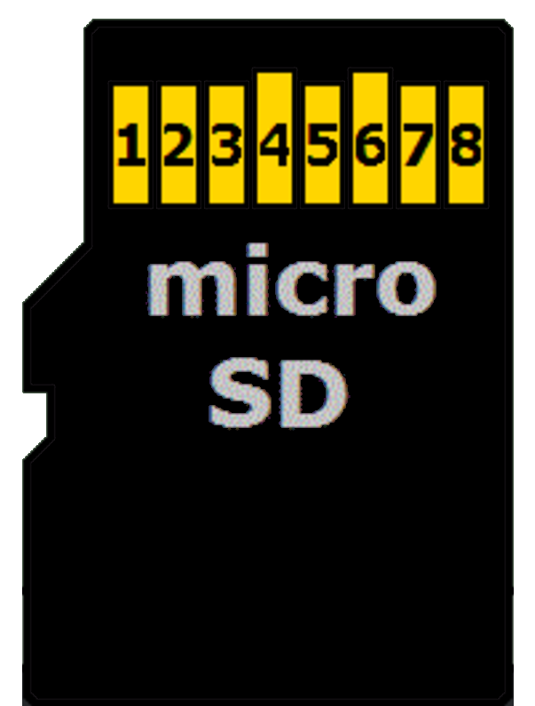
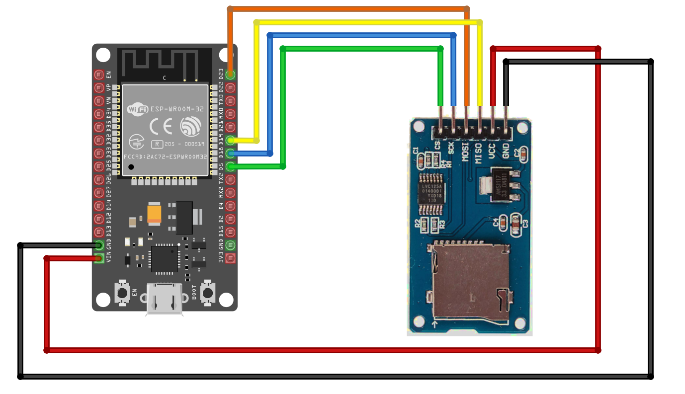

{{#title Подключение ESP32 к модулю microSD-карты по SPI на Rust}}

# Схема подключения

### Распиновка microSD-карты в режиме SPI

Мы будем рассматривать только microSD-карту, так как именно её мы используем. У microSD восемь выводов, но для режима SPI нужны только шесть. Возможно, вы заметили, что у модуля считывателя SD-карт тоже шесть выводов, на которых указаны функции SPI. В таблице ниже показаны выводы microSD-карты и соответствующие им функции SPI.

  
  <table>
    <thead>
      <tr>
        <th>Вывод microSD-карты</th>
        <th>Функция SPI</th>
      </tr>
    </thead>
    <tbody>
      <tr>
        <td>1</td>
        <td>-</td>
      </tr>
      <tr>
        <td>2</td>
        <td>Выбор микросхемы (CS); также называется Card Select</td>
      </tr>
      <tr>
        <td>3</td>
        <td>Входные данные (DI), соответствуют MOSI. Для приёма данных от микроконтроллера.</td>
      </tr>
      <tr>
        <td>4</td>
        <td>VDD — питание (3,3 В)</td>
      </tr>
      <tr>
        <td>5</td>
        <td>Тактирование (SCK)</td>
      </tr>
      <tr>
        <td>6</td>
        <td>Земля (GND)</td>
      </tr>
      <tr>
        <td>7</td>
        <td>Выходные данные (DO), соответствуют MISO. Для передачи данных от microSD-карты к микроконтроллеру.</td>
      </tr>
      <tr>
        <td>8</td>
        <td>-</td>
      </tr>
    </tbody>
  </table>

### Подключение ESP32 к считывателю SD-карт

microSD-карта работает от 3,3 В, поэтому питание её напряжением 5 В может повредить карту. Однако модуль считывателя имеет встроенный стабилизатор напряжения и преобразователь логических уровней, поэтому его безопасно подключать к источнику питания 5 В ESP32.

<table>
  <thead>
    <tr>
      <th>Вывод ESP32</th>
      <th style="width: 250px; margin: 0 auto;">Провод</th>
      <th>Вывод SD-карты</th>
    </tr>
  </thead>
  <tbody>
    <tr>
      <td>GPIO 5</td>
      <td style="text-align: center; vertical-align: middle; padding: 0;">
        

          

          

        

      </td>
      <td>CS</td>
    </tr>
    <tr>
      <td>GPIO 18</td>
      <td style="text-align: center; vertical-align: middle; padding: 0;">
        

          

          

        

      </td>
      <td>SCK</td>
    </tr>
    <tr>
      <td>GPIO 23</td>
      <td style="text-align: center; vertical-align: middle; padding: 0;">
        

          

          

        

      </td>
      <td>MOSI</td>
    </tr>
    <tr>
      <td>GPIO 19</td>
      <td style="text-align: center; vertical-align: middle; padding: 0;">
        

          

          

        

      </td>
      <td>MISO</td>
    </tr>
    <tr>
      <td>Vin</td>
      <td style="text-align: center; vertical-align: middle; padding: 0;">
        

          

          

        

      </td>
      <td>VCC</td>
    </tr>
    <tr>
      <td>GND</td>
      <td style="text-align: center; vertical-align: middle; padding: 0;">
        

          

          

        

      </td>
      <td>GND</td>
    </tr>
  </tbody>
</table>
 

