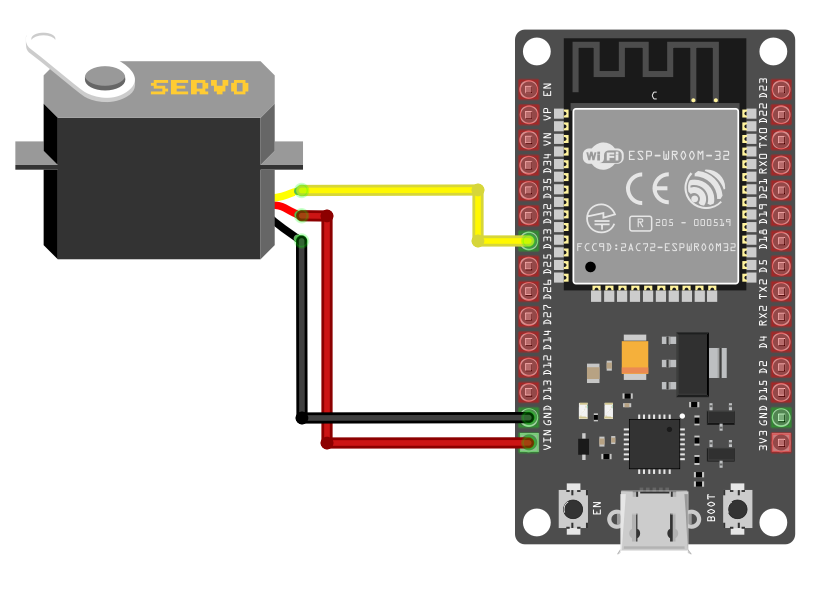

{{#title Подключение сервопривода SG90 к ESP32}}

# Общая схема подключения

1. **Земля (GND)**: подключите вывод GND сервопривода (обычно **коричневый** провод, хотя это может меняться) к любому выводу земли ESP32.
2. **Питание (VCC)**: подключите вывод VCC сервопривода (обычно **красный** провод) к выводу питания ESP32 5 В (Vin).
3. **Сигнал (PWM)**: подключите управляющий (сигнальный) вывод сервопривода к **GPIO 33** ESP32, настроенному для ШИМ. Обычно это **оранжевый** провод (может отличаться).

<table style="margin-bottom:20px">
  <thead>
    <tr>
      <th>Вывод ESP32</th>
      <th style="width: 250px; margin: 0 auto;">Провод</th>
      <th>Сервопривод</th>
      <th>Примечания</th>
    </tr>
  </thead>
  <tbody>
    <tr>
      <td>VIN</td>
      <td style="text-align: center; vertical-align: middle; padding: 0;">
        

          

          

        

      </td>
      <td>Питание (красный провод)</td>
      <td>Подаёт питание 5 В на сервопривод.</td>
    </tr>
    <tr>
      <td>GND</td>
      <td style="text-align: center; vertical-align: middle; padding: 0;">
        

          

          

        

      </td>
      <td>Земля (коричневый провод)</td>
      <td>Подключается к земле.</td>
    </tr>
    <tr>
      <td>GPIO 33</td>
      <td style="text-align: center; vertical-align: middle; padding: 0;">
        

          

          

        

      </td>
      <td>Сигнал (оранжевый провод)</td>
      <td>Получает ШИМ-сигнал для управления положением сервопривода.</td>
    </tr>
  </tbody>
</table>

