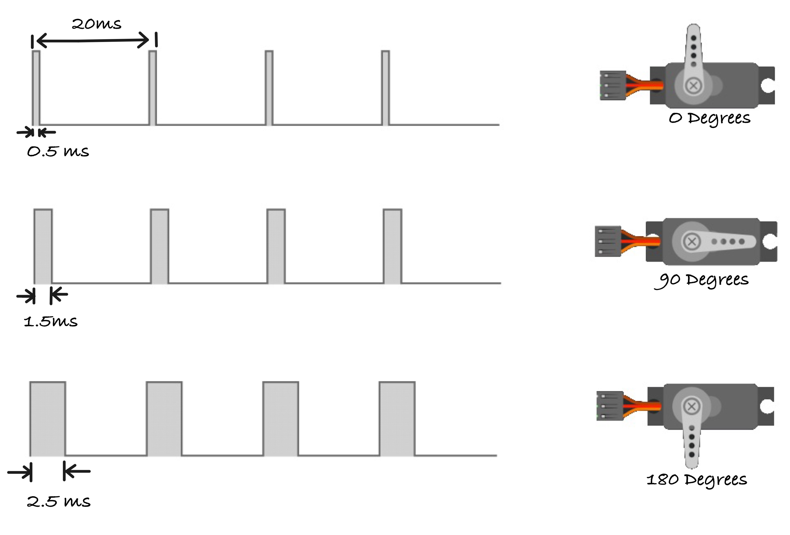

# Изменение положения сервопривода по коэффициенту заполнения ШИМ

Сервопривод, который мы используем, работает на частоте 50 Гц, то есть импульс отправляется каждые 20 миллисекунд (мс).

Разберём подробнее:
  - **Частота 50 Гц:** частота показывает, сколько раз событие происходит за единицу времени. Частота 50 Гц означает, что сервопривод ожидает импульс 50 раз в секунду. Другими словами, он получает импульс каждую пятидесятую долю секунды, то есть каждые 20 миллисекунд.
  - **Интервал 20 мс:** это время между импульсами. Каждые 20 миллисекунд сервопривод ожидает новый импульс, чтобы изменить своё положение. В пределах этих 20 мс ширина импульса (то, сколько времени сигнал остаётся «высоким») определяет угол, на который повернётся сервопривод.

Итак, когда мы говорим, что сервопривод работает на 50 Гц, это значит, что он постоянно получает импульсы каждые 20 мс, чтобы оставаться в движении или корректировать положение в зависимости от ширины каждого импульса.

## Ширина импульса и коэффициент заполнения
Разберём подробнее, как разные ширины импульсов, например 0,5 мс, 1,5 мс и 2,5 мс, влияют на положение сервопривода.

### **Импульс 0,5 мс (положение: 0 градусов)**
- **Что происходит**: импульс 0,5 мс означает, что сигнал находится в «высоком» состоянии 0,5 миллисекунды в каждом 20-миллисекундном цикле. Сервопривод интерпретирует это как команду перейти в положение 0 градусов.
- **Коэффициент заполнения**: коэффициент заполнения (duty cycle) — это процент времени, в течение которого сигнал находится в «высоком» состоянии за один полный цикл. Для импульса 0,5 мс:
\\[
\text{Коэффициент заполнения (\%)} = \\frac{0.5 \text{ms}}{20 \text{ms}} \\times 100 = 2.5\\%
\\]

  Это значит, что лишь 2,5% каждого 20-миллисекундного цикла сигнал находится в «высоком» состоянии, что заставляет сервопривод повернуться в положение 0 градусов.

### **Импульс 1,5 мс (положение: 90 градусов)**

- **Что происходит**: импульс 1,5 мс означает, что сигнал находится в «высоком» состоянии 1,5 миллисекунды в 20-миллисекундном цикле. Сервопривод переходит в нейтральное положение, примерно 90 градусов (среднее положение).
- **Коэффициент заполнения**: для импульса 1,5 мс:
\\[
\text{Коэффициент заполнения (\%)} = \\frac{1.5 \text{ms}}{20 \text{ms}} \\times 100 = 7.5\\%
\\]
  Здесь сигнал находится в «высоком» состоянии 7,5% цикла, что устанавливает сервопривод в положение 90 градусов (нейтральное).

### **Импульс 2,5 мс (положение: 180 градусов)**

- **Что происходит**: импульс 2,5 мс означает, что сигнал находится в «высоком» состоянии 2,5 миллисекунды в 20-миллисекундном цикле. Сервопривод переходит в максимальное положение, обычно 180 градусов (полный поворот в одну сторону).
- **Коэффициент заполнения**: для импульса 2,5 мс:
\\[
\text{Коэффициент заполнения (\%)} = \\frac{2.5 \text{ms}}{20 \text{ms}} \\times 100 = 12.5\\%
\\]
  В этом случае сигнал находится в «высоком» состоянии 12,5% цикла, что заставляет сервопривод повернуться на 180 градусов.
