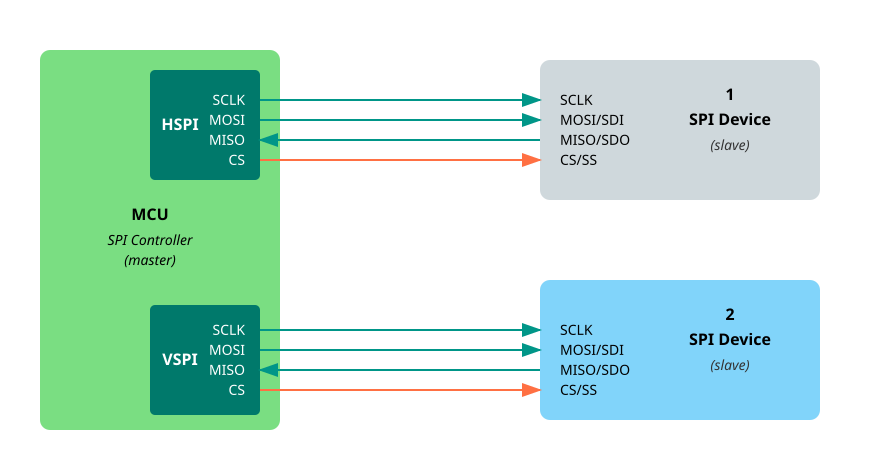

{{#title Периферия SPI ESP32 и настройка шины SPI на Rust}}

# Периферия SPI ESP32

В ESP32 есть четыре контроллера SPI, но для общего использования доступны только два из них: SPI2 и SPI3. Их обычно называют HSPI и VSPI. Два других контроллера, SPI0 и SPI1, зарезервированы для внутренних нужд.



На ESP32 многие выводы GPIO можно использовать для разных функций. Например, один вывод в одном приложении может быть универсальным цифровым выходом, а в другом — линией тактирования SPI. Это называется мультиплексированием: один физический вывод может быть подключён к разным внутренним сигналам в зависимости от того, как вы его настроили в коде.

У ESP32 есть несколько выводов GPIO, напрямую подключённых к каждому контроллеру SPI. Это:

- Для HSPI (SPI2): GPIO2, GPIO4 и GPIO12–GPIO15

- Для VSPI (SPI3): GPIO5, GPIO18, GPIO19 и GPIO21–GPIO23

Эти выводы разведены в чипе так, чтобы эффективно работать с SPI, и их часто используют. Однако ESP32 также позволяет переназначить сигналы SPI на многие другие GPIO.

Ниже приведены назначения выводов SPI по умолчанию для отладочной платы ESP32 DevKit:

| Канал SPI   | MOSI (SDI) | MISO (SDO) | SCLK    | CS      |
| ----------- | ---------- | ---------- | ------- | ------- |
| VSPI        | GPIO 23    | GPIO 19    | GPIO 18 | GPIO 5  |
| HSPI        | GPIO 13    | GPIO 12    | GPIO 14 | GPIO 15 |


## Использование SPI в esp-hal

Чтобы использовать SPI в крейте esp-hal, создаём и настраиваем интерфейс SPI с нужными выводами. Вот пример, который использует шину SPI2.

```rust
use esp_hal::spi::master::Config as SpiConfig;
use esp_hal::spi::master::Spi;
use esp_hal::spi::Mode as SpiMode;

// Инициализируем SPI
let spi_bus = Spi::new(
    peripherals.SPI2,
    SpiConfig::default()
        .with_frequency(Rate::from_mhz(60))
        .with_mode(SpiMode::_0),
)
.unwrap()
//CLK
.with_sck(peripherals.GPIO18)
//DIN
.with_mosi(peripherals.GPIO23);
let cs = Output::new(peripherals.GPIO15, Level::Low, OutputConfig::default());
```

## Пример использования драйвера

Теперь, когда интерфейс SPI настроен, используем его для общения с SD-картой с помощью крейта embedded_sdmmc. Мы будем использовать `ExclusiveDevice` из крейта embedded-hal-bus.

```rust
use embedded_hal_bus::spi::ExclusiveDevice;
use embedded_sdmmc::SdCard;
use esp_hal::delay::Delay;

//  Получаем эксклюзивный доступ к шине SPI (она не общая).
let spi_dev = ExclusiveDevice::new(spi_bus, cs, Delay).unwrap();

// Инициализируем драйвер SD-карты с SPI-устройством
let sdcard = SdCard::new(spi_dev, Delay);
```
