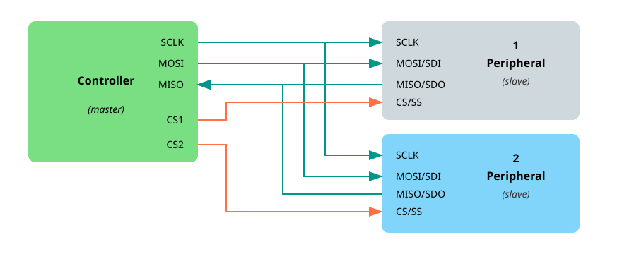

{{#title Учебник по SPI на ESP32: объяснение последовательного периферийного интерфейса}}

# Последовательный периферийный интерфейс (SPI)

В этом разделе мы узнаем, что такое SPI, и научимся использовать шины SPI ESP32.

## Что такое SPI?

SPI расшифровывается как Serial Peripheral Interface (последовательный периферийный интерфейс). Это один из самых распространённых способов, которыми микроконтроллеры обмениваются данными с дисплеями, датчиками и SD-картами. Технически его называют последовательным, полнодуплексным и синхронным интерфейсом. Что же означают эти термины?

- Последовательный (serial) означает, что данные передаются по одному биту за раз. Представьте однополосный мост, по которому одновременно может проехать только одна машина. Каждый бит данных — как машина, которая переезжает мост одна за другой, в очереди. Это отличается от многополосной магистрали (параллельная передача), где много машин могут ехать бок о бок одновременно.

- Полнодуплексный (full duplex) означает, что два устройства могут общаться друг с другом одновременно. Представьте телефонный разговор двух людей: оба могут говорить и слушать одновременно. Это и есть полный дуплекс. В отличие от этого полудуплекс похож на рацию: говорит только один человек, пока другой слушает, а затем они меняются ролями.

- Синхронный (synchronous) означает, что оба устройства используют общий сигнал тактирования, чтобы оставаться синхронными. Представьте двух людей, которые перебрасываются мячом, но бросают и ловят только тогда, когда звучит свисток. Свисток работает как сигнал тактирования: обе стороны точно знают, когда отправлять и принимать данные.

## Контроллер и периферийное устройство

SPI использует модель «контроллер — периферийное устройство» (раньше её называли «ведущий — ведомый», master-slave). Контроллер — это устройство, которое начинает обмен и формирует сигнал тактирования. Периферийное устройство отвечает на команды контроллера.

В большинстве встраиваемых проектов ESP32 выступает в роли контроллера, а такие устройства, как дисплеи, датчики или SD-карты, — в роли периферийных.

<em>Рисунок: одна шина SPI с контроллером и одним периферийным устройством</em>

Обычно соединение использует четыре линии:

- Линия SCK (Serial Clock) передаёт сигнал тактирования, который формирует контроллер. Этот сигнал синхронизирует контроллер и устройство во время передачи данных.

- Линия MOSI (Master Out, Slave In) используется для отправки данных от контроллера к устройству. В некоторых даташитах эту линию могут обозначать как SDO (Serial Data Out).

- Линия MISO (Master In, Slave Out) передаёт данные от устройства к контроллеру. В зависимости от устройства её также могут называть SDI (Serial Data In).

- Наконец, линия CS (Chip Select) используется контроллером, чтобы выбрать, с каким устройством он хочет общаться. У каждого подключённого устройства обычно есть собственная линия CS. Когда контроллер переводит линию CS устройства в низкий уровень (активный), это устройство становится активным и готовым к обмену. В некоторой старой документации эту линию могут называть SS (Slave Select).

<em>Рисунок: одна шина SPI с контроллером и несколькими периферийными устройствами</em>

### Режимы SPI

SPI поддерживает четыре режима, пронумерованных от 0 до 3. Они определяют, когда данные читаются и записываются, в зависимости от уровня простоя тактового сигнала и фронта.

Пока не переживайте слишком сильно из-за деталей. Режим 0 — самый распространённый, и он подходит для большинства устройств.

## Почему SPI?

SPI — отличный выбор, когда нужна быстрая и надёжная связь между микроконтроллером и периферийным устройством. Он заметно быстрее I²C или UART, прост в использовании и позволяет одновременно отправлять и принимать данные (полный дуплекс). Поэтому он идеально подходит для быстрых устройств, таких как дисплеи или SD-карты.

Пока есть достаточно выводов GPIO и не нужно подключать большое количество устройств, SPI обычно — лучший инструмент для задачи.

## Ресурсы

Для более глубоких технических подробностей см.:
- [Serial Peripheral Interface (SPI) от Sparkfun](https://learn.sparkfun.com/tutorials/serial-peripheral-interface-spi/all)
- [Основы протокола связи SPI](https://www.circuitbasics.com/basics-of-the-spi-communication-protocol/)
