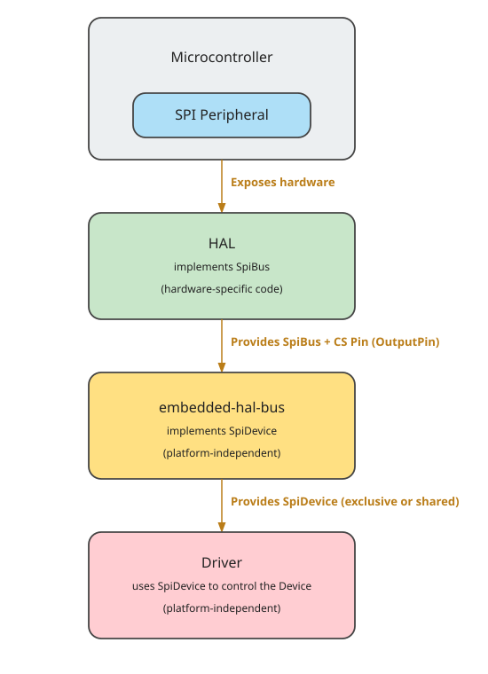

{{#title Понимание SpiBus и SpiDevice во встраиваемом Rust для ESP32}}

# Использование SPI в экосистеме embedded Rust

В предыдущем разделе мы узнали, что такое SPI и как работает модель «контроллер — периферийное устройство». Теперь посмотрим, как эти понятия применяются в экосистеме embedded Rust.

Экосистема embedded Rust построена модульно и с расчётом на повторное использование. Это значит, что код, написанный для одного микроконтроллера, можно перенести на другой с минимальными изменениями. Ключ к такой гибкости — трейты, определённые в крейте embedded-hal.

## SPI в embedded-hal

Крейт embedded-hal определяет стандартные трейты для работы с SPI, чтобы драйверы и библиотеки можно было писать обобщённо. Два важных трейта для SPI:

- SpiBus: представляет полный контроль над шиной SPI, включая линии SCK, MOSI и MISO. Его обязан реализовать крейт HAL микроконтроллера. Например, крейт esp-hal реализует SpiBus. Если интересно, можно посмотреть реализацию [здесь](https://github.com/esp-rs/esp-hal/blob/de67c3101346cdbe030ffa1bb95b13943ee8d790/esp-hal/src/spi/master.rs#L2703).

- SpiDevice: представляет доступ к одному устройству SPI, которое может делить шину с другими. Он управляет линией выбора микросхемы (CS) и гарантирует, что устройство выбрано перед обменом и освобождается после него.

## Драйверы, не зависящие от платформы

Представьте, что вы пишете драйвер для датчика или дисплея, который обменивается данными по SPI. Вы не хотите привязывать код к конкретному микроконтроллеру, например Raspberry Pi Pico или ESP32. Вместо этого можно написать драйвер обобщённо, используя трейты embedded-hal.

Пока ваш драйвер зависит только от трейтов SpiDevice или SpiBus, он может работать на любой платформе, которая реализует эти трейты, — будь то STM32, nRF или ESP32.

## Совместное использование шины SPI

Во многих проектах несколько устройств SPI используют одну и ту же шину. Например, дисплей, SD-карта и датчик температуры могут быть подключены к одним и тем же линиям MOSI, MISO и SCK. Различает их только линия выбора микросхемы (CS).

<em>Рисунок: одна шина SPI с контроллером и несколькими периферийными устройствами</em>

Если отдать полный контроль над шиной SPI одному драйверу (через SpiBus), остальные не смогут её использовать. Поэтому нам нужен способ безопасно делить шину SPI между несколькими устройствами.

Здесь на помощь приходит SpiDevice: он позволяет каждому драйверу использовать только свою линию CS, оставаясь при этом на общей шине.

На практике это означает, что каждому драйверу нужно передать структуру, которая реализует SpiDevice, а не всю шину целиком.

## Как получить SpiDevice?

Мы сказали, что каждому драйверу следует передавать реализацию SpiDevice, а не всю шину SpiBus. Но должны ли мы сами писать эту структуру SpiDevice?

Не обязательно. Можно написать собственную реализацию, но обычно в этом нет необходимости — и её легко сделать неправильно, особенно когда нескольким устройствам нужно согласовывать доступ к шине.

Для этого существует крейт embedded-hal-bus. Он предоставляет готовые обёртки, которые реализуют трейт SpiDevice. Эти обёртки сами управляют доступом к шине, линией CS и, при необходимости, синхронизацией между устройствами.

- Если ваш проект использует только одно устройство SPI и не нужно делить шину, можно использовать структуру `ExclusiveDevice`: она даёт эксклюзивный доступ к шине для одного устройства.

- Если же в проекте несколько устройств SPI делят одну шину, можно выбрать одну из реализаций совместного доступа, например `AtomicDevice` или `CriticalSectionDevice`. Они управляют доступом к шине так, что каждое устройство получает свою очередь и не мешает остальным.

Эти структуры позволяют сосредоточиться на использовании или написании драйверов, не заботясь о низкоуровневой координации и шаблонном коде.

## Ресурсы

- [Документация embedded-hal по SPI](https://docs.rs/embedded-hal/latest/embedded_hal/spi/index.html): подробное описание того, как устроены трейты SPI и как их предполагается использовать на разных платформах.
