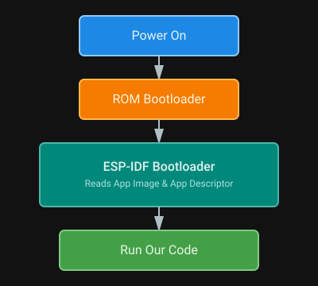

{{#title Загрузчик ESP32 и дескриптор приложения в Rust}}

# Последовательность запуска приложения

Прежде чем переходить к прошивке, нужно добавить в код ещё одну строку. Чтобы понять зачем, посмотрим, что происходит при включении микроконтроллера. В чипах Espressif наша программа не первая, кто запускается: до старта приложения выполняются два загрузчика.



Загрузчик первого этапа (First Stage Bootloader) записан в ROM чипа на этапе производства, и изменить его нельзя. Загрузчик второго этапа (Second Stage Bootloader) как раз загружает ваше приложение и настраивает память. Стандартный загрузчик второго этапа — ESP-IDF Bootloader.

По умолчанию, когда вы прошиваете программу с помощью `espflash`, он автоматически включает предварительно собранный ESP-IDF Bootloader с настройками по умолчанию, так что собирать или настраивать его самостоятельно не нужно.

## Дескриптор приложения

Во время загрузки ESP-IDF Bootloader читает секцию под названием «Application Descriptor», чтобы проверить вашу прошивку. Этот дескриптор содержит метаданные о приложении: информацию о версии, название проекта, время и дату компиляции, версию ESP-IDF и SHA256-хеш ELF-файла приложения.

Создавать этот дескриптор самостоятельно не нужно. Можно добавить такой крейт:

```toml
esp-bootloader-esp-idf = { version = "0.4.0", features = ["esp32"] }
```

Затем добавьте в файл `main.rs` этот макрос:

```rust
esp_bootloader_esp_idf::esp_app_desc!();
```

Этот макрос автоматически генерирует структуру дескриптора приложения, которую ESP-IDF Bootloader ожидает найти в каждом образе прошивки.
