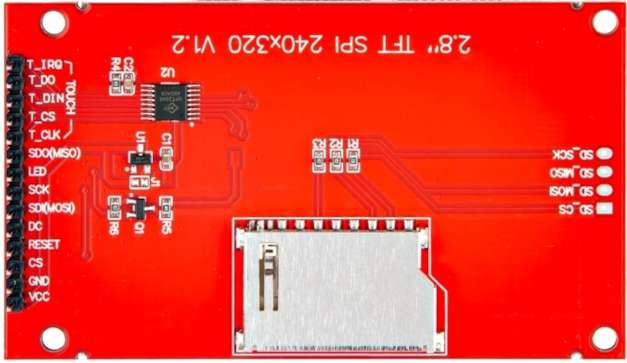
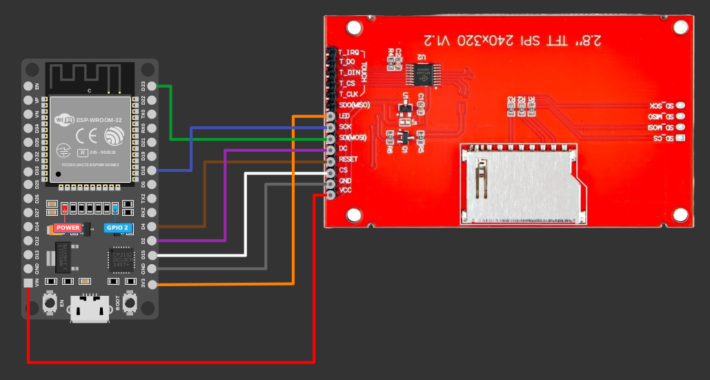

{{#title Подключение TFT-дисплея ILI9341 к ESP32 по SPI}}

# Подключение TFT-дисплея к ESP32

В этом разделе мы рассмотрим распиновку TFT-модуля и узнаем, как подключить его к ESP32. Если присмотреться, она очень похожа на распиновку модуля e-ink. Это потому, что оба дисплея используют SPI (Serial Peripheral Interface) для связи и имеют общие управляющие линии: CS, DC, RESET, MOSI и SCK. Поэтому, разобравшись, как подключить и управлять одним дисплеем на SPI, перейти к другому будет гораздо проще.

## Распиновка TFT-дисплея

- **VCC**: питание (3,3 В или 5 В). Это основное питание всего дисплейного модуля. Оно питает контроллер дисплея (например, ILI9341) и другие части.
- **GND**: земля
- **CS**: Chip Select (выбор микросхемы). Сообщает дисплею, когда нужно слушать команды SPI. Держите низкий уровень (активный) при отправке данных.
- **RESET**: сброс дисплея. Полезен при запуске, чтобы дисплей стартовал в известном состоянии.
- **DC**: линия выбора данных/команды (Data/Command). Высокий уровень — отправка данных, низкий уровень — отправка команд. С её помощью переключаются между записью команд и данных пикселей.
- **SDI (MOSI)**: Master Out Slave In. Линия данных SPI от микроконтроллера к дисплею. По ней передаются данные пикселей и команды.
- **SCK**: Serial Clock. Тактовый сигнал SPI от микроконтроллера. Он синхронизирует передаваемые данные.
- **LED**: этот вывод предназначен для подсветки (светодиодной панели) дисплея. Он регулирует яркость экрана. Если нужна постоянно включённая подсветка, подключите этот вывод к 3,3 В. Если хотите регулировать яркость (например, приглушать или выключать), подключите его к выводу GPIO микроконтроллера, поддерживающему ШИМ.
- **SDO (MISO)**: Master In Slave Out. Линия чтения SPI от дисплея к микроконтроллеру. Используется не всегда, но некоторые дисплеи поддерживают чтение памяти или состояния дисплея.

### Распиновка контроллера касания

Если в вашем TFT-дисплее есть резистивный сенсорный экран, в нём, скорее всего, используется контроллер касания, например **XPT2046**. Эти выводы касания отделены от выводов дисплея и тоже подключаются по SPI. Подключать их нужно только если вы хотите использовать функцию касания.

- **T_CLK**: вывод тактирования шины SPI сенсорного экрана
- **T_CS**: вывод выбора микросхемы сенсорного экрана
- **T_DIN**: вывод записи данных SPI сенсорного экрана (MOSI)
- **T_DO**: вывод чтения данных SPI сенсорного экрана (MISO)
- **T_IRQ**: вывод обнаружения прерывания сенсорного экрана

Если сенсорный ввод вам не нужен или в модуле нет сенсорной панели, эти выводы можно не подключать.

## Подключение TFT-дисплея к ESP32

 

<table style="margin-bottom:20px">
  <thead>
    <tr>
      <th>Вывод TFT-дисплея</th>
      <th style="width: 250px; margin: 0 auto;">Провод</th>
      <th>Вывод ESP32</th>
    </tr>
  </thead>
  <tbody>
    <tr>
      <td>VCC</td>
      <td style="text-align: center; vertical-align: middle; padding: 0;">
        

          

          

        

      </td>
      <td>Vin</td>
    </tr>
    <tr>
      <td>GND</td>
      <td style="text-align: center; vertical-align: middle; padding: 0;">
        

          

          

        

      </td>
      <td>GND</td>
    </tr>
    <tr>
      <td>CS</td>
      <td style="text-align: center; vertical-align: middle; padding: 0;">
        

          

          

        

      </td>
      <td>GPIO15</td>
    </tr>
    <tr>
      <td>RESET</td>
      <td style="text-align: center; vertical-align: middle; padding: 0;">
        

          

          

        

      </td>
      <td>GPIO4</td>
    </tr>
    <tr>
      <td>DC</td>
      <td style="text-align: center; vertical-align: middle; padding: 0;">
        

          

          

        

      </td>
      <td>GPIO2</td>
    </tr>
    <tr>
      <td>SDI (MOSI)</td>
      <td style="text-align: center; vertical-align: middle; padding: 0;">
        

          

          

        

      </td>
      <td>GPIO23</td>
    </tr>
    <tr>
      <td>SCK (CLK)</td>
      <td style="text-align: center; vertical-align: middle; padding: 0;">
        

          

          

        

      </td>
      <td>GPIO18</td>
    </tr>
    <tr>
      <td>LED</td>
      <td style="text-align: center; vertical-align: middle; padding: 0;">
        

          

          

        

      </td>
      <td>3.3V (или PWM-вывод для регулировки яркости)</td>
    </tr>
  </tbody>
</table>
