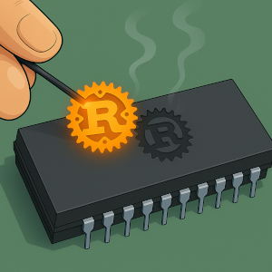

{{#title Вывод изображения на TFT-дисплей с ESP32 и Rust}}

# Вывод изображения на TFT-дисплей с ESP32 и Rust

Выведем изображение на TFT-дисплей. Для этого можно использовать крейт embedded-graphics и, по желанию, крейт tinybmp.

Крейт tinybmp мы уже рассматривали в разделе про OLED. Он позволяет загрузить BMP-файл и вывести его на экран. Кроме того, тот же результат можно получить, используя сырой байтовый массив изображения.

Крейт требует, чтобы изображение было в формате BMP. Если ваше изображение в другом формате, его нужно конвертировать в BMP.

Я использую картинку, которую нашёл в интернете, но не уверен, кто её автор, чтобы правильно указать источник. Скачать изображение можно [здесь](./images/embedded-rust.bmp). Можете взять другое изображение, но обязательно переведите его в формат BMP.




## Создание проекта с помощью esp-generate
Чтобы создать проект, используйте команду `esp-generate`. Выполните:

```sh
esp-generate --chip esp32 tft-display-image
```

Откроется экран с вопросом о выборе опций. 

- Сначала выберите опцию «Enable unstable HAL features.»

Сохраните настройки, нажав на клавиатуре «s».

## Обновляем cargo.toml

```toml
embedded-hal-bus = { version = "0.3" }
display-interface-spi = "0.5"
ili9341 = "0.6.0"
embedded-graphics = "0.8.1"

tinybmp = "0.6.0"
```

Подробности остальных крейтов и базовую настройку SPI и кода дисплея мы уже разобрали, поэтому повторяться не будем. Сразу перейдём к выводу изображения после очистки экрана.

## Чёрный фон

Вместо белого фона зальём фон чёрным цветом.

```rust
display.clear(Rgb565::BLACK).unwrap();
```

## Вывод изображения

Поместите файл embedded-rust.bmp в корневую папку проекта. Код довольно простой: загрузите изображение как байты и передайте их в функцию `from_slice` у `Bmp`. Затем используйте результат с `Image`.

```rust
let bmp_data = include_bytes!("../../embedded-rust.bmp");
let bmp = Bmp::from_slice(bmp_data).unwrap();

let image = Image::new(&bmp, Point::new(10, 0));
image.draw(&mut display).unwrap();

```

## Клонирование существующего проекта
Вы также можете клонировать (или посмотреть) созданный мной проект и перейти в папку `tft-display-image`.

```sh
git clone https://github.com/ImplFerris/esp32-projects
cd esp32-projects/tft-display-image/
```

## Полный код

```rust
#![no_std]
#![no_main]
#![deny(
    clippy::mem_forget,
    reason = "mem::forget is generally not safe to do with esp_hal types, especially those \
    holding buffers for the duration of a data transfer."
)]

use defmt::info;
use embedded_graphics::image::Image;
use esp_hal::clock::CpuClock;
use esp_hal::main;
use esp_hal::time::{Duration, Instant};
use esp_println as _;

// Связанное с embedded-graphics
use embedded_graphics::pixelcolor::Rgb565;
use embedded_graphics::prelude::*;

// Мост между SPI ESP32 и драйвером дисплея
use display_interface_spi::SPIInterface;
use embedded_hal_bus::spi::ExclusiveDevice;
use esp_hal::delay::Delay;
use esp_hal::spi::Mode as SpiMode;
use esp_hal::spi::master::Config as SpiConfig;
use esp_hal::spi::master::Spi;
use esp_hal::time::Rate; // Для задания частоты SPI
use ili9341::{DisplaySize240x320, Ili9341, Orientation};

// Для управления состоянием GPIO
use esp_hal::gpio::{Level, Output, OutputConfig};
use tinybmp::Bmp;

#[panic_handler]
fn panic(_: &core::panic::PanicInfo) -> ! {
    loop {}
}

// Создаёт дескриптор приложения по умолчанию, который требуется загрузчику esp-idf.
// Подробнее см.: <https://docs.espressif.com/projects/esp-idf/en/stable/esp32/api-reference/system/app_image_format.html#application-description>
esp_bootloader_esp_idf::esp_app_desc!();

#[main]
fn main() -> ! {
    // generator version: 1.0.0

    let config = esp_hal::Config::default().with_cpu_clock(CpuClock::max());
    let peripherals = esp_hal::init(config);

    // Инициализируем SPI
    let spi = Spi::new(
        peripherals.SPI2,
        SpiConfig::default()
            .with_frequency(Rate::from_mhz(4))
            .with_mode(SpiMode::_0),
    )
    .unwrap()
    //CLK
    .with_sck(peripherals.GPIO18)
    //DIN
    .with_mosi(peripherals.GPIO23);
    let cs = Output::new(peripherals.GPIO15, Level::Low, OutputConfig::default());
    let dc = Output::new(peripherals.GPIO2, Level::Low, OutputConfig::default());
    let reset = Output::new(peripherals.GPIO4, Level::Low, OutputConfig::default());

    let spi_dev = ExclusiveDevice::new_no_delay(spi, cs).unwrap();
    let interface = SPIInterface::new(spi_dev, dc);

    let mut display = Ili9341::new(
        interface,
        reset,
        &mut Delay::new(),
        Orientation::Portrait,
        DisplaySize240x320,
    )
    .unwrap();

    display.clear(Rgb565::BLACK).unwrap();

    let bmp_data = include_bytes!("../../embedded-rust.bmp");
    let bmp = Bmp::from_slice(bmp_data).unwrap();

    let image = Image::new(&bmp, Point::new(10, 0));
    image.draw(&mut display).unwrap();

    loop {
        info!("Hello world!");
        let delay_start = Instant::now();
        while delay_start.elapsed() < Duration::from_millis(500) {}
    }
}
```
