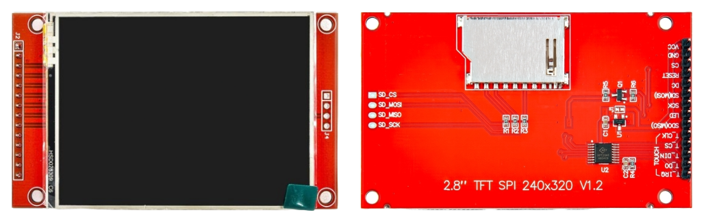

{{#title Начало работы с TFT-дисплеями на ESP32 на Rust}}

# TFT-дисплей

В этой главе мы научимся работать с TFT-дисплеем. TFT расшифровывается как Thin-Film Transistor (тонкоплёночный транзистор). Это разновидность ЖК-дисплея (LCD), которая даёт яркие цвета, чёткие изображения и высокую скорость обновления. По сравнению с простыми текстовыми дисплеями, такими как ЖК 16x2 или монохромные OLED, TFT-дисплеи позволяют выводить полноцветную графику, фигуры, изображения и даже интерфейсы с сенсорным управлением.

## Что такое TFT-дисплей?

TFT-дисплей состоит из тысяч крошечных пикселей, расположенных в виде сетки. Каждый пиксель может показывать разные цвета, благодаря чему на экране можно нарисовать что угодно. В дисплее есть микросхема-контроллер, которая понимает данные, приходящие от микроконтроллера, и соответственно обновляет экран.

TFT-дисплеи очень распространены в мобильных телефонах, смарт-часах и портативных гаджетах. Во встраиваемых системах их используют для панелей мониторинга, игр, пультов управления и многого другого.

## Разновидности TFT-дисплеев

TFT-модули бывают разных размеров, разрешений и типов связи. Вот несколько распространённых различий:

- Размер: от 1,3 дюйма до 7 дюймов и больше.

- Разрешение: от 128×160 до 800×480 и выше.

- Тип интерфейса: TFT-дисплеи предлагают разные способы подключения к микроконтроллеру. Интерфейс SPI прост и использует меньше выводов, но работает медленнее. Параллельный интерфейс быстрее, но требует больше выводов. У больших дисплеев часто используется интерфейс RGB (TTL), который очень быстрый, но для работы требует специального контроллера.

## Наш дисплей: 2,8-дюймовый сенсорный экран с SPI

В этом проекте мы будем использовать TFT-модуль 2,8 дюйма с разрешением 240×320 пикселей. Он работает по интерфейсу SPI, благодаря чему подключается к микроконтроллеру всего несколькими выводами.

Модуль также оснащён резистивным сенсорным экраном, который позволяет определять касания, измеряя давление на экран. Сначала мы сосредоточимся на выводе изображения на дисплей.

## Драйвер дисплея (контроллер)

У каждого TFT-дисплея есть микросхема-контроллер, которая отвечает за отрисовку пикселей на экране. В нашем случае дисплей использует микросхему ILI9341. Мы отправляем этой микросхеме команды, и она выполняет такие задачи, как обновление экрана, рисование фигур, заливка цветом и многое другое.

Контроллер ILI9341 чаще всего используется в 2,4- и 2,8-дюймовых TFT-дисплеях, а иногда и в 3,2-дюймовых. Если ваш экран использует ту же микросхему ILI9341, с ним будут работать те же код и примеры из этого руководства.

Также можно использовать дисплеи с другими микросхемами драйверов (например, ST7735, ILI9225, ILI9486), но для них понадобятся другие крейты Rust или иные инструкции по настройке. Поэтому важно перед покупкой проверить, какой контроллер используется в дисплее, чтобы убедиться в совместимости с руководством.

## Контроллер сенсорного экрана

Некоторые TFT-дисплеи (как тот, что используем мы) также имеют резистивный сенсорный экран поверх основного. В таких дисплеях функцию касания выполняет отдельная микросхема — XPT2046.

Эта микросхема считывает координаты X и Y, когда вы касаетесь экрана, и передаёт эти данные по SPI. Она работает независимо от драйвера дисплея (ILI9341).

## Даташиты

- [Даташит ILI9341](https://cdn-shop.adafruit.com/datasheets/ILI9341.pdf).
- [Даташит XPT2046](https://grobotronics.com/images/datasheets/xpt2046-datasheet.pdf)
