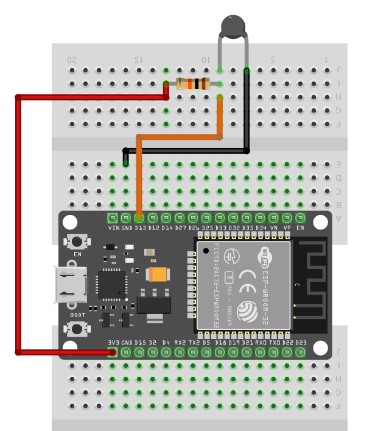

# Схема: подключение ESP32 к термистору

1. Один вывод термистора подключён к `GND`.
2. Другой вывод термистора подключён к `GPIO13`, который является выводом ADC2 на ESP32.
3. Резистор 10 кОм подключается последовательно с термистором, образуя делитель напряжения между термистором и `3.3V`. Поэтому один вывод резистора подключите к `3.3V`, а другой — к `GPIO13`.

