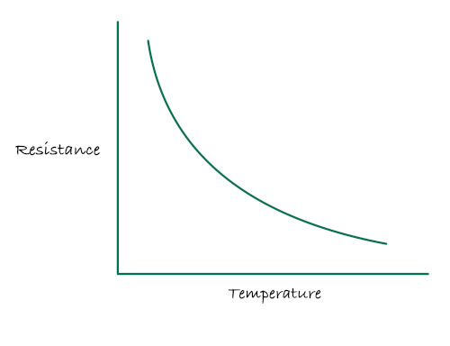

# Нелинейность термистора

У термисторов связь между сопротивлением и температурой нелинейна: при изменении температуры сопротивление меняется не по прямой линии. Поведение термисторов можно описать с помощью уравнения Штейнхарта — Харта или B-уравнения.

B-уравнение просто рассчитать, используя B-значение, которое можно найти в даташите термистора или у производителя. Уравнение Штейнхарта — Харта использует коэффициенты A, B и C. Некоторые производители предоставляют эти коэффициенты для своих термисторов. Когда подходящие коэффициенты доступны, уравнение Штейнхарта — Харта может дать более точные расчёты температуры в более широком диапазоне.

В следующих главах мы подробно разберём, как использовать B-уравнение и уравнение Штейнхарта — Харта для определения температуры. 

### Ссылки
- [B-параметр и уравнение Штейнхарта — Харта](https://blog.meteodrenthe.nl/2022/09/07/the-b-parameter-vs-steinhart-hart-equation/)
- [Характеристики термисторов: краткое введение, B-значение и коэффициенты Штейнхарта — Харта](https://community.element14.com/challenges-projects/design-challenges/experimenting-with-thermistors/b/challenge-blog/posts/blog-3-characterising-thermistors-a-quick-primer-beta-value-steinhart-hart-coefficients)
