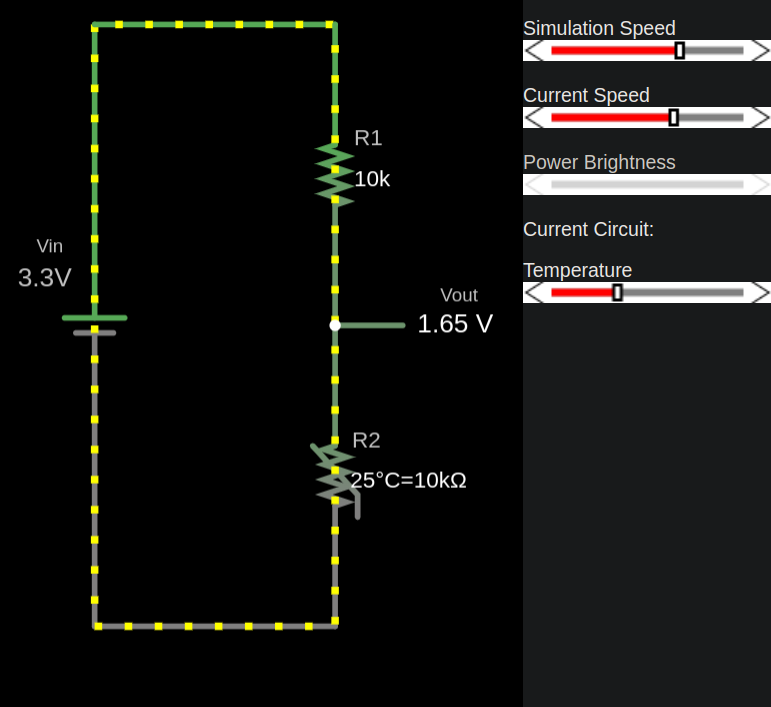
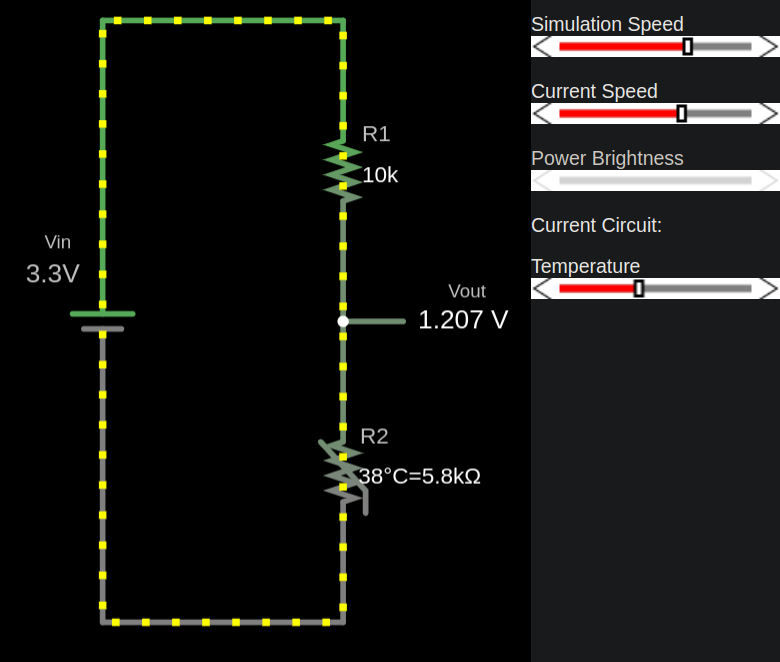
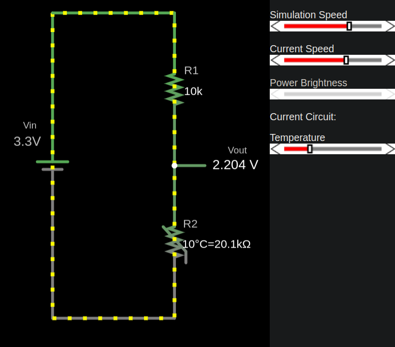

{{#title Понимание NTC-термисторов в схеме делителя напряжения}}

# NTC и делитель напряжения

Я создал схему на сайте Falstad, и вы можете скачать файл [voltage-divider-thermistor.circuitjs.txt](./voltage-divider-thermistor.circuitjs.txt), чтобы импортировать его и поэкспериментировать. Эта схема похожа на ту, что мы рассматривали в главе [Делитель напряжения](../core-concepts/voltage-divider.md). Если вы ещё не проходили этот раздел, настоятельно рекомендую сначала изучить теорию там.

Эта схема включает термистор 10 кОм (R2), сопротивление которого при 25°C равно 10 кОм. Входное напряжение \\( V_{in} \\) задано равным 3,3 В.

**Примечание:** когда вы собираете этот делитель напряжения с микроконтроллером, периферия АЦП преобразует Vout в цифровое значение.

### Термистор при 25°C
Сопротивление термистора при 25°C составляет 10 кОм, и выходное напряжение (\\( V_{out} \\)) равно 1,65 В.

## Термистор при 38°C
Сопротивление термистора уменьшается из-за его отрицательного температурного коэффициента, что меняет выходное напряжение делителя.

## Термистор при 10°C
Сопротивление термистора растёт, что приводит к более высокому выходному напряжению (\\( V_{out} \\)).

Эти изображения приведены только для наглядности: показания вашего термистора могут немного отличаться.
