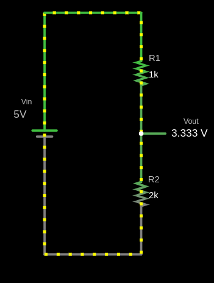
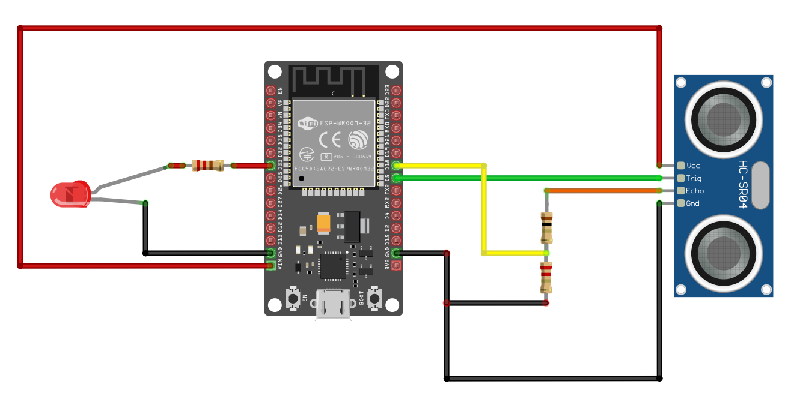
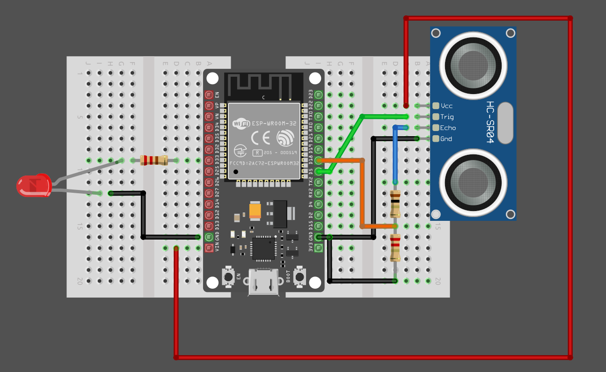

{{#title Подключение HC-SR04 к ESP32: схема и делитель напряжения}}

# Подключение HC-SR04 к ESP32

## Зачем нужен делитель напряжения?

Этот раздел можно пропустить, если у вас HC-SR04+, который также принимает питание 3,3 В.

Прежде чем переходить к подключению, познакомьтесь с понятием делителя напряжения: см. [эту главу](../core-concepts/voltage-divider.md). Как мы говорили ранее, модуль нужно питать от 5 В, которые можно подать через вывод Vin ESP32. Модуль возвращает сигнал через вывод Echo. Однако выводы GPIO ESP32 допускают не более 3,6 В, поэтому напряжение нужно понизить с помощью делителя между выводом Echo и выводом GPIO ESP32.

Для этого понадобятся два резистора с разными номиналами, чтобы выходное напряжение было примерно 3,3 В. Например, можно взять резистор 1 кОм в качестве R1 и резистор 2 кОм в качестве R2: они понизят напряжение примерно до 3,3 В.

Если хотите поэкспериментировать с разными номиналами резисторов, можно использовать [сайт Falstad](https://www.falstad.com/circuit/) и [текстовый файл схемы делителя](./voltage-divider-hc-sr04.txt). Он позволяет менять значения R1 и R2 и смотреть, какое напряжение выдаёт каждая комбинация. Так вы сможете собрать делитель из резисторов, которые у вас есть.

## Схема для HC-SR04

<table>
  <thead>
    <tr>
      <th>Вывод ESP32</th>
      <th style="height: 4px; width: 250px; margin: 0 auto;">Провод</th>
      <th>Вывод HC-SR04</th>
    </tr>
  </thead>
  <tbody>
    <tr>
      <td>Vin (5 В)</td>
      <td style="text-align: center; vertical-align: middle; padding: 0;">
        

          

          

        

      </td>
      <td>VCC</td>
    </tr>
    <tr>
      <td>GPIO 5</td>
      <td style="text-align: center; vertical-align: middle; padding: 0;">
        

          

          

        

      </td>
      <td>Trig</td>
    </tr>
    <tr>
      <td>GPIO 18</td>
      <td style="text-align: center; vertical-align: middle; padding: 0;">
        

          

          

        

      </td>
      <td>Echo (через делитель напряжения)</td>
    </tr>
    <tr>
      <td>GND</td>
      <td style="text-align: center; vertical-align: middle; padding: 0;">
        

          

          

        

      </td>
      <td>GND</td>
    </tr>
  </tbody>
</table>

- **VCC**: подключите вывод VCC датчика HC-SR04 к выводу Vin ESP32. Если используете HC-SR04+, подключите к выводу 3,3 В ESP32.
- **Trig**: подключите к GPIO 5 ESP32.
- **Echo**: подключите вывод Echo датчика HC-SR04 к GPIO 18 через делитель напряжения (резистор 1 кОм между Echo и GPIO 18 и резистор 2 кОм между GPIO 18 и GND; таким образом, GPIO 18 оказывается посередине). Думаю, с принципиальной схемой это будет понятнее.
- **GND**: подключите вывод GND датчика HC-SR04 к выводу GND ESP32.

## Схема для светодиода

Анод (длинную ножку) светодиода подключите к GPIO 33, как в [разделе о внешнем светодиоде](../led/external-led.md), через резистор (например, 330 Ом), чтобы не повредить светодиод. Катод (короткую ножку) светодиода подключите к земле.

<table>
  <thead>
    <tr>
      <th>Вывод ESP32</th>
      <th style="width: 250px; margin: 0 auto;">Провод</th>
      <th>Компонент</th>
    </tr>
  </thead>
  <tbody>
    <tr>
      <td>GPIO 33</td>
      <td style="text-align: center; vertical-align: middle; padding: 0;">
        

          

          

        

      </td>
      <td>Резистор</td>
    </tr>
    <tr>
      <td>Резистор</td>
      <td style="text-align: center; vertical-align: middle; padding: 0;">
        

          

          

        

      </td>
      <td>Анод (длинная ножка) светодиода</td>
    </tr>
    <tr>
      <td>GND</td>
      <td style="text-align: center; vertical-align: middle; padding: 0;">
        

          

          

        

      </td>
      <td>Катод (короткая ножка) светодиода</td>
    </tr>
  </tbody>
</table>

## Схема подключения

Я привёл схемы как с макетной платой, так и без неё. Признаюсь, версия с макетной платой получилась у меня немного запутанной. Если всё ещё непонятно, создайте issue в репозитории GitHub и опишите, что неясно. Я постараюсь улучшить схему.

**Схема без макетной платы**:

**Схема с макетной платой**:

