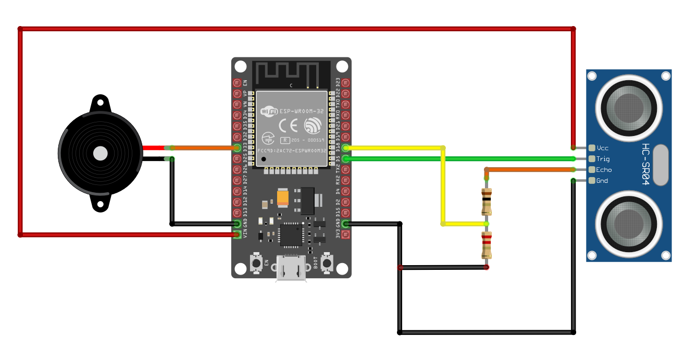

{{#title Сигнал тревоги с пищалкой и ультразвуковым датчиком на ESP32 и Rust}}

# Пищалка для обнаружения объектов: ESP32 и ультразвуковой датчик

В предыдущем упражнении мы использовали светодиод, который становился ярче по мере приближения объекта к ультразвуковому датчику. Теперь вместо светодиода мы используем активную пищалку. Она будет издавать звук по мере приближения объекта. Хотя с помощью ШИМ можно создавать разные звуки и тона, в этом проекте мы оставим всё простым: когда объект приближается к датчику, пищалка издаёт писк.

## Схема

Схема почти такая же, как раньше. Единственное отличие: нужно убрать светодиод и его резистор. Вместо них подключите пищалку к GPIO 33. Положительный вывод пищалки (обычно отмеченный знаком «плюс») подключаем к GPIO 33, а другой вывод — к земле.




### Создание проекта с помощью esp-generate

Этот шаг вы уже выполнили в разделе «Быстрый старт».

Чтобы создать проект, используйте команду `esp-generate`. Выполните:

```sh
esp-generate --chip esp32 ultrasonic-alert
```

Откроется экран с вопросом о выборе опций. Нестабильные или другие дополнительные функции нам не нужны, поэтому просто сохраните настройки, нажав на клавиатуре «s».


## Код

Мы настроим GPIO 33 как выходной вывод с начальным состоянием Low. Это то же, что и в коде для светодиода, меняется только имя переменной.

```rust
let mut buzzer = Output::new(peripherals.GPIO33, Level::Low, OutputConfig::default());
```

Таймер и настройки ШИМ, которые мы использовали для светодиода, здесь не нужны. Вместо этого мы переводим пищалку в High (она издаёт звук в состоянии High), если расстояние меньше 30 см; в противном случае она остаётся в Low.

```rust
if distance < 30.0 {
    buzzer.set_high();
} else {
    buzzer.set_low();
}
```

## Полный код

```rust
#![no_std]
#![no_main]
#![deny(
    clippy::mem_forget,
    reason = "mem::forget is generally not safe to do with esp_hal types, especially those \
    holding buffers for the duration of a data transfer."
)]

use esp_hal::clock::CpuClock;
use esp_hal::gpio::{Input, InputConfig, Level, Output, OutputConfig, Pull};
use esp_hal::main;
use esp_hal::time::{Duration, Instant};

#[panic_handler]
fn panic(_: &core::panic::PanicInfo) -> ! {
    loop {}
}

// Создаёт дескриптор приложения по умолчанию, который требуется загрузчику esp-idf.
// Подробнее см.: <https://docs.espressif.com/projects/esp-idf/en/stable/esp32/api-reference/system/app_image_format.html#application-description>
esp_bootloader_esp_idf::esp_app_desc!();

#[main]
fn main() -> ! {
    // generator version: 1.0.0

    let config = esp_hal::Config::default().with_cpu_clock(CpuClock::max());
    let peripherals = esp_hal::init(config);

    let mut buzzer = Output::new(peripherals.GPIO33, Level::Low, OutputConfig::default());

    // Для ультразвукового датчика HC-SR04
    let mut trig = Output::new(peripherals.GPIO5, Level::Low, OutputConfig::default());
    let echo = Input::new(
        peripherals.GPIO18,
        InputConfig::default().with_pull(Pull::Down),
    );

    loop {
        blocking_delay(Duration::from_millis(5));

        // Отправляем ультразвуковые волны
        trig.set_low();
        blocking_delay(Duration::from_micros(2));
        trig.set_high();
        blocking_delay(Duration::from_micros(10));
        trig.set_low();

        // Измеряем, как долго сигнал остаётся в высоком состоянии
        while echo.is_low() {}
        let time1 = Instant::now();
        while echo.is_high() {}
        let pulse_width = time1.elapsed().as_micros();

        // Вычисляем расстояние по ширине импульса
        let distance = (pulse_width as f64 * 0.0343) / 2.0;
        // esp_println::println!("Pulse Width: {}", pulse_width);
        // esp_println::println!("Distance: {}", distance);

        if distance < 30.0 {
            buzzer.set_high();
        } else {
            buzzer.set_low();
        }

        blocking_delay(Duration::from_millis(60));
    }
}

fn blocking_delay(duration: Duration) {
    let delay_start = Instant::now();
    while delay_start.elapsed() < duration {}
}
```


## Клонирование существующего проекта
Вы можете клонировать (или посмотреть) созданный мной проект и перейти в папку `ultrasonic-alert`.

```sh
git clone https://github.com/ImplFerris/esp32-projects
cd esp32-projects/ultrasonic-alert
``` 
