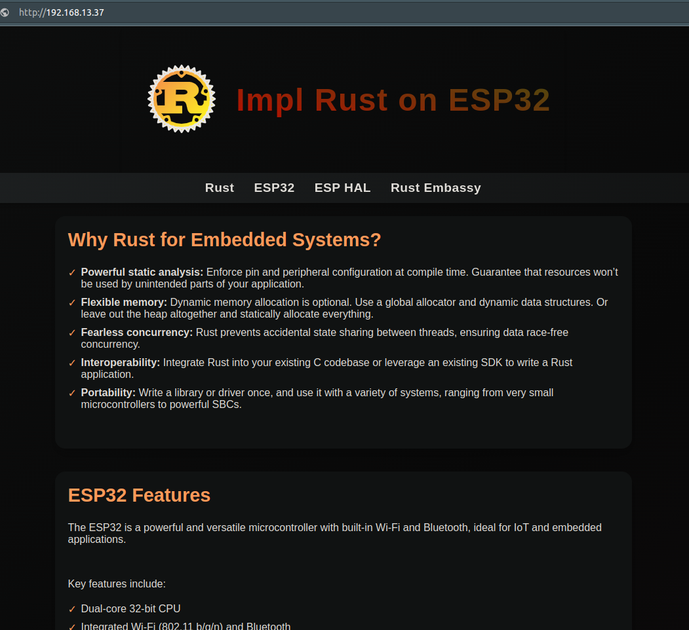
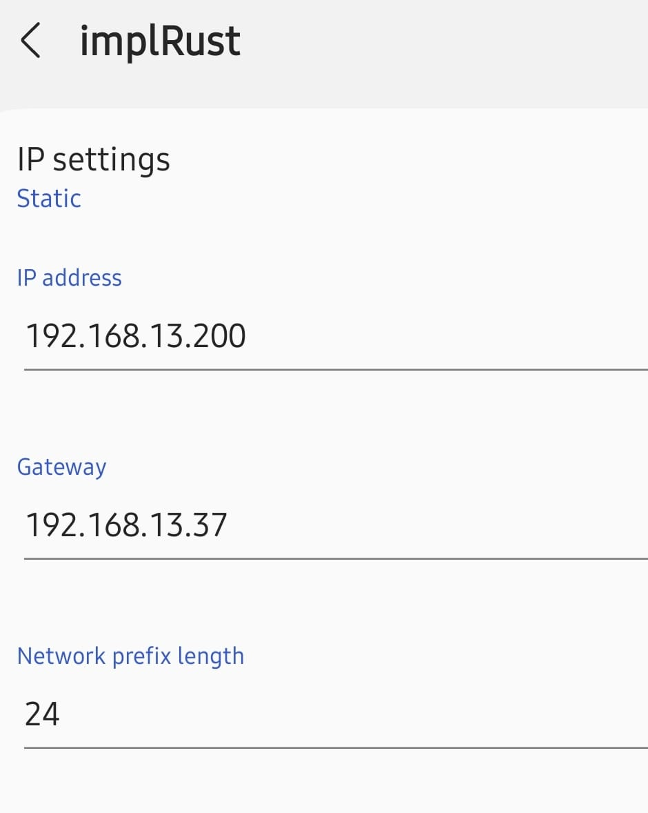
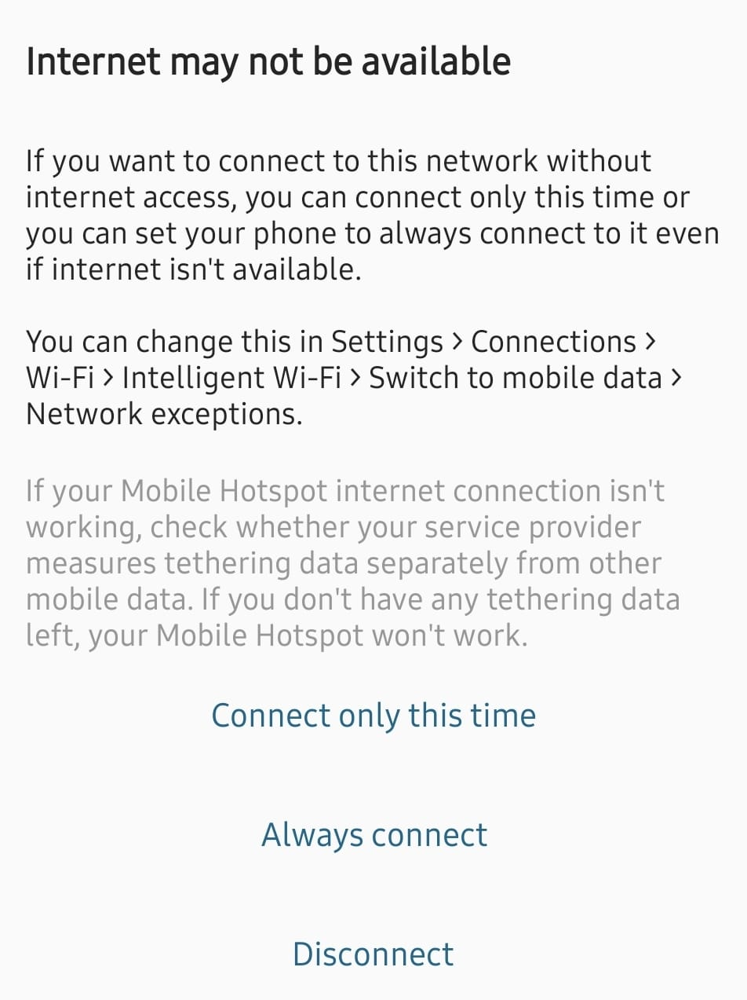

{{#title Как открыть веб-сервер ESP32 без роутера}}

# Как запустить?

Нужно передать переменные окружения для подключения к Wi-Fi.

Примечание: на этот раз нужно указать имя Wi-Fi и пароль для сети, которую мы создадим с помощью ESP32. Имя может быть любым, но не длиннее 32 символов. Пароль можно передать или пропустить, если вы закомментировали часть кода с паролем.

```sh
SSID=YOUR_WIFI_NAME PASSWORD=YOUR_WIFI_PASSWORD  cargo run --release
```

Когда прошивка будет загружена в ESP32, дождитесь, пока программа выведет IP-адрес и сообщение о запуске веб-сервера.

## Подключите компьютер к Wi-Fi ESP32

На нашем ESP32 не работает DHCP-сервер, поэтому устройства, которые подключаются к нашей Wi-Fi-сети, не получают IP-адрес автоматически. Поэтому при подключении нужно задать статический IP-адрес на самом устройстве. Как задать статический IP-адрес для Wi-Fi в вашей операционной системе, можно узнать в её документации и настроить соответствующим образом.

Убедитесь, что ваш компьютер подключён к созданной нами Wi-Fi-сети. Затем откройте веб-страницу в браузере по адресу «http://192.168.13.37/» (замените его на IP-адрес, который вы назначили).




## Подключите телефон к Wi-Fi ESP32

Чтобы подключить Android-телефон к Wi-Fi ESP32, выберите эту сеть и нажмите «Подробнее» (на разных моделях телефонов это может выглядеть по-разному), задайте статический IP-адрес и затем переподключитесь.



На Android может появиться сообщение вроде «Интернет может быть недоступен». В этом случае выберите вариант «Подключиться только в этот раз» или «Всегда подключаться». После подключения откройте веб-сервер, перейдя по адресу.


