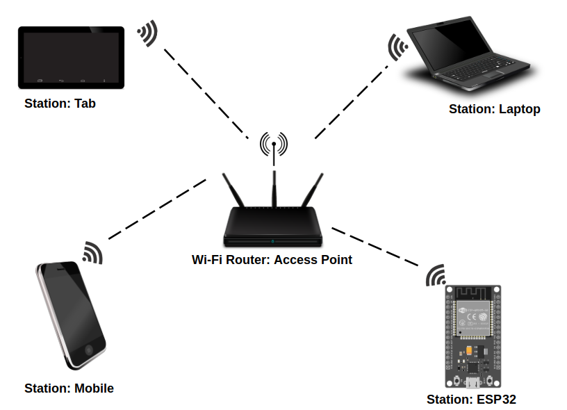
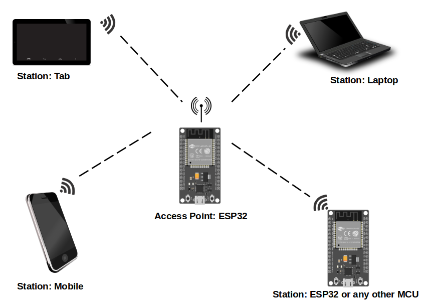

{{#title Программирование Wi-Fi на ESP32 на embedded Rust}}

# Wi-Fi

До сих пор мы не говорили об одной из главных сильных сторон чипа ESP32: его поддержке Wi-Fi. В этом разделе мы рассмотрим возможности Wi-Fi ESP32 и то, чего с его помощью можно добиться.

ESP32 поддерживает стандартные протоколы Wi-Fi (802.11 b/g/n) и может работать в двух режимах: режиме станции (Station, STA) и режиме программной точки доступа (Soft Access Point). Также он может работать в обоих режимах одновременно.

## Режим станции (STA)

В этом режиме ESP32 подключается к существующей сети Wi-Fi как клиент, так же как ваш смартфон или ноутбук подключается к Wi-Fi-роутеру. После подключения ESP32 может получить доступ к интернету или обмениваться данными с другими устройствами в той же сети.

## Режим точки доступа (AP)

В этом режиме ESP32 выступает как точка доступа Wi-Fi: он создаёт собственную сеть, к которой могут подключаться другие устройства. По сути, ESP32 работает как роутер, позволяя смартфонам, ноутбукам или другим микроконтроллерам (например, другому ESP32) напрямую обмениваться с ним данными.

