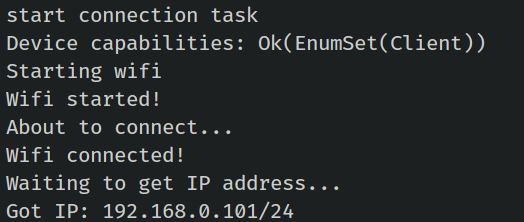

{{#title Отдача HTML-страниц с ESP32 на Rust с picoserve}}

# Веб-модуль: отдача веб-страницы

Типовой код для подключения Wi-Fi готов. Далее с помощью крейта picoserve настроим маршрут для корневого URL («/»), который будет отдавать нашу HTML-страницу.

## Функция `impl_trait_in_assoc_type`
Крейту picoserve нужна функция `impl_trait_in_assoc_type`, которая в Rust пока является нестабильной. Чтобы её включить, добавьте следующую строку в начало файла lib.rs (мы уже сделали это):
```rust
#![feature(impl_trait_in_assoc_type)]
```

## Приложение и маршрутизация

Крейт picoserve предоставляет различные трейты для настройки маршрутизации и других функций, нужных веб-приложению. Трейт `AppBuilder` используется для создания статического роутера без состояния, а трейт `AppWithStateBuilder` позволяет создать статический роутер с состоянием приложения. Поскольку наше приложение отдаёт только одну HTML-страницу и не требует состояния, реализуем трейт AppBuilder.  Больше примеров использования picoserve можно найти [здесь](https://github.com/sammhicks/picoserve/tree/development/examples).

```rust
pub struct Application;

impl AppBuilder for Application {
    type PathRouter = impl routing::PathRouter;

    fn build_app(self) -> picoserve::Router<Self::PathRouter> {
        picoserve::Router::new().route(
            "/",
            routing::get_service(File::html(include_str!("index.html"))),
        )
    }
}
```

Мы создали простую структуру, которая реализует трейт AppBuilder. Нужно указать тип PathRouter, и мы определяем его как любой тип, реализующий трейт routing::PathRouter.

Затем нужно реализовать функцию build_app, которая возвращает экземпляр Router. Мы настраиваем единственный маршрут для «/», который отдаёт статическую HTML-страницу. Содержимое HTML-страницы встраивается в приложение на этапе компиляции с помощью макроса include_str!("index.html").  Поместите файл «index.html» в папку «src/».


## Размер пула

Чтобы обрабатывать входящие запросы, нужно запустить несколько задач. Вскоре мы создадим функцию web_task (задачу Embassy) с размером пула, который задаётся константой, объявленной прямо сейчас. Затем запустим задачи в цикле на основе этого значения, которое определяет, сколько задач может работать одновременно.

```rust
pub const WEB_TASK_POOL_SIZE: usize = 2;
```

Мы задали размер пула 2. В примерах picoserve размер пула равен 8. Его можно увеличить, но имейте в виду, что тогда придётся соответствующим образом изменить и такие ресурсы, как сокеты и область памяти.


## Веб-приложение

Определим структуру WebApp, которая содержит экземпляр роутера picoserve и конфигурацию.

```rust
pub struct WebApp {
    pub router: &'static Router<<Application as AppBuilder>::PathRouter>,
    pub config: &'static picoserve::Config<Duration>,
}
```

Далее реализуем трейт Default для WebApp и инициализируем роутер picoserve, вызвав build_app. Также настроим таймауты сервера, которые ограничивают время выполнения операций: чтения запроса, ожидания чтения или ожидания записи ответа. Если какая-либо операция превышает таймаут, соединение будет закрыто.


```rust
impl Default for WebApp {
    fn default() -> Self {
        let router = picoserve::make_static!(AppRouter<Application>, Application.build_app());

        let config = picoserve::make_static!(
            picoserve::Config<Duration>,
            picoserve::Config::new(picoserve::Timeouts {
                start_read_request: Some(Duration::from_secs(5)),
                read_request: Some(Duration::from_secs(1)),
                write: Some(Duration::from_secs(1)),
                persistent_start_read_request: Some(Duration::from_secs(1)),
            })
            .keep_connection_alive()
        );

        Self { router, config }
    }
}
```
 
## Функция веб-задачи

Мы создали задачу Embassy и указали размер пула в атрибуте. Веб-сервер будет слушать порт 80. Для каждой задачи мы определяем буферы чтения и записи TCP, а также HTTP-буфер. Наконец, вызываем функцию listen_and_serve из picoserve для обработки входящих запросов.

```rust
#[embassy_executor::task(pool_size = WEB_TASK_POOL_SIZE)]
pub async fn web_task(
    task_id: usize,
    stack: Stack<'static>,
    router: &'static AppRouter<Application>,
    config: &'static picoserve::Config<Duration>,
) -> ! {
    let port = 80;
    let mut tcp_rx_buffer = [0; 1024];
    let mut tcp_tx_buffer = [0; 1024];
    let mut http_buffer = [0; 2048];

    picoserve::Server::new(router, config, &mut http_buffer)
        .listen_and_serve(task_id, stack, port, &mut tcp_rx_buffer, &mut tcp_tx_buffer)
        .await
        .into_never()
}
```


## Clone the existing project
You can also clone (or refer) project I created and navigate to the `webserver-html` folder.

```sh
git clone https://github.com/ImplFerris/esp32-projects
cd esp32-projects/webserver-html
```

### Как запустить?

В этом примере тоже нужно передать переменные окружения для подключения к Wi-Fi. Можно создать файл .env или передать их напрямую, как делаю я здесь.

```sh
SSID=YOUR_WIFI_NAME PASSWORD=YOUR_WIFI_PASSWORD  cargo run --release
```

Когда прошивка будет загружена в ESP32, в консоли должен появиться такой вывод с IP-адресом, который назначил ваш Wi-Fi-роутер.



Убедитесь, что ваш компьютер подключён к той же сети Wi-Fi.  Затем откройте веб-страницу в браузере по адресу «http://192.168.0.101/» (замените на полученный IP-адрес). 


