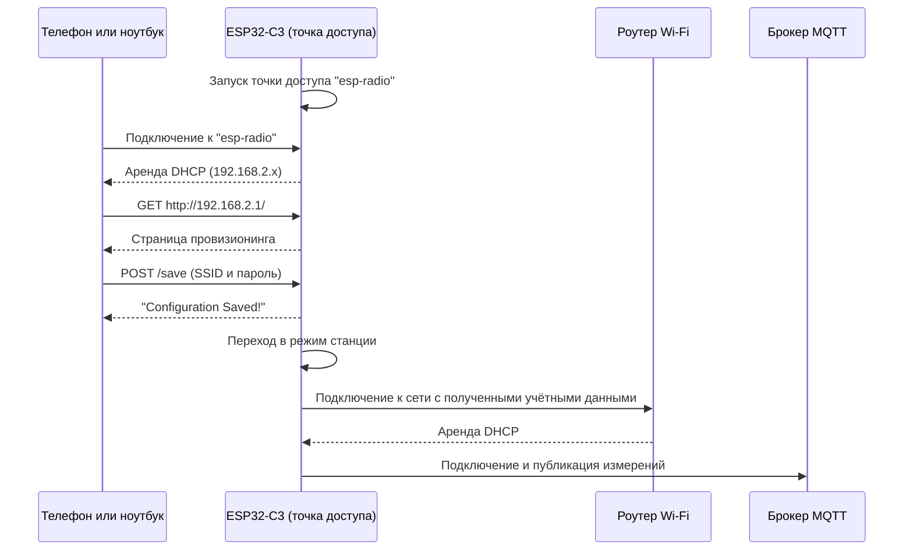

# Wi-Fi-провизионинг

В этой главе мы удаляем учётные данные Wi-Fi, известные на этапе компиляции. Вместо этого плата запускает собственную точку доступа и отдаёт небольшую веб-страницу, на которой вы вводите название сети и пароль. Как только учётные данные поступают, плата выходит из режима точки доступа, подключается к сети и, как и раньше, публикует данные датчика в брокер MQTT. Готовый код для этой главы находится в `project/part4/`.

Настройка I2C, куча и задача MQTT из главы [Публикация данных в брокер MQTT](./publishing-data.md) в основном остаются прежними. Задача MQTT теперь также публикует влажность в `measurement/humidity`. Основные изменения — второй сетевой стек, набор небольших серверов, работающих на устройстве, и канал, который передаёт учётные данные от веб-страницы к задаче подключения Wi-Fi.

## Что такое Wi-Fi-провизионинг?

До сих пор `SSID` и `PASSWORD` считывались с помощью `env!` и встраивались в прошивку. Это работает на рабочем столе разработчика, но не масштабируется на реальные устройства:

- Для каждой сети понадобится отдельная прошивка.
- Человек, который устанавливает устройство, обычно не может пересобрать и прошить прошивку.
- Смена роутера или пароля требует перепрошивки устройства.

**Wi-Fi-провизионинг** — это процесс передачи учётных данных сети ненастроенному устройству во время работы. Прошивка одинакова для всех устройств, а учётные данные пользователь вводит при первоначальной настройке.

Существует несколько способов передать учётные данные на устройство, но два самых распространённых:

- **Точка доступа (SoftAP)**: устройство создаёт собственную сеть Wi-Fi. Пользователь подключается к ней с телефона или ноутбука и вводит учётные данные либо на веб-странице, которую отдаёт устройство, либо в приложении-компаньоне.
- **Bluetooth Low Energy (BLE)**: устройство рассылает объявления по BLE, а приложение на телефоне передаёт учётные данные по соединению BLE. Радиомодулю Wi-Fi устройства никогда не нужно работать как точке доступа, а телефон во время настройки остаётся подключённым к собственной сети.

ESP-IDF поддерживает оба транспорта в своей [унифицированной платформе провизионинга][idf-provisioning], а Espressif предоставляет приложения-компаньоны для Android и iOS.

В этой главе мы используем подход с точкой доступа и веб-страницей. Для него пользователю нужен только браузер, а из стека Wi-Fi используется то, что у нас уже есть.

Процесс провизионинга выглядит так:



## Режимы станции и точки доступа

Радиомодуль Wi-Fi может выполнять две роли:

- В **режиме станции (STA)** устройство — клиент, который подключается к существующей сети. Именно так мы работали в предыдущих главах.
- В **режиме точки доступа (AP)** устройство *и есть* сеть. Другие устройства находят его SSID, подключаются к нему и взаимодействуют с ним напрямую.

Провизионингу нужны оба режима: режим AP — чтобы получить учётные данные, и режим STA — чтобы использовать их.

### Два интерфейса, два сетевых стека

[`esp_radio::wifi::new`][wifi-new] уже возвращает не только интерфейс станции. В этой главе мы используем оба интерфейса — точки доступа и станции — из [`Interfaces`][wifi-interfaces]:

```rust,ignore
{{#shiftinclude auto:../../project/part4/src/main.rs:wifi_interfaces}}
```

Каждый интерфейс — отдельное сетевое устройство, поэтому у каждого из них свой стек `embassy-net`:

```rust,ignore
{{#shiftinclude auto:../../project/part4/src/main.rs:network_stacks}}
```

Два стека настроены по-разному:

```rust,ignore
{{#shiftinclude auto:../../project/part4/src/network.rs:stack_configs}}
```

- **Стек станции** использует DHCP, как и раньше, потому что адрес назначает роутер.
- **Стек точки доступа** использует статический адрес. В собственной сети устройства нет роутера, поэтому никто не может выдать ему адрес. Устройство является шлюзом (gateway) подсети `/24` и использует адрес шлюза для себя.

Адрес шлюза по умолчанию — `192.168.2.1`, его можно переопределить на этапе компиляции через `GATEWAY_IP`:

```rust,ignore
{{#shiftinclude auto:../../project/part4/src/main.rs:gateway_ip}}
```

Стеку точки доступа также нужно больше сокетов, чем стеку станции, поскольку он размещает серверы DHCP, DNS и HTTP:

```rust,ignore
{{#shiftinclude auto:../../project/part4/src/network.rs:ap_stack}}
```

Стек станции сохраняет `StackResources<3>` из предыдущих глав. Оба стека по-прежнему нуждаются в `StaticCell` по тем же причинам, связанным с временем жизни `'static`, которые описаны в главе [Подключение к Wi-Fi](./wifi-connectivity.md#почему-ресурсы-стека-статические).

### Настройка контроллера

Интерфейсы передают только кадры. [`WifiController`][wifi-controller] определяет, какую роль играет радиомодуль, а задача `connection` запускает его в режиме точки доступа:

```rust,ignore
{{#shiftinclude auto:../../project/part4/src/network.rs:ap_mode}}
```

[`AccessPointConfig`][ap-config] по умолчанию задаёт открытую сеть на канале 1. Мы меняем только SSID на `esp-radio` — это сеть, к которой вы подключитесь с телефона или компьютера.

После получения учётных данных та же задача заменяет конфигурацию на [`StationConfig`][sta-config]:

```rust,ignore
{{#shiftinclude auto:../../project/part4/src/network.rs:station_mode}}
```

[`set_config`][set-config] перезапускает Wi-Fi в новом режиме, поэтому точка доступа исчезает, и страница провизионинга становится недоступна. Затем станция подключается и переподключается тем же циклом, что и в предыдущих главах.

> `esp-radio` также поддерживает одновременную работу обеих ролей через [`Config::AccessPointStation`][wifi-config]. Это позволило бы порталу оставаться активным, пока устройство пробует новые учётные данные, например чтобы сообщить пользователю о неверном пароле. Мы разделяем два этапа, чтобы пример оставался небольшим.

## Задачи и зачем они нужны

Теперь у приложения семь параллельных активностей. `main` инициализирует аппаратное обеспечение, создаёт общие ресурсы и запускает большинство задач:

```rust,ignore
{{#shiftinclude auto:../../project/part4/src/main.rs:spawn_tasks}}
```

| Задача               | Стек  | Назначение                                                                                  |
| -------------------- | ----- | ------------------------------------------------------------------------------------------- |
| `connection`         | —     | Владеет `WifiController`, запускает точку доступа, затем переключается в режим станции.     |
| `net_task`           | AP    | Опрашивает `Runner` стека точки доступа.                                                    |
| `sta_net_task`       | STA   | Опрашивает `Runner` стека станции.                                                          |
| `run_dhcp`           | AP    | Выдаёт IP-адреса клиентам, которые подключаются к точке доступа.                            |
| `run_captive_portal` | AP    | Отвечает на DNS-запросы адресом самого устройства.                                          |
| `run_http_server`    | AP    | Отдаёт страницу провизионинга и принимает учётные данные.                                    |
| `mqtt_task`          | STA   | Считывает датчик и публикует измерения, как в предыдущей главе.                             |

Каждая из этих задач — цикл, который никогда не завершается. Большую часть времени они ждут пакета, соединения или сообщения. Поскольку это отдельные задачи Embassy, исполнитель запускает ту, у которой есть работа, а ожидающие задачи ничего не стоят. Один последовательный `main` не смог бы одновременно ждать HTTP-запрос, отвечать на DHCP и опрашивать два сетевых стека.

### Две задачи-раннера

Каждый стек `embassy-net` требует, чтобы его `Runner` непрерывно опрашивался, поэтому нам нужна одна задача-раннер на каждый стек:

```rust,ignore
{{#include ../../project/part4/src/network.rs:runner_tasks}}
```

Две функции идентичны. Они существуют отдельно, потому что у функции, помеченной [`#[embassy_executor::task]`][embassy-task], есть пул задач фиксированного размера, выделенный статически, и его размер по умолчанию равен единице. Повторный запуск `net_task` привёл бы к ошибке. Альтернатива — `#[embassy_executor::task(pool_size = 2)]`, но две именованные задачи яснее показывают, какой раннер относится к какому стеку.

### Серверы на точке доступа

Телефон, который подключается к `esp-radio`, ожидает те же службы, что предоставляет обычный роутер. Задачи провизионинга предоставляют минимальный набор с помощью крейтов из семейства [`edge-net`][edge-net], которые работают поверх `embassy-net` через [`edge-nal-embassy`][edge-nal-embassy].

`run_dhcp` использует [`edge-dhcp`][edge-dhcp], чтобы назначать адреса клиентам. Без него пользователю пришлось бы вручную настраивать статический IP-адрес, прежде чем открыть страницу:

```rust,ignore
{{#shiftinclude auto:../../project/part4/src/http.rs:dhcp_server}}
```

`run_captive_portal` использует [`edge-captive`][edge-captive] — DNS-сервер, который отвечает на каждый запрос адресом шлюза. Его цель — чтобы любое имя хоста вело на страницу провизионинга:

```rust,ignore
{{#shiftinclude auto:../../project/part4/src/http.rs:captive_dns}}
```

`run_http_server` использует [`edge-http`][edge-http], чтобы отдавать страницу провизионинга на порту 80:

```rust,ignore
{{#shiftinclude auto:../../project/part4/src/http.rs:http_server}}
```

`main` запускает HTTP-сервер только после того, как стек точки доступа поднят и настроен, а затем выводит в лог инструкции по подключению к порталу:

```rust,ignore
{{#shiftinclude auto:../../project/part4/src/main.rs:portal_ready}}
```

Задача `mqtt_task` запускается сразу, но пока ничего полезного не делает. Её первый шаг — `stack.wait_link_up()` на стеке станции, поэтому она ждёт, пока провизионинг не завершится и станция не подключится к сети.

### Captive-порталы

Когда телефон или ноутбук подключается к новой сети, операционная система запрашивает известный URL, например `/generate_204` на Android или `/connecttest.txt` в Windows, чтобы проверить доступ в Интернет. Публичные точки доступа используют эту проверку, чтобы автоматически открыть страницу входа. Такой механизм называется **captive-портал**.

Обработчик HTTP перенаправляет такие пробные URL на страницу провизионинга:

```rust,ignore
{{#shiftinclude auto:../../project/part4/src/http.rs:captive_paths}}
```

Чтобы операционная система отправила свой запрос на устройство, клиент должен использовать устройство в качестве DNS-сервера. В этом проекте DNS-ответчик слушает UDP-порт `8853`, а клиенты отправляют DNS-запросы на стандартный порт `53`, и DHCP-сервер не сообщает адрес DNS-сервера. В результате страница провизионинга не открывается автоматически: вы открываете её сами по адресу `http://192.168.2.1/`.

### Передача учётных данных между задачами

HTTP-сервер получает учётные данные, но `WifiController` принадлежит задаче `connection`. Эти две задачи обмениваются данными через [`Channel` из `embassy-sync`][embassy-channel]:

```rust,ignore
{{#shiftinclude auto:../../project/part4/src/main.rs:credentials_channel}}
```

Канал имеет ёмкость в одно сообщение, поскольку нам нужен только один набор учётных данных. Он использует `CriticalSectionRawMutex`, который безопасно разделять между задачами и прерываниями. Как и ресурсы стека, он хранится в `StaticCell`, чтобы обе задачи могли держать ссылку `&'static`.

Тип сообщения — небольшая структура:

```rust,ignore
{{#include ../../project/part4/src/network.rs:wifi_credentials}}
```

Поля — строки [`heapless::String`][heapless-string] фиксированной ёмкости, размер которых соответствует ограничениям Wi-Fi: SSID — не более 32 байт, а парольная фраза WPA2 — не более 63 символов или 64 шестнадцатеричных цифр. Деривация `Deserialize` позволяет обработчику HTTP создать структуру напрямую из тела JSON-запроса. Фича `serde` в `heapless` делает это возможным.

Задача `connection` ожидает на приёмном конце:

```rust,ignore
{{#shiftinclude auto:../../project/part4/src/network.rs:receive_credentials}}
```

`receive().await` приостанавливает задачу до прихода сообщения, не опрашивая канал. Двухсекундная задержка даёт HTTP-серверу время отправить страницу подтверждения до того, как точка доступа выключится.

## Отдача страницы провизионинга

Обработчик HTTP сопоставляет метод запроса и путь. `GET /` возвращает страницу провизионинга:

```rust,ignore
{{#shiftinclude auto:../../project/part4/src/http.rs:home_route}}
```

`GET /saved` возвращает страницу подтверждения аналогичным образом. Любой другой путь возвращает `404 Not Found`.

Форма отправляет учётные данные в формате JSON на `POST /save`:

```rust,ignore
{{#shiftinclude auto:../../project/part4/src/http.rs:save_route}}
```

Обработчик считывает тело запроса в буфер на 256 байт и разбирает его с помощью [`serde-json-core`][serde-json-core] — парсера JSON для `no_std`, который ничего не выделяет в куче. Если разбор успешен, учётные данные отправляются через канал, а обработчик отвечает страницей подтверждения. Если тело пустое или не является корректным JSON, обработчик отвечает `400 Bad Request`.

> Обработчик записывает полученный пароль в лог на уровне `debug`. При изучении это полезно, но реальный продукт никогда не должен записывать секреты в лог.

## HTML-шаблоны

Две страницы находятся в `project/part4/assets/templates/`:

- `home.html` — форма провизионинга с полями SSID и пароля.
- `saved.html` — страница подтверждения, которая показывается после отправки учётных данных.

На устройстве нет файловой системы. Вместо этого [`include_str!`][include-str] встраивает оба файла в прошивку во время компиляции:

```rust,ignore
{{#include ../../project/part4/src/http.rs:templates}}
```

`CARGO_MANIFEST_DIR` — это каталог, содержащий `Cargo.toml`, поэтому пути не зависят от каталога, из которого вы запускаете Cargo. Страницы становятся константами `&'static str`, которые хранятся во флеш-памяти, а обработчик записывает их байты напрямую в TCP-соединение.

При редактировании страниц учитывайте несколько моментов:

- Несмотря на название каталога, страницы не обрабатываются шаблонизатором. Они отдаются точно в том виде, в котором написаны.
- Изменения требуют пересборки и повторной прошивки, потому что HTML входит в образ прошивки.
- `home.html` выводит `esp-radio` и `192.168.2.1` как обычный текст. Если вы измените SSID точки доступа или `GATEWAY_IP`, обновите страницу тоже.
- Форма использует небольшой вызов `fetch` на JavaScript, чтобы отправить JSON, а не стандартную кодировку формы браузера. Именно это позволяет прошивке разобрать тело с помощью `serde-json-core` в `WifiCredentials`. При успехе скрипт переходит на `/saved`.
- Каждый байт HTML и CSS увеличивает размер прошивки. Встроенные стили и отсутствие внешних ресурсов делают страницы самодостаточными, что важно, потому что во время подключения к точке доступа у клиента нет доступа в Интернет.

## Запуск приложения

Запустите брокер MQTT из корня репозитория:

```shell
cargo xtask mqtt-server
```

В другом терминале перейдите в `project/part4/` и прошейте приложение. `SSID` и `PASSWORD` больше не нужны:

```shell
HOST_IP="your-ip" cargo run --release
```

Замените `your-ip` на IP-адрес хоста, который вывела команда `cargo xtask mqtt-server`. `BROKER_PORT` работает так же, как в предыдущей главе, а `GATEWAY_IP` меняет адрес портала провизионинга.

После загрузки в мониторе последовательного порта отображаются инструкции по порталу:

```text
INFO - WiFi AP started!
INFO - Starting Captive Portal DNS server on port 8853
INFO - WiFi Provisioning Portal Ready
INFO - 1. Connect to the AP: `esp-radio`
INFO - 2. Navigate to: http://192.168.2.1/
INFO - Starting HTTP server on port 80
```

Затем выполните провизионинг устройства:

1. На телефоне или компьютере подключитесь к открытой сети Wi-Fi `esp-radio`.
2. Откройте `http://192.168.2.1/` в браузере. Используйте `http://`, а не `https://`.
3. Введите SSID и пароль сети, в которой доступен брокер MQTT, и нажмите **Save Configuration**.
4. Переподключите телефон или компьютер к обычной сети. Сеть `esp-radio` исчезнет, как только устройство переключится в режим станции.

Монитор последовательного порта показывает переход в режим станции, затем подключение к MQTT и показания датчика:

```text
INFO - Credentials received! SSID: your-ssid
INFO - Connecting to WiFi network...
INFO - Successfully connected to WiFi!
INFO - connecting to MQTT broker at 192.168.1.10:1884...
INFO - connected!
INFO -   24.31 °C | 42.18 %RH
```

Терминал брокера теперь выводит оба топика:

```text
Topic: measurement/temperature | Payload: 24.31
Topic: measurement/humidity | Payload: 42.18
```

Если пароль неверный, задача `connection` продолжает повторять попытки каждые пять секунд. Сбросьте плату, чтобы снова запустить портал провизионинга.

## Ограничения

Этот пример показывает основу Wi-Fi-провизионинга, но не включает несколько вещей, которые понадобились бы продукту:

- **Учётные данные не сохраняются.** Они существуют только в RAM, поэтому после каждого сброса портал провизионинга запускается заново. Реальное устройство сохраняло бы их во флеш-памяти и запускало портал, только если сохранённых действительных учётных данных нет.
- **Точка доступа открыта.** Любой поблизости может подключиться к ней и отправить учётные данные, а пароль передаётся по обычному HTTP. Защитить точку доступа паролем WPA2 или использовать протокол провизионинга с собственным шифрованием, например схемы безопасности из компонента provisioning в ESP-IDF, — способы решить эту проблему.
- **Нет обратной связи при ошибке.** Точка доступа уже пропадает к моменту, когда устройство пробует учётные данные, поэтому пользователь не видит на странице сообщение об ошибке подключения.

На этом этапе устройству больше не нужны учётные данные на этапе компиляции: одна и та же прошивка может подключиться к любой сети. В следующей главе мы рассмотрим обновление прошивки в полевых условиях с помощью [обновлений по воздуху (OTA)](./ota-updates.md).

[idf-provisioning]: https://docs.espressif.com/projects/esp-idf/en/latest/esp32c3/api-reference/provisioning/provisioning.html
<!-- TODO: Use /latest/ when new docs are redeployed -->
[wifi-new]: https://docs.espressif.com/projects/rust/esp-radio/0.18.0/esp32c3/esp_radio/wifi/fn.new.html
[wifi-interfaces]: https://docs.espressif.com/projects/rust/esp-radio/0.18.0/esp32c3/esp_radio/wifi/struct.Interfaces.html
[wifi-controller]: https://docs.espressif.com/projects/rust/esp-radio/0.18.0/esp32c3/esp_radio/wifi/struct.WifiController.html
[wifi-config]: https://docs.espressif.com/projects/rust/esp-radio/0.18.0/esp32c3/esp_radio/wifi/enum.Config.html
[set-config]: https://docs.espressif.com/projects/rust/esp-radio/0.18.0/esp32c3/esp_radio/wifi/struct.WifiController.html#method.set_config
[ap-config]: https://docs.espressif.com/projects/rust/esp-radio/0.18.0/esp32c3/esp_radio/wifi/ap/struct.AccessPointConfig.html
[sta-config]: https://docs.espressif.com/projects/rust/esp-radio/0.18.0/esp32c3/esp_radio/wifi/sta/struct.StationConfig.html
[embassy-task]: https://docs.rs/embassy-executor/0.10.0/embassy_executor/attr.task.html
[embassy-channel]: https://docs.rs/embassy-sync/0.8.0/embassy_sync/channel/struct.Channel.html
[edge-net]: https://github.com/sysgrok/edge-net
[edge-nal-embassy]: https://docs.rs/edge-nal-embassy/0.8.1/edge_nal_embassy/
[edge-dhcp]: https://docs.rs/edge-dhcp/0.7.0/edge_dhcp/
[edge-captive]: https://docs.rs/edge-captive/0.7.0/edge_captive/
[edge-http]: https://docs.rs/edge-http/0.7.0/edge_http/
[heapless-string]: https://docs.rs/heapless/0.9.3/heapless/string/type.String.html
[serde-json-core]: https://docs.rs/serde-json-core/0.6.0/serde_json_core/
[include-str]: https://doc.rust-lang.org/core/macro.include_str.html
