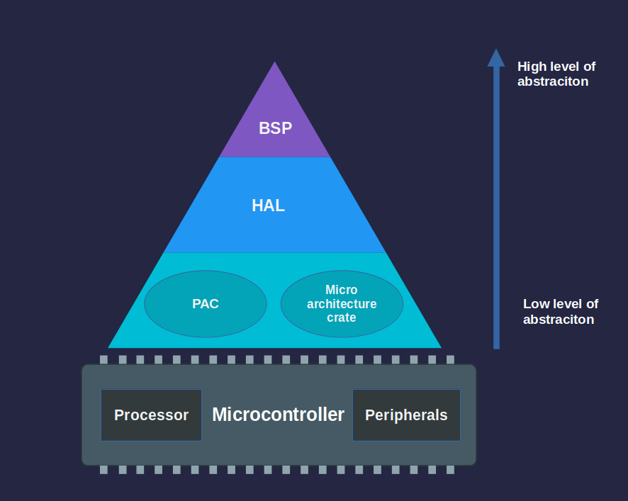

{{#title Уровни абстракции в embedded Rust: PAC, HAL, BSP | impl Rust для RP2350}}

# Уровни абстракции

Работая с embedded Rust, вы часто будете встречать термины PAC, HAL и BSP. Это различные уровни, через которые вы взаимодействуете с оборудованием. Каждый уровень даёт свой баланс между гибкостью и простотой использования.

Начнём с самого высокого уровня абстракции и спустимся к самому низкому.

## Пакет поддержки платы (BSP)

BSP, в Rust также называемый Board Support Crate, — это пакет, созданный под конкретные отладочные платы. Он объединяет HAL с настройками, специфичными для платы, и предоставляет готовые интерфейсы для встроенных компонентов, таких как светодиоды, кнопки и датчики. Это позволяет разработчикам сосредоточиться на логике приложения, а не на низкоуровневых деталях оборудования. Поскольку популярного BSP именно для Raspberry Pi Pico 2 нет, в этой книге мы не будем использовать этот подход.

---

## Уровень абстракции оборудования (HAL)

HAL находится непосредственно под уровнем BSP. Если вы работаете с платами Raspberry Pi Pico или платами на базе ESP32, в основном вы будете использовать именно HAL. HAL обычно пишут под конкретный чип (например, RP2350 или ESP32), а не под отдельные платы, поэтому один и тот же HAL подходит для разных плат с одним и тем же микроконтроллером. Для семейства микроконтроллеров Raspberry Pi существует крейт [rp-hal](https://github.com/rp-rs/rp-hal), который предоставляет эту абстракцию.

HAL построен поверх PAC и предоставляет более простые интерфейсы высокого уровня для периферии микроконтроллера. Вместо работы с регистрами напрямую HAL предлагает методы и трейты, которые упрощают настройку таймеров, организацию последовательной связи или управление выводами GPIO.

HAL для микроконтроллеров обычно реализуют трейты `embedded-hal` — стандартные платформонезависимые интерфейсы для периферии, такой как GPIO, SPI, I2C и UART. Благодаря этому драйверы и библиотеки можно писать так, чтобы они работали на разном оборудовании, если используют совместимый HAL.

### Embassy для RP

Embassy находится на том же уровне, что и HAL, но дополнительно предоставляет среду выполнения с поддержкой асинхронности. Embassy (а точнее, embassy-rp для Raspberry Pi Pico) построен поверх уровня HAL и предоставляет асинхронный исполнитель, таймеры и дополнительные абстракции, которые упрощают написание параллельных embedded-приложений.

Embassy предоставляет отдельный крейт `embassy-rp` для микроконтроллеров Raspberry Pi (RP2040 и RP235x). Этот крейт напрямую опирается на rp-pac (Raspberry Pi Peripheral Access Crate).

В этой книге мы будем использовать и rp-hal, и embassy-rp в разных упражнениях.

---

> [!NOTE]
> Уровни ниже HAL редко используются напрямую. В большинстве случаев PAC доступен через HAL, а не сам по себе. Если только вы не работаете с чипом, для которого нет HAL, обычно нет необходимости взаимодействовать с нижними уровнями напрямую. В этой книге мы сосредоточимся на уровне HAL.

## Крейт доступа к периферии (PAC)

PAC — самый низкий уровень абстракции. Это автоматически сгенерированные крейты, которые обеспечивают типобезопасный доступ к периферии микроконтроллера. Обычно их генерируют из SVD-файла (System View Description), который предоставляет производитель, с помощью инструментов вроде `svd2rust`. PAC дают структурированный и безопасный способ работать с регистрами оборудования напрямую.

## Raw MMIO

Raw MMIO (memory-mapped IO, ввод-вывод, отображаемый в память) означает прямую работу с регистрами оборудования через чтение и запись по конкретным адресам памяти. Такой подход повторяет традиционную манипуляцию регистрами в стиле C и требует использования блоков `unsafe` в Rust из-за потенциальных рисков. Мы не будем касаться этой области: я ни разу не видел, чтобы кто-то использовал этот подход.
