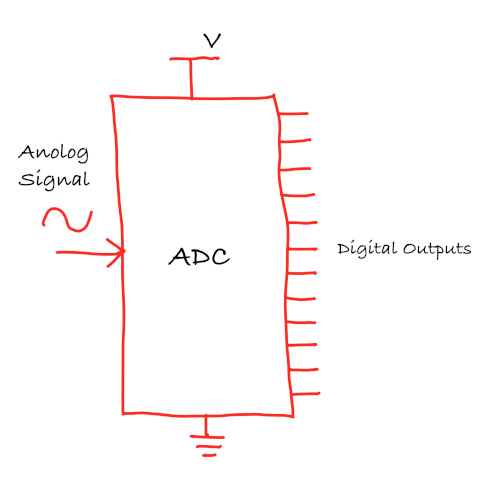

# АЦП (Analog to Digital Converter)

Надеюсь, вы уже знакомы с понятием аналоговых и цифровых сигналов. Окружающий мир в основном аналоговый: температура плавно растёт и падает, сила света меняется постепенно, звук распространяется в воздухе волнами, а датчики выдают напряжения, которые меняются непрерывно.

Однако микроконтроллеры понимают только дискретные значения. Внутри всё представлено двоичными числами — единицами и нулями, HIGH и LOW. Так возникает базовый разрыв между реальным миром и цифровой логикой. Как цифровая система может понять то, что меняется плавно?

Здесь на помощь приходит аналого-цифровой преобразователь (АЦП, ADC — Analog to Digital Converter). АЦП измеряет аналоговое напряжение и превращает его в цифровое число, которое микроконтроллер может обработать, сохранить и использовать для принятия решений.

Возможно, вы помните из главы о ШИМ, что цифровая система может создать аналогоподобный выход, быстро включая и выключая вывод. АЦП делает обратное: он позволяет микроконтроллеру считывать аналоговые входные сигналы из реального мира и понимать их. Вместе такие периферийные блоки, как ШИМ и АЦП, позволяют встраиваемым системам и ощущать окружающую среду, и управлять ею.

Рассмотрим простой пример — систему контроля температуры. Датчик температуры выдаёт напряжение, которое зависит от температуры, например 0 В при 0 °C и 3,3 В при 100 °C. Без АЦП этот плавный сигнал ничего не значил бы для микроконтроллера. АЦП через равные промежутки времени измеряет напряжение и превращает каждое измерение в цифровое значение. Ваш код может считать это значение, интерпретировать его как температуру и соответствующим образом отреагировать.



## Разрешение АЦП

Одна из важнейших характеристик АЦП — его разрешение, которое определяет, насколько мелко он может разбить диапазон аналогового входа на дискретные цифровые значения. Разрешение обычно выражают в битах: например, 8-битный, 10-битный или 12-битный. Количество битов определяет, сколько различных значений может выдать АЦП.

8-битный АЦП делит диапазон входного напряжения на 256 уровней (2<sup>8</sup>). 10-битный даёт 1 024 уровня (2<sup>10</sup>), а 12-битный — 4 096 уровней (2<sup>12</sup>). Как видите, каждый дополнительный бит удваивает число уровней и заметно повышает точность. Чем больше битов у АЦП, тем меньшую разницу напряжений он способен различить.

### Пример

Разберём это на примере. Допустим, вы используете 10-битный АЦП с опорным напряжением 3,3 В. АЦП будет представлять напряжения от 0 В до 3,3 В цифровыми значениями от 0 до 1 023.

Наименьшее изменение напряжения, которое может обнаружить АЦП (его называют шагом квантования), вычисляется так:

\\[
\text{Step Size} = \frac{\text{Vref}}{2^{\text{bits}}}
\\]

```text
Шаг = 3,3 В / 1 024 = 3,22 мВ
```

Это значит, что АЦП не может отличить два напряжения, которые ближе друг к другу, чем примерно на 3,22 мВ. Например, если выход датчика меняется с 1,500 В до 1,502 В, АЦП, скорее всего, выдаст одно и то же цифровое значение для обоих.

Сравните с 12-битным АЦП с тем же опорным напряжением 3,3 В:

```text
Шаг = 3,3 В / 4 096 = 0,81 мВ
```

12-битный преобразователь даёт заметно более тонкую точность, что может быть критично в приложениях, где нужны точные измерения.

## Формула АЦП

Концептуально АЦП превращает входное напряжение в цифровое число по следующей зависимости:

\\[
ADC = \frac{V_{in}}{V_{ref}} \times 2^{\text{bits}}
\\]

Где:
- \\(V_{in}\\) — входное напряжение
- \\(V_{ref}\\) — опорное напряжение

## Преобразование значений АЦП в напряжение

Когда вы читаете АЦП в коде, он возвращает сырое цифровое значение от 0 до 4095 (для 12-битного АЦП). Это число показывает, где измеренное напряжение находится в диапазоне от 0 В до 3,3 В. Чтобы превратить сырое значение обратно в реальное напряжение, нужен простой расчёт.

Формула преобразования:

\\[
\text{Voltage} = \frac{\text{ADC Reading} \times \text{Reference Voltage}}{2^{\text{bits}}}
\\]

Для RP2350 с его 12-битным АЦП и опорным напряжением 3,3 В:

\\[
\text{Voltage} = \frac{\text{ADC Reading} \times 3.3}{4096}
\\]

### Пример

Допустим, мы получили показание АЦП, равное 1000.

```text
Voltage = (1000 × 3.3) / 4096 = 0.806 V
```

## Ссылки

- [Что такое аналого-цифровой преобразователь и как он работает](https://www.elprocus.com/analog-to-digital-converter/)
