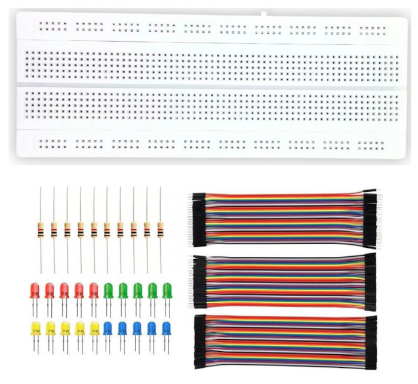

{{#title Дополнительное оборудование для проектов на Raspberry Pi Pico 2 | impl Rust для RP2350}}

# Дополнительное оборудование

В этом разделе мы рассмотрим дополнительное оборудование, которое можно использовать вместе с Raspberry Pi Pico.

## Наборы электроники

Можно начать с базового набора для электроники или покупать компоненты по мере необходимости. Для начала достаточно простого недорогого набора, если в нём есть резисторы, перемычки и макетная плата. Они понадобятся на протяжении всех уроков.

    
    
Базовый набор для электроники

Другие компоненты, которые используются в книге: светодиоды, ультразвуковой датчик HC-SR04, активные и пассивные пищалки, микросервопривод SG90, фоторезистор LDR, NTC-термистор, RFID-считыватель RC522, адаптер для micro SD-карты, дисплей HD44780 и модуль джойстика.

## Дополнительное оборудование: отладочный зонд

Отладочный зонд Raspberry Pi Debug Probe значительно упрощает прошивку Pico 2. Без него нужно каждый раз нажимать кнопку BOOTSEL, чтобы загрузить новую прошивку. Кроме того, зонд обеспечивает полноценную отладку, что очень полезно.

Этот инструмент необязателен. Вы можете пройти всю книгу без него (кроме глав, которые относятся именно к отладочному зонду). Когда я только начинал работать с Pico, я обходился без зонда и купил его позже.

    
    
Отладочный зонд Raspberry Pi Pico

### Стоит ли покупать?

Если бюджет ограничен, можно пока обойтись без него: зонд стоит примерно вдвое дороже Pico 2. Если цена не главный фактор, это хорошая покупка, которая очень пригодится. Также можно использовать другую Pico как недорогой отладочный зонд, если у вас есть вторая плата.
