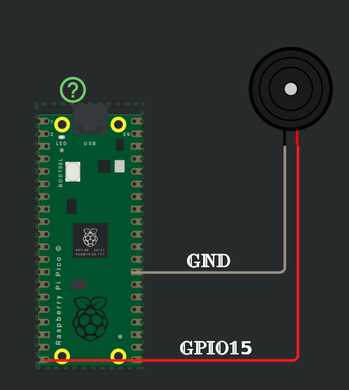

# Подключение пищалки к Raspberry Pi Pico

Подключим GPIO 15 к положительному (сигнальному) выводу пищалки, а GND Pico — к земляному выводу пищалки. При необходимости можно использовать другой вывод GPIO.

<table style="margin-bottom:20px">
  <thead>
    <tr>
      <th>Вывод Pico</th>
      <th style="width: 250px; margin: 0 auto;">Провод</th>
      <th>Вывод пищалки</th>
      <th>Примечания</th>
    </tr>
  </thead>
  <tbody>
    <tr>
      <td>GPIO 15</td>
      <td style="text-align: center; vertical-align: middle; padding: 0;">
        

          

          

        

      </td>
      <td>Положительный вывод</td>
      <td>Получает сигналы ШИМ для создания звука.</td>
    </tr>
    <tr>
      <td>GND</td>
      <td style="text-align: center; vertical-align: middle; padding: 0;">
        

          

          

        

      </td>
      <td>Земляной вывод</td>
      <td>Подключается к земле.</td>
    </tr>
  </tbody>
</table>

