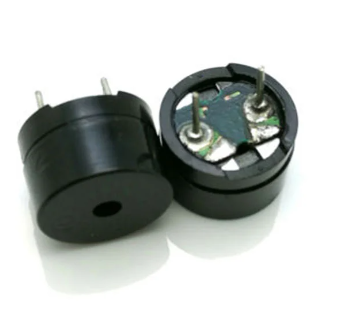

{{#title Основы зуммера для Raspberry Pi Pico 2 | impl Rust для RP2350}}

# Buzzinga

В этом разделе мы рассмотрим несколько интересных занятий с использованием зуммера. Название Buzzinga я выбрал просто ради шутки (это игра слов с «Bazinga» — фразой Шелдона из сериала «Теория большого взрыва»). Это не технический термин.

## Что такое зуммер?

Зуммер — небольшой электронный компонент, который издаёт звук, когда на него подают питание или управляющий электрический сигнал. Его используют для генерации сигналов, оповещений или простых мелодий, обеспечивая звуковую обратную связь в электронных устройствах.

Зуммеры часто встречаются в будильниках, таймерах, системах уведомлений, компьютерах и простых пользовательских интерфейсах, где они подтверждают действия пользователя или сигнализируют о событиях.

## Распространённые типы зуммеров

В embedded-проектах вы чаще всего будете встречать два типа:

### Активный зуммер

Внутри такого зуммера есть встроенный генератор. Нужно только подать питание, и он сразу начнёт издавать звук. Активные зуммеры очень просты в использовании, но позволяют мало управлять высотой тона.

#### Как определить

Активный зуммер обычно имеет белое покрытие сверху и гладкий чёрный корпус снизу. Проще всего его проверить, подключив напрямую к батарейке: если он издаёт звук без дополнительных схем, это активный зуммер.

### Пассивный зуммер

Пассивный зуммер сам по себе звука не издаёт. Его нужно управлять сигналом ШИМ или меандром (прямоугольными импульсами). Это позволяет задавать частоту, а значит, получать разные тона или даже простые мелодии.

#### Как определить

У пассивного зуммера обычно нет белого покрытия сверху, и часто он выглядит как маленькая печатная плата с синим или зелёным основанием. Если подключить его напрямую к батарейке, звука не будет.

## Какой выбрать?

Выбирайте активный зуммер, если нужен простой фиксированный тон или сигнал. Он подходит для базовых оповещений, будильников или подтверждения действий пользователя и требует минимальной настройки.

Выбирайте пассивный зуммер, если хотите больше контроля над звуком. Поскольку им нужно управлять сигналом ШИМ или меандром, можно получать разные тоны, мелодии и звуковые узоры.

Для наших упражнений рекомендуется пассивный зуммер, потому что он позволяет напрямую задавать частоту выходного сигнала и получить более качественный тон. Однако если у вас есть только активный зуммер, можно всё равно следовать книге. Я сам сначала использовал именно активный.

## Требования к оборудованию

- Пассивный зуммер
- Перемычки

У зуммера обычно два вывода: положительный (для сигнала) и земляной. Положительный вывод часто помечен знаком «+» и, как правило, длиннее, а отрицательный — короче, как у светодиода.

Однако некоторые пассивные зуммеры не имеют полярности. В этом случае любой из выводов можно подключить к сигналу или к земле. Если не уверены, проверьте маркировку или даташит.

## Ссылка

- [Официальное руководство Raspberry Pi по зуммеру](https://projects.raspberrypi.org/en/projects/introduction-to-the-pico/9)
