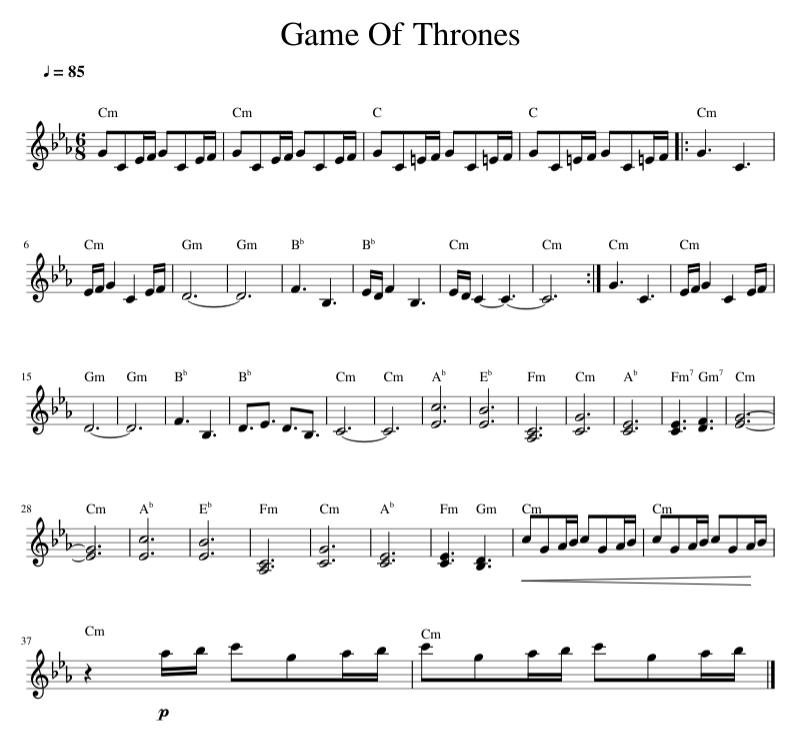

## Введение в ноты и нотное письмо

Это краткое руководство по нотам и нотному письму. Оно не охватывает всего, но даёт быстрый справочник по ключевым понятиям.

### Нотный лист

Ноты для мелодии записаны на следующем нотном листе. Подробности можно посмотреть по [ссылке на MuseScore](https://musescore.com/user/8407786/scores/2156716).

В музыке длительность нот обозначается следующими типами, которые определяют, как долго звучит каждая нота:

- **Целая нота**: самая длинная длительность, звучит 4 доли.
- **Половинная нота**: звучит 2 доли.
- **Четвертная нота**: звучит 1 долю.
- **Восьмая нота**: звучит половину доли, то есть 1/8 длительности целой ноты.
- **Шестнадцатая нота**: звучит четверть доли, то есть 1/16 длительности целой ноты.

### Нота с точкой

Нота с точкой — это нота, рядом с которой стоит точка. Точка увеличивает длительность ноты на половину её исходного значения. Например:

- **Половинная нота с точкой**: звучит 3 доли (2 + 1).
- **Четвертная нота с точкой**: звучит 1,5 доли (1 + 0,5).

### Темп и BPM (ударов в минуту)

Темп — это скорость, с которой исполняется музыкальное произведение. Обычно его измеряют в **ударах в минуту** (BPM, beats per minute), то есть в том, сколько долей проходит за одну минуту.
