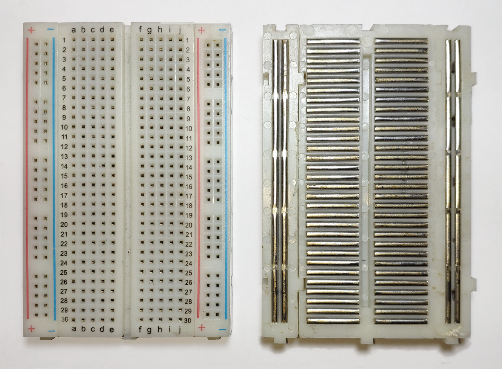

{{#title Основы макетной платы и внутренние соединения | impl Rust для RP2350}}

# Макетная плата

Макетная плата — небольшая плата, которая помогает собирать схемы без пайки. На ней много отверстий, в которые можно вставлять провода и электронные детали. Внутри платы металлические полоски соединяют некоторые из этих отверстий. Это позволяет легко соединять детали между собой и замыкать цепь.

    
    
Источник изображения: <a href="https://commons.wikimedia.org/wiki/File:Breadboard.png">Wikimedia Commons</a>, лицензия: CC BY-SA 3.0

На рисунке показано, как отверстия соединены внутри макетной платы.

## Шины питания

Длинные вертикальные линии по обеим сторонам называются шинами питания. Обычно питание подключают к шине, помеченной знаком «+», а землю — к шине, помеченной «-». Каждое отверстие в шине соединено с остальными отверстиями той же шины по всей её длине сверху вниз.

Допустим, нужно подать питание на множество деталей. Достаточно подключить источник питания (например, 3,3 В или 5 В) к одной точке на шине «+». Затем можно использовать любое другое отверстие на этой же шине, чтобы питать свои компоненты.

## Средняя часть

Средняя часть макетной платы — место, где располагают большую часть компонентов. Отверстия здесь соединены короткими горизонтальными рядами. В каждом ряду по пять отверстий, которые соединены между собой внутри платы.

Как видно на изображении, каждый ряд отдельный, и группы, помеченные `a b c d e`, отделены от групп, помеченных `f g h i j`. Центральный разрыв делит плату на две стороны, поэтому соединения не переходят с одной стороны на другую.

Вот несколько простых примеров:

- Если вставить провод в гнездо 5a, а другой — в 5c, они соединены, так как находятся в одном ряду.
- Если один провод вставить в 5a, а другой — в 5f, они `не` соединены, потому что находятся по разные стороны разрыва.
- Если один провод вставить в 5a, а другой — в 6a, они `не` соединены, так как находятся в разных рядах.
