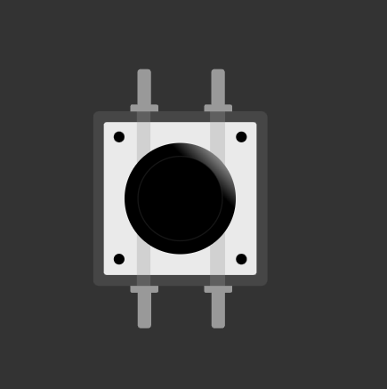
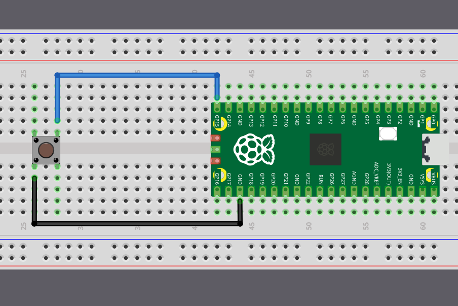

{{#title Чтение входа с кнопки на Raspberry Pi Pico 2 на embedded Rust | impl Rust для RP2350}}

# Кнопки

Теперь, когда мы умеем заставлять светодиод мигать, научимся считывать сигнал с кнопки. Это позволит взаимодействовать с Raspberry Pi Pico и заставит программы реагировать на наши действия.

    
    
Тактовые кнопки

Кнопка — это небольшой тактовый переключатель. Такие кнопки есть в большинстве наборов для начинающих. Когда вы её нажимаете, два внутренних контакта соединяются и цепь замыкается. Когда отпускаете, контакты разъединяются и цепь размыкается. Программа может считывать это состояние (разомкнуто или замкнуто) и действовать в зависимости от него.

## Как работает тактовая кнопка

У тактовой кнопки четыре ножки, расположенные парами. Если смотреть на кнопку сверху, ножки образуют прямоугольник. Две ножки с каждой стороны кнопки электрически соединены внутри.

    
    
Внутреннее устройство кнопки

Позже я обновлю этот раздел и добавлю более понятную схему, которая явнее покажет внутренние соединения. А пока этой иллюстрации достаточно, чтобы понять принцип. Светлая линия показывает, что выводы слева соединены между собой, то же самое справедливо для выводов справа. Когда кнопка нажата, левая и правая стороны соединяются.

## Подключение кнопки к Pico

Подключите одну сторону кнопки к земле, а другую — к выводу GPIO (например, GPIO 15). Когда кнопка нажата, обе стороны соединяются внутри, и вывод GPIO 15 притягивается к низкому уровню. В коде мы можем проверить, притянут ли вывод к низкому уровню, и запустить действия в зависимости от этого.

    
    
Кнопка с Raspberry Pi Pico 2

Стоп. Что происходит, когда кнопка *не* нажата? Какой уровень напряжения читает сейчас вывод GPIO? Чтобы логика работала, вывод должен находиться в высоком состоянии, тогда низкое состояние будет означать нажатие. Но без дополнительных элементов в схеме вывод GPIO окажется в так называемом *плавающем состоянии*. Это ненадёжно: вывод может случайным образом переключаться между высоким и низким уровнями, даже когда кнопка не нажата. Как это исправить? Посмотрим в следующем разделе.
