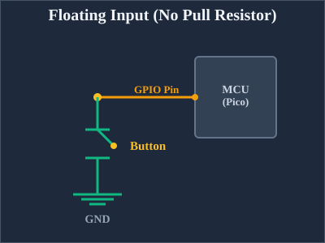
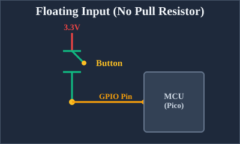
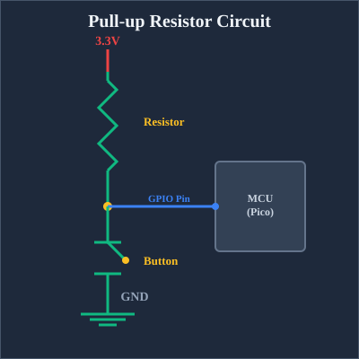
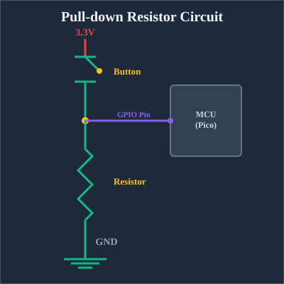
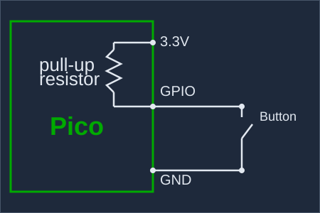

{{#title Подтягивающие резисторы pull-up и pull-down для кнопок на Raspberry Pi Pico 2}}

# Подтягивающие резисторы: pull-up и pull-down

Работая с кнопками, переключателями и другими цифровыми входами Raspberry Pi Pico, вы быстро столкнётесь с любопытной проблемой: что происходит, когда к входному выводу ничего не подключено? Ответ может удивить: вывод становится «плавающим» (floating), подхватывает электрические помехи и выдаёт случайные, непредсказуемые значения. Здесь на помощь приходят подтягивающие резисторы — pull-up и pull-down.

## Проблема плавающего вывода

Представьте, что вы подключаете кнопку напрямую к выводу GPIO на Pico. Когда кнопка нажата, она соединяет вывод с землёй (0 В). Когда кнопка отпущена, можно ожидать, что вывод будет читаться как HIGH, но это не так. Вместо этого вывод оказывается отключённым от всего. Он находится в неопределённом плавающем состоянии, работая как антенна, которая собирает электрические помехи от соседних цепей, от вашей руки или даже от радиоволн в воздухе.

<div class="image-with-caption" style="text-align:center; ">
    
    <div class="caption" style="font-size:0.9em; color:#555; margin-top:6px;">Плавающий вход — одна сторона подключена к земле</div>
</div>

Из-за этого плавающего состояния код будет читать случайные значения, и кнопка может «нажиматься» сама по себе или вести себя непредсказуемо. Нам нужен способ задать выводу предсказуемое состояние по умолчанию.

Кстати, кнопку можно подключить и наоборот: одну сторону — к 3,3 В вместо земли (хотя для RP2350 я бы этого не рекомендовал, и вскоре объясню почему). Но проблема остаётся той же. Когда кнопка нажата, вывод соединяется с высоким уровнем. Когда отпущена, можно ожидать низкого уровня, но вывод снова оказывается в плавающем состоянии.

<div class="image-with-caption" style="text-align:center; ">
    
    <div class="caption" style="font-size:0.9em; color:#555; margin-top:6px;">Плавающий вход — одна сторона подключена к 3,3 В</div>
</div>

## Что такое подтягивающие резисторы pull-up и pull-down?

Подтягивающие резисторы — простые решения, которые гарантируют, что вывод всегда имеет известный уровень напряжения, даже когда ничто другое его не задаёт.

Pull-up резистор: подключает вывод к положительному напряжению (3,3 В на Pico) через резистор. Это «подтягивает» вывод к HIGH по умолчанию. Когда вы нажимаете кнопку, которая соединяет вывод с землёй, вывод читается как LOW.

Pull-down резистор: подключает вывод к земле (0 В) через резистор. Это «подтягивает» вывод к LOW по умолчанию. Когда вы нажимаете кнопку, которая соединяет вывод с 3,3 В, вывод читается как HIGH.

### Как работает pull-up резистор

Рассмотрим типичную схему кнопки с pull-up резистором:

<div class="image-with-caption" style="text-align:center; ">
    
    <div class="caption" style="font-size:0.9em; color:#555; margin-top:6px;">Pull-up резистор</div>
</div>

Когда кнопка не нажата, ток течёт через резистор к выводу GPIO и удерживает его на уровне 3,3 В (HIGH). Когда вы нажимаете кнопку, создаётся прямой путь к земле. Поскольку электричество выбирает путь наименьшего сопротивления, ток течёт через кнопку на землю, а не к выводу, и вывод читается как LOW.

## Как работает pull-down резистор

Pull-down резистор работает в противоположном направлении:

<div class="image-with-caption" style="text-align:center; ">
    
    <div class="caption" style="font-size:0.9em; color:#555; margin-top:6px;">Pull-down резистор</div>
</div>

Когда кнопка не нажата, вывод GPIO соединён с землёй через резистор и читается как LOW. При нажатии кнопка напрямую соединяет вывод с 3,3 В, и вывод читается как HIGH.

## Внутренние подтягивающие резисторы

На каждом выводе GPIO Raspberry Pi Pico есть встроенные pull-up и pull-down резисторы. Для простых входов с кнопками внешние резисторы добавлять не нужно: их можно включить программно.

### Использование подтягивающих резисторов в embedded Rust

Посмотрим, как настроить внутренние подтягивающие резисторы при подключении кнопки к Pico.

<div class="image-with-caption" style="text-align:center; ">
    
    <div class="caption" style="font-size:0.9em; color:#555; margin-top:6px;">Внутренний pull-up резистор</div>
</div>

Как видно на схеме, когда мы включаем внутренний pull-up резистор, вывод GPIO по умолчанию подтянут к 3,3 В. Резистор находится внутри самого чипа Pico, поэтому никакие внешние компоненты не нужны — только кнопка между выводом GPIO и землёй.

Вот как это настроить в коде:

```rust
let button = Input::new(p.PIN_16, Pull::Up);

// Читаем состояние кнопки
if button.is_low() {
    // Кнопка нажата (подключена к земле)
    // Выполнить действие
}
```

Когда pull-up резистор включён, вывод GPIO по умолчанию подтянут к высокому напряжению. Когда вы нажимаете кнопку, она соединяет вывод с землёй и переводит его в LOW. Итоговая логика такая: кнопка не нажата = HIGH, кнопка нажата = LOW.

**Настройка кнопки с pull-down резистором**

Вот похожий код, но на этот раз мы используем внутренний pull-down резистор. С pull-down вывод по умолчанию притянут к LOW. Когда кнопка нажата и соединяет вывод с 3,3 В, он читается как HIGH.

```rust
let button = Input::new(p.PIN_16, Pull::Down);

// Читаем состояние кнопки
if button.is_high() {
    // Кнопка нажата (подключена к 3,3 В)
    // Выполнить действие
}
```

> [!IMPORTANT]
> В исходном чипе RP2350, выпущенном в 2024 году, есть аппаратная ошибка (RP2350-E9), которая влияет на внутренние pull-down резисторы.
>
> Из-за неё вывод GPIO может читаться как HIGH, даже когда кнопка не нажата, — то есть наоборот по отношению к ожидаемому. Подробнее об этой проблеме — в [статье Саймона Монка](https://www.doctormonk.com/2024/09/are-pico-2-rp2350-gpio-pins-broken.html) (на английском языке).
>
> Ошибка исправлена в более новой ревизии чипа RP2350 A3. Если у вас более старый чип, не используйте `Pull::Down` в коде. Вместо этого можно установить внешний pull-down резистор и задать в коде `Pull::None`.

С включённым pull-down резистором кнопка должна соединять вывод с 3,3 В при нажатии. Вывод читается как LOW, когда кнопка не нажата, и как HIGH, когда нажата.

## Использование плавающего входа

Можно также настроить вывод без внутреннего подтягивающего резистора:

```rust
let button = Input::new(p.PIN_16, Pull::None);
```

Однако, как мы обсуждали выше, плавающие входы ненадёжны для кнопок, потому что они подхватывают электрические помехи и читают случайные значения. Такой вариант полезен, только когда в схеме есть внешний pull-up или pull-down резистор либо когда подключённое устройство активно задаёт вывод в HIGH или LOW (как некоторые датчики).
