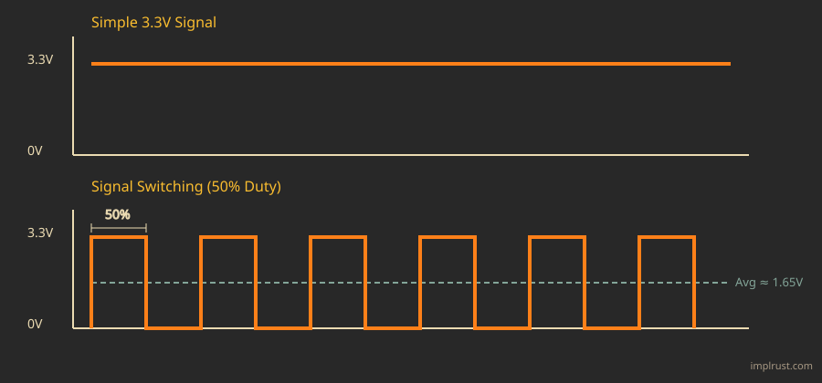
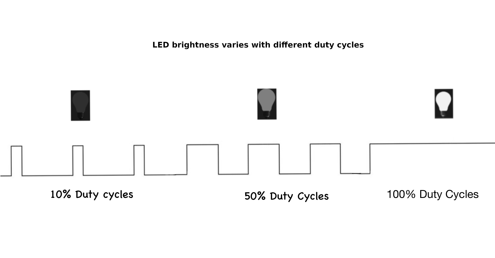

# Широтно-импульсная модуляция (ШИМ)

ШИМ — это широтно-импульсная модуляция (Pulse Width Modulation, PWM). Это метод, при котором цифровой сигнал быстро переключается между HIGH и LOW, чтобы получить выход, ведущий себя как аналоговое напряжение.

На изображении выше первый график показывает простой сигнал 3,3 В. Именно такой сигнал мы обычно выдаём на вывод GPIO, например чтобы полностью включить или полностью выключить светодиод, что создаёт эффект мигания.

Чтобы получить напряжение между 0 В и 3,3 В, мы не держим сигнал в HIGH всё время. Вместо этого мы многократно переключаем вывод между 0 В и 3,3 В.

Когда такое переключение происходит очень быстро, подключённое устройство не успевает отслеживать каждое отдельное изменение. Оно не видит чистых 0 В или чистых 3,3 В. Оно реагирует на то, как долго сигнал остаётся на уровне 3,3 В по сравнению с тем, сколько времени он находится на уровне 0 В.

В этом примере сигнал половину времени находится на уровне 3,3 В, а половину — на уровне 0 В. Поэтому устройство получает в среднем примерно половину напряжения, то есть около 1,65 В.

## Ширина импульса и коэффициент заполнения

Ширина импульса — это просто то, как долго сигнал остаётся включённым, прежде чем выключиться. Она измеряется во времени, например в микросекундах или миллисекундах.

Например, если импульс имеет ширину 1 миллисекунду, сигнал остаётся в HIGH 1 миллисекунду, а затем переходит в LOW на оставшуюся часть цикла.

Коэффициент заполнения (duty cycle) описывает ту же идею, но иначе. Вместо времени он показывает, какую часть цикла сигнал остаётся включённым, в процентах.

Поэтому вместо того чтобы говорить, что сигнал включён 1 миллисекунду, можно сказать, что он включён 50 % времени.

Например:
- Коэффициент заполнения 0 % означает, что сигнал всегда LOW (в среднем 0 В).
- Коэффициент заполнения 50 % означает, что сигнал HIGH и LOW одинаковое время (в среднем 1,65 В в системе на 3,3 В).
- Коэффициент заполнения 75 % означает, что сигнал HIGH 75 % времени и LOW 25 % времени.
- Коэффициент заполнения 100 % означает, что сигнал всегда HIGH (3,3 В).

Изменение коэффициента заполнения меняет мощность, которая передаётся нагрузке, поэтому на изображении выше светодиод выглядит тусклым, средним по яркости или полностью ярким.

## Пример использования 1: уменьшение яркости светодиода

Светодиод мигает так быстро, что глаз не видит отдельных импульсов включения и выключения, и вы воспринимаете только среднюю яркость. Низкий коэффициент заполнения делает свечение тусклым, более высокий — ярче, хотя светодиод всё время переключается между полным напряжением и нулём. В следующей главе мы сделаем это на практике.

## Пример использования 2: управление сервоприводом

Сервопривод определяет угол поворота по ширине импульса. Он ожидает импульс каждые 20 миллисекунд, и ширина импульса — примерно 1 мс для 0°, 1,5 мс для 90° и 2 мс для 180° — указывает сервоприводу, в какую сторону двигаться.
