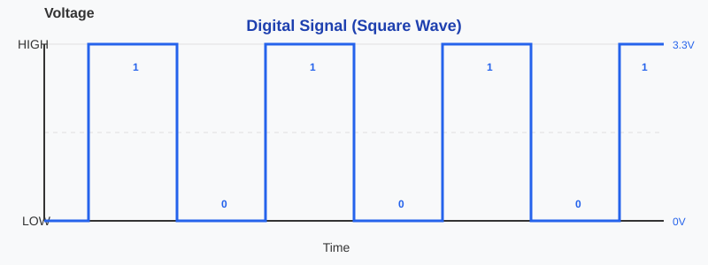
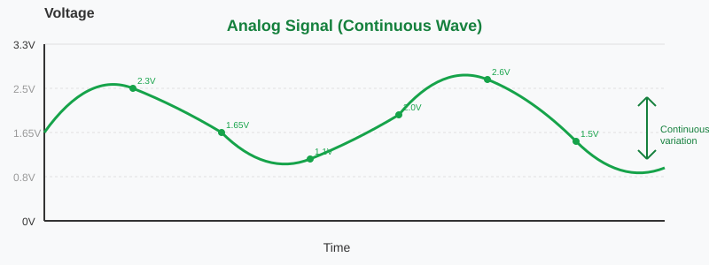

{{#title Широтно-импульсная модуляция (ШИМ, PWM) для embedded Rust на Raspberry Pi Pico 2}}

# Широтно-импульсная модуляция (ШИМ)

В этом разделе мы разберём, что такое ШИМ и зачем он нужен.

## Цифровой и аналоговый сигналы

Чтобы понять ШИМ, сначала нужно понять, что такое цифровой и аналоговый сигналы.

### Цифровые сигналы

Цифровой сигнал имеет только два состояния: HIGH или LOW. В микроконтроллерах HIGH обычно означает полное напряжение (5 В или 3,3 В), а LOW — 0 В. Промежуточных значений нет. Представьте выключатель света, который может быть только полностью включён или полностью выключен.

Когда вы используете цифровой вывод микроконтроллера, он может выдавать только эти два значения. Если записать в вывод HIGH, он выдаст 3,3 В. Если записать LOW, он выдаст 0 В. Нельзя заставить цифровой вывод выдать 1,5 В, 2,7 В или любое другое значение между ними.

## Аналоговые сигналы

Аналоговый сигнал может принимать любое значение напряжения в пределах диапазона. Вместо простого «вкл» или «выкл» он меняется непрерывно и плавно. Представьте регулятор яркости, который может установить яркость в любой точке от полностью выключено до полностью ярко, причём с бесконечным числом промежуточных положений.

Например, аналоговый сигнал может быть 0 В, 0,5 В, 1,5 В, 2,8 В, 3,1 В или любым другим значением в допустимом диапазоне. Такое плавное изменение позволяет точно управлять устройствами.

## Проблема

Вот в чём трудность: большинство выводов микроконтроллера цифровые, и они могут выдавать только HIGH или LOW. Но что, если вы хотите:

уменьшить яркость светодиода до 50 % вместо простого полного включения или выключения (как в примере мигания из быстрого старта)? Или повернуть сервопривод в любое положение от 0° до 180°? Или плавно регулировать скорость вентилятора или температуру?

Нужно что-то, что работает как аналоговый выход, но у вас есть только цифровые выводы. Здесь на помощь приходит ШИМ.
