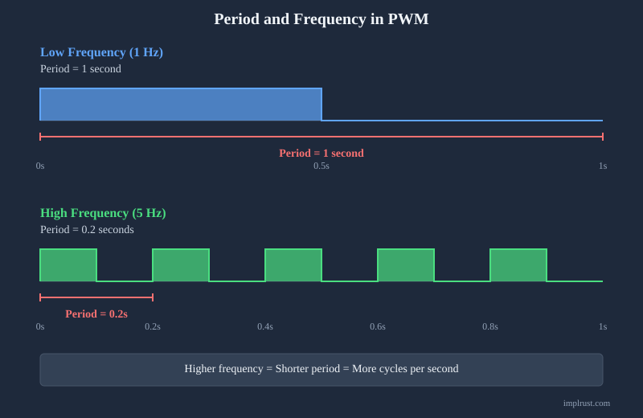

# Период и частота

К этому моменту у вас должно быть базовое представление о ширине импульса и коэффициенте заполнения. Далее рассмотрим ещё два важных понятия, которые используются в ШИМ: период и частоту.

Эти два понятия описывают, как часто повторяется сигнал ШИМ.

## Период

Период — это общее время, за которое завершается один полный цикл «включено — выключено». Иными словами, это время от одной точки сигнала до того момента, когда та же точка снова появляется в следующем цикле.

Например:

- В верхней части схемы один полный цикл занимает 1 секунду, поэтому период равен 1 секунде. Это медленно меняющийся сигнал.
- В нижней части схемы один полный цикл занимает 0,2 секунды, поэтому период равен 0,2 секунды. Это быстрее меняющийся сигнал.

## Частота

Частота показывает, сколько полных циклов происходит за одну секунду. Измеряется она в герцах (Гц, Hz).

Например:

- 1 Гц = 1 цикл в секунду (как в верхней части схемы)
- 5 Гц = 5 циклов в секунду (как в нижней части схемы)

## Связь

Частота сигнала и его период обратно пропорциональны друг другу.

\\[
\text{Frequency (Hz)} = \\frac{1}{\text{Period (s)}}
\\]

Это означает:

- Когда период уменьшается, частота растёт
- Когда период увеличивается, частота падает

**Всё ещё непонятно? Представьте так:**

Представьте, что вы с другом считаете от 0 до 99 снова и снова.

Вы считаете быстро и быстро заканчиваете один круг. Ваш друг считает медленно и тратит на тот же круг гораздо больше времени. Вы оба называете одни и те же числа. Различается только скорость.

Время, которое уходит на один круг, — это период. Насколько часто вы повторяете круги, — это частота. Счёт быстрее означает более короткий период и более высокую частоту. Счёт медленнее означает более длинный период и более низкую частоту.

### Примеры

Итак, если период равен 1 секунде, то частота будет 1 Гц.

\\[
1 \text{ Hz} = \\frac{1 \text{ cycle}}{1 \text{ second}} = \\frac{1}{1 \text{ s}}
\\]

Например, если период равен 20 мс (0,02 с), частота будет 50 Гц.

\\[
\text{Frequency} = \\frac{1}{20 \text{ ms}} = \\frac{1}{0.02 \text{ s}} = 50 \text{ Hz}
\\]
