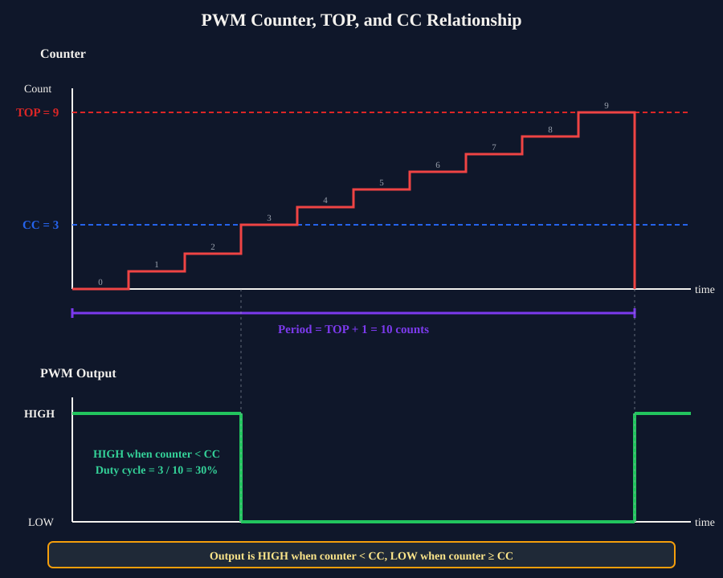
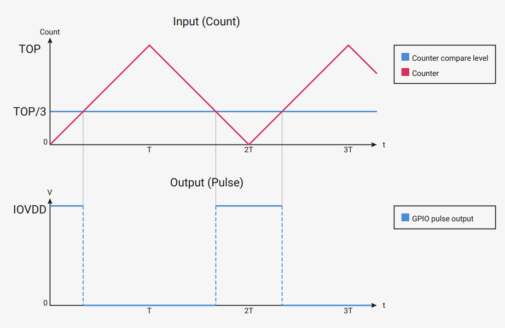

{{#title Значения TOP и делителя ШИМ: задаём частоту ШИМ на Raspberry Pi Pico 2}}

# TOP и делитель ШИМ

Иногда нужно задать точную частоту выходного сигнала ШИМ. Например, любительские сервоприводы обычно работают на 50 Гц. Однако ни embassy-rp, ни rp-hal не предоставляют простого способа задать частоту напрямую (насколько мне известно). Вместо этого нужно работать с настройками самой аппаратной части ШИМ. Крейт embassy-rp позволяет настроить ШИМ через структуру `Config`, в которой есть различные поля. Мы сосредоточимся на параметрах top и divider. Разберёмся, как они работают.

## Как работает ШИМ внутри RP2350

Слайс ШИМ в RP2350 управляется тактовым сигналом. Этот сигнал гораздо быстрее, чем ШИМ-сигнал, который нужен вам на выводе. Аппаратная часть ШИМ использует счётчик, который многократно считает от 0 до TOP, а затем начинает снова с 0. Регистр TOP определяет, до какого значения доходит счётчик, прежде чем начать заново.

Каждый раз, когда счётчик достигает верхнего значения, он возвращается к нулю и начинает снова. Один полный счёт от нуля до верхнего значения — это один период ШИМ.

Если счётчик увеличивается очень быстро, частота ШИМ будет высокой. Если медленнее — частота будет ниже. Здесь в дело вступает делитель.

Для генерации ШИМ в RP2350 используются два основных 16-битных регистра: регистр захвата/сравнения (CC, Capture/Compare) и регистр TOP. Регистр CC определяет, сколько времени выходной импульс остаётся в высоком состоянии в каждом цикле (скважность). Регистр TOP определяет, сколько времени занимает каждый полный цикл (период).

Для простого объяснения пусть значение TOP равно 9, а значение CC равно 3. Счётчик будет считать от 0 до 9, как показано на схеме. Сигнал остаётся в высоком состоянии до тех пор, пока счётчик не достигнет значения CC. После этого в данном цикле он остаётся в низком состоянии. Не торопитесь и постарайтесь понять диаграмму выше. На диаграмме каждый отсчёт нарисован ступенькой (красным цветом). Импульс остаётся в высоком состоянии (зелёным цветом), пока счётчик не совпадёт со значением CC. Как видно, начиная с 3 и до 9 импульс переходит в низкое состояние.

## Как TOP управляет частотой

Счётчик ШИМ считает от 0 до значения TOP, а затем возвращается к 0. Один полный цикл счёта (от 0 до TOP) даёт один период ШИМ. Частота — это просто количество таких полных циклов в секунду.

Системная частота тактирования RP2350 равна 150 МГц (150 миллионов циклов в секунду). Если пока не учитывать делитель и оставить его равным 1, счётчик увеличивается на единицу за каждый такт системной частоты. Важно понимать, как TOP влияет на частоту:

- Большее значение TOP => счётчику нужно больше шагов, чтобы завершить один цикл => ниже частота ШИМ
- Меньшее значение TOP => счётчику нужно меньше шагов, чтобы завершить один цикл => выше частота ШИМ

Рассмотрим несколько конкретных примеров, чтобы это стало понятнее.

### Пример 1: TOP = 149

Счётчик считает: 0, 1, 2, 3, ... 148, 149, а затем возвращается к 0.

Получается 150 отсчётов за цикл (от 0 до 149 включительно).

При системной частоте 150 МГц частота ШИМ равна:

> [!NOTE]
> Пока не полагайтесь на эту упрощённую формулу. Она недостаточно точна, потому что нужно учесть ещё один множитель — делитель тактовой частоты. Мы приводим её здесь только для того, чтобы понять базовую связь между TOP и частотой.

\\[
f_{PWM} = \frac{150,000,000}{150} = 1,000,000 \text{ Hz (1 MHz)}
\\]

Пример 2: TOP = 1,499

Счётчик проходит 1 500 значений (от 0 до 1 499).

Частота ШИМ:

\\[
f_{PWM} = \frac{150,000,000}{1,500} = 100,000 \text{ Hz (100 kHz)}
\\]

### Почему одного TOP недостаточно

Регистр TOP имеет ширину 16 бит, поэтому максимальное значение, которое он может хранить, — 65 535. Это значит, что счётчик проходит 65 536 шагов, прежде чем вернуться к нулю. Если применить это максимальное значение TOP к тому же расчёту, что и в примерах выше, получим частоту ШИМ около 2 288 Гц.

Это самая низкая частота, которой можно добиться только с помощью TOP при системной частоте 150 МГц.

Для многих реальных задач этого всё равно слишком много. Например, любительским сервоприводам нужна частота ШИМ около 50 Гц. Используя только TOP, невозможно замедлить ШИМ настолько, чтобы попасть в этот диапазон.

Чтобы решить эту задачу, RP2350 предоставляет дополнительный инструмент: делитель тактовой частоты ШИМ. Делением тактового сигнала, который подаётся на счётчик ШИМ, можно получить гораздо более низкие частоты, включая нужные сервоприводам 50 Гц.

## Делитель тактовой частоты

Делитель замедляет тактовый сигнал, который управляет счётчиком ШИМ. Вместо счёта на полной системной частоте 150 МГц счётчик увеличивается медленнее, в зависимости от значения делителя.

Когда делитель увеличивается, каждый отсчёт занимает больше времени. Это значит, что счётчику требуется больше времени, чтобы пройти от 0 до TOP, и частота ШИМ становится ниже. Именно это позволяет получить низкие частоты, например 50 Гц, которые невозможны при использовании только TOP.

Прежде чем переходить к настоящей формуле из даташита RP2350, рассмотрим ещё один упрощённый пример.

Допустим, мы задаём TOP равным 1 499, так что счётчик проходит 1 500 шагов (от 0 до 1 499). Теперь, если задать делитель тактовой частоты равным 10, каждый шаг будет занимать 10 тактов системной частоты вместо одного.

\\[
f_{PWM} = \frac{150{,}000{,}000}{1{,}500 \times 10} = 10{,}000\ \text{Hz (10 kHz)}
\\]

Без делителя для того же значения TOP мы получили бы 100 кГц. Теперь при делителе 10 получаем 10 кГц — в десять раз медленнее. Это показывает, как делитель позволяет замедлять частоту ШИМ.

## Фазово-корректный режим

Потерпите немного. Прежде чем приводить настоящую формулу, нужно понять ещё одно важное понятие.

До сих пор мы считали, что счётчик ШИМ считает в одном направлении: от 0 до TOP, а затем сразу возвращается к 0. Но ШИМ может работать и иначе. В фазово-корректном режиме счётчик ведёт себя по-другому, и это напрямую влияет на частоту ШИМ.

В фазово-корректном режиме счётчик ШИМ не возвращается к нулю при достижении TOP. Вместо этого он считает от 0 до TOP, а затем обратно от TOP до 0. Получается симметричный шаблон счёта «вверх-вниз».

    
    
Изображение из даташита RP2350

Из-за этого один полный цикл ШИМ включает и счёт вверх, и счёт вниз. Другими словами, счётчику требуется примерно вдвое больше времени, чтобы завершить полный цикл, по сравнению с обычным режимом счёта только вверх.

Важный вывод прост: включение фазово-корректного режима вдвое уменьшает частоту ШИМ при тех же значениях TOP и делителя.

Этот режим часто используют, когда нужны более чистые и симметричные сигналы ШИМ, например для управления моторами.

## Формула частоты ШИМ

Даташит RP2350 точно определяет, как вычисляется период ШИМ. Период показывает, сколько тактов системной частоты требуется для одного полного цикла ШИМ.

Период в тактах вычисляется по формуле:

\\[
\text{period} = (\text{TOP} + 1) \times (\text{CSR\_PH\_CORRECT} + 1) \times \left( \text{DIV\_INT} + \frac{\text{DIV\_FRAC}}{16} \right)
\\]

Чтобы определить выходную частоту по системной частоте тактирования, используйте формулу:

\\[
f_{PWM} = \frac{f_{sys}}{\text{period}} = \frac{f_{sys}}{(\text{TOP} + 1) \times (\text{CSR\_PH\_CORRECT} + 1) \times \left( \text{DIV\_INT} + \frac{\text{DIV\_FRAC}}{16} \right)}
\\]

Где:

- \\( f_{PWM} \\) — выходная частота ШИМ.
- \\( f_{sys} \\) — системная частота тактирования. Для Pico 2 она равна 150 МГц.

### Делитель и дробная часть

В формуле, которую мы рассматривали выше, есть одна важная часть, которую мы пока не объяснили: `DIV_FRAC`. Она задаёт дробную часть делителя тактовой частоты в RP2350.

Делитель тактовой частоты RP2350 состоит из двух частей. `DIV_INT` — целая часть, которая задаёт целое деление. `DIV_FRAC` — дробная часть, которая позволяет точнее управлять коэффициентом деления. Вместе они дают возможность замедлять счётчик ШИМ точнее, чем при использовании только целого делителя. Одно важное правило: если `DIV_INT` равен 0, нельзя задавать никакие биты `DIV_FRAC`.
