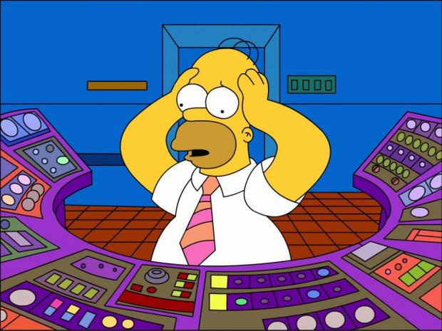
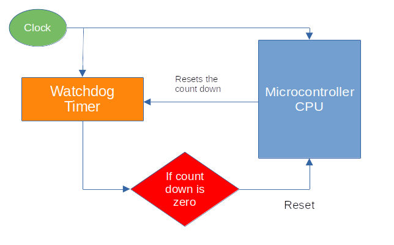

# Сторожевой таймер

Эта книга изначально была написана с использованием `rp-hal`. Позже я переработал её так, чтобы в основном использовать Embassy. При работе с `rp-hal` есть шаг, на котором мы явно настраиваем сторожевой таймер (watchdog). Чтобы объяснить, зачем нужна эта строка и что она на самом деле делает, в этой главе вводится понятие сторожевого таймера.

В январе 1994 года космический аппарат Clementine успешно картографировал Луну. Во время полёта к астероиду Geographos 7 мая 1994 года в процессоре Honeywell 1750 произошло исключение из-за операции с плавающей запятой. Этот процессор обрабатывал телеметрию и несколько других критически важных функций космического аппарата.



В Honeywell 1750 был встроенный сторожевой таймер, но им не воспользовались. После этого отказа команда разработчиков публично пожалела о таком решении. Также отмечалось, что даже стандартный сторожевой таймер, возможно, не был бы достаточно надёжен, чтобы обнаружить именно этот режим отказа.

Итак, что же такое сторожевой таймер и зачем он нужен?

Возможно, у вас уже есть общее представление.

## Что такое сторожевой таймер?

Сторожевой таймер (WDT, watchdog timer) — аппаратный компонент, который часто встречается во встраиваемых системах. Его главная задача — обнаружить сбой программного обеспечения и автоматически перезагрузить процессор, если что-то пошло не так. Так система может восстановиться без вмешательства человека.

Сторожевые таймеры особенно важны в системах, которые должны работать без присмотра в течение длительного времени.

## Как это работает?

Сторожевой таймер работает как таймер обратного отсчёта. Он начинает отсчёт от заданного значения к нулю. Программа должна периодически сбрасывать этот таймер, пока он не дошёл до нуля.

Это действие обычно называют «кормлением сторожевого таймера» (feeding the watchdog). Также можно встретить выражение «пнуть собаку» (kicking the dog), но этот термин широко используется, а я лично его избегаю.

Если программа не сбросила таймер вовремя, например из-за бесконечного цикла, взаимной блокировки (deadlock) или зависания системы, сторожевой таймер решает, что система работает некорректно, и инициирует перезагрузку процессора. После перезагрузки система может запуститься заново из известного хорошего состояния.

**Кормление собаки:**

Сторожевой таймер можно представить как собаку, которую нужно кормить через равные промежутки времени. Со временем собака голодает всё сильнее. Если её не покормить вовремя, она отреагирует. Во встраиваемых системах эта реакция — аппаратная перезагрузка.

Чтобы система работала нормально, программа должна регулярно «кормить» сторожевой таймер, сбрасывая его счётчик.



## Код

В следующем фрагменте мы настраиваем драйвер сторожевого таймера. Это необходимо, потому что код инициализации тактирования зависит от доступности сторожевого таймера.

```rust
// Настраиваем драйвер сторожевого таймера — он нужен для настройки тактирования
let mut watchdog = hal::Watchdog::new(pac.WATCHDOG);
```

## Ссылки
- [Great Watchdog Timers For Embedded Systems, Jack Ganssle](https://www.ganssle.com/watchdogs.pdf)
- [Born to fail](https://www.embedded.com/born-to-fail/)
- [A Guide to Watchdog Timers for Embedded Systems](https://interrupt.memfault.com/blog/firmware-watchdog-best-practices)
- [Proper Watchdog Timer Use](https://betterembsw.blogspot.com/2014/05/proper-watchdog-timer-use.html)
