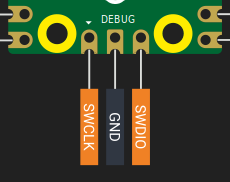

{{#title Использование отладочного зонда Raspberry Pi с Pico 2 в embedded Rust}}

# Отладочный зонд для Raspberry Pi Pico 2

Нажимать кнопку BOOTSEL каждый раз, когда нужно прошить новую программу, неудобно. На отладочных платах вроде ESP32 DevKit этот шаг почти полностью автоматизирован, потому что плата может сама перевести чип в режим загрузчика при необходимости. У Pico 2 такой функции нет, но ту же удобность и даже больше возможностей можно получить с помощью отладочного зонда.

В этой главе объясняется, почему отладочный зонд полезен, и пошагово показано, как его настроить и использовать для прошивки и отладки Pico 2 без нажатия BOOTSEL каждый раз.

## Raspberry Pi Debug Probe

Raspberry Pi Debug Probe — официальный инструмент, рекомендуемый для отладки по SWD на Pico и Pico 2. Это небольшое USB-устройство, которое работает как адаптер CMSIS-DAP. CMSIS-DAP — открытый стандарт для отладчиков, который позволяет компьютеру обмениваться данными с микроконтроллерами по протоколу SWD.

<div class="image-with-caption" style="text-align:center; ">
    
    <div class="caption" style="font-size:0.9em; color:#555; margin-top:6px;">Источник: <a href="https://www.raspberrypi.com/documentation/microcontrollers/debug-probe.html">raspberrypi.com</a> — отладочный зонд, подключённый к Pico.</div>
</div>

Зонд предоставляет две основные возможности:

1. **Интерфейс SWD (Serial Wire Debug)** — подключается к отладочным выводам Pico и используется для прошивки и отладки в реальном времени. Можно ставить точки останова, просматривать переменные и отлаживать программу так же, как обычное настольное приложение.

2. **UART-мост** — обеспечивает соединение USB с последовательным портом, чтобы вы могли видеть вывод консоли или обмениваться данными с платой.

Обе возможности работают через один и тот же USB-кабель, подключённый к компьютеру, поэтому настройка остаётся простой: отдельное UART-устройство не нужно.

## Пайка выводов SWD

Прежде чем подключить отладочный зонд к Pico 2, нужно сделать доступными [выводы SWD](../pico2-pinout.md#swd-debugging-pins). Они находятся у нижнего края платы Pico, на небольшом 3-контактном отладочном разъёме, отдельном от основных выводов GPIO.

<div class="image-with-caption" style="text-align:center; display:inline-block;">
    
    <div class="caption" style="font-size:0.9em; color:#555; margin-top:6px;">Отладочные выводы SWD</div>
</div>

Когда выводы SWD припаяны, ваш Pico готов к подключению к отладочному зонду.

## Подготовка отладочного зонда

Ваш отладочный зонд может быть поставлен не с последней прошивкой, особенно с той версией, которая добавляет поддержку Pico 2 (чип RP2350). Перед началом рекомендуется обновить прошивку.

Официальная документация Raspberry Pi содержит понятные инструкции по обновлению отладочного зонда. Следуйте [приведённым шагам](https://www.raspberrypi.com/documentation/microcontrollers/debug-probe.html#updating-the-firmware-on-the-debug-probe).

## Подключение Pico к отладочному зонду

На боковой стороне отладочного зонда есть два порта:

- **Порт D** — для соединения SWD (отладки)
- **Порт U** — для соединения UART (последовательного порта)

### Соединение SWD (обязательно)

Соединение SWD позволяет прошивать программы и использовать отладчик. Используйте кабель JST–Dupont, который поставляется с вашим отладочным зондом.

Подключите провода от порта D отладочного зонда к выводам Pico 2 следующим образом:

| Провод зонда | Вывод Pico 2 |
| ------------ | ------------ |
| Оранжевый    | SWCLK        |
| Чёрный       | GND          |
| Жёлтый       | SWDIO        |

Перед подключением убедитесь, что выводы SWD на Pico 2 припаяны правильно.

### Соединение UART (необязательно)

Соединение UART полезно, если вы хотите видеть последовательный вывод (например, логи `println!` из Rust) в терминале компьютера. Оно не зависит от соединения SWD.

Подключите провода от порта U отладочного зонда к выводам Pico 2:

| Провод зонда | Вывод Pico 2     | Физический номер вывода |
| ------------ | ---------------- | ----------------------- |
| Жёлтый       | GP0 (TX на Pico) | **Контакт 1**           |
| Оранжевый    | GP1 (RX на Pico) | **Контакт 2**           |
| Чёрный       | GND              | **Контакт 3**           |

Можно использовать любые выводы GPIO, настроенные для UART, но GP0 и GP1 — это выводы UART0 по умолчанию для Pico.

### Питание Pico

Отладочный зонд не питает Pico 2, а передаёт только сигналы SWD и UART. Чтобы питать Pico 2, подключите отладочный зонд к компьютеру через его USB-порт, а затем отдельно питайте Pico 2 через его собственный USB-порт. Для корректной отладки оба устройства должны получать питание.

### Итоговая настройка

Когда всё подключено:

1. Подключите отладочный зонд к компьютеру по USB
2. Убедитесь, что Pico 2 получает питание
3. Красный светодиод на отладочном зонде должен загореться, показывая, что он получает питание
4. Настройка готова — теперь не нужно нажимать кнопку BOOTSEL

Теперь вы можете прошивать и отлаживать Pico 2 напрямую из своей среды разработки без ручных действий.

## Проверка

Чтобы убедиться, что отладочный зонд и Pico 2 подключены правильно, можно использовать проект быстрого старта. Прошейте его и проверьте, что всё работает.

```sh
git clone https://github.com/ImplFerris/pico2-quick
cd pico2-quick
```

Просто `cargo run`, как раньше, использовать нельзя, если только вы не меняли `config.toml`. Дело в том, что проект быстрого старта настроен на использование picotool в качестве runner. Вы можете закомментировать runner picotool и включить runner probe-rs. После этого можно использовать команду `cargo run`.

Или, что проще (я рекомендую именно этот вариант), используйте команды, которые предоставляет `probe-rs`. Они прошьют программу через отладочный зонд:

```sh
cargo flash
# или
cargo flash --release
```

## cargo embed

С помощью `cargo embed` можно прошить программу и наблюдать вывод логов в терминале. Проект быстрого старта уже настроен на отправку логов через RTT, поэтому перед запуском ничего настраивать не нужно.

```sh
cargo embed
# или
cargo embed --release
```

О RTT мы расскажем позже, а сейчас достаточно просто выполнить команду, чтобы увидеть, как программа работает и выводит логи.

Если всё работает, вы увидите сообщение «Hello, World!» в системном терминале.

<div class="image-with-caption" style="text-align:center; ">
    
    <div class="caption" style="font-size:0.9em; color:#555; margin-top:6px;">cargo embed показывает логи defmt</div>
</div>

Чтобы выйти из терминала, используйте обычное сочетание [Ctrl]-[C].

## Ссылки

- [Raspberry Pi Debug Probe — официальная документация](https://www.raspberrypi.com/documentation/microcontrollers/debug-probe.html)
