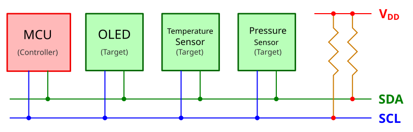
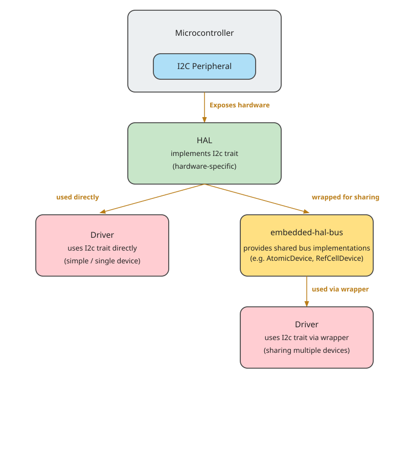

{{#title Использование I2C в embedded Rust с embedded-hal на Raspberry Pi Pico 2}}

# Использование I2C в экосистеме embedded Rust

В предыдущем разделе мы изучили основы связи по I2C и модель «контроллер — цель» (раньше «ведущий — ведомый»). Теперь посмотрим, как эти понятия применяются в экосистеме embedded Rust, где ключевой принцип — модульность и повторное использование кода.

## Роль embedded-hal

Крейт embedded-hal определяет стандартный набор трейтов для абстракции embedded-оборудования, включая I2C. Эти трейты позволяют писать код драйверов (например, для дисплеев или датчиков) в обобщённом виде, чтобы он работал на многих микроконтроллерах без платформенно-зависимых изменений.

Основной трейт I2C выглядит так:

```rust
pub trait I2c<A: AddressMode = SevenBitAddress>: ErrorType {
    // Этот метод обязаны реализовать авторы HAL
    fn transaction(...);
    // Это методы по умолчанию, построенные поверх `transaction`
    fn read(...);
    fn write(...);
    fn write_read(...);
}
```

Единственный метод, который HAL обязан реализовать, — `transaction`. Трейт предоставляет реализации по умолчанию для `read`, `write` и `write_read`, которые используют этот метод.

Обобщённый параметр типа `A` задаёт режим адресации и имеет тип по умолчанию `SevenBitAddress`. Поэтому в большинстве случаев его не нужно указывать вручную. Для 10-битной адресации можно использовать `TenBitAddress`.

Крейты HAL конкретных микроконтроллеров (например, `esp-hal`, `stm32-hal` или `nrf-hal`) реализуют этот трейт для своей периферии I2C. Например, крейт `esp-hal` реализует I2C. Если вам интересно, можно посмотреть [реализацию](https://github.com/esp-rs/esp-hal/blob/de67c3101346cdbe030ffa1bb95b13943ee8d790/esp-hal/src/i2c/master/mod.rs#L671).

> Помимо обычного крейта `embedded-hal`, есть асинхронная версия под названием `embedded-hal-async`. Она определяет похожие трейты, но они рассчитаны на работу с асинхронным кодом, что полезно при написании неблокирующих драйверов или задач во встраиваемых системах.

## Драйверы, не зависящие от платформы

Представьте, что вы пишете драйвер для датчика или дисплея, который общается по I2C. Вы не хотите привязывать свой код к конкретному микроконтроллеру, например Raspberry Pi Pico или ESP32. Вместо этого можно написать драйвер обобщённо, используя трейт `embedded-hal`.

Пока ваш драйвер зависит только от трейта I2C, он может работать на любой платформе, которая предоставляет реализацию этого трейта, — например, на STM32, nRF или ESP32.

## Совместное использование шины I2C

Во многих embedded-проектах к одним и тем же линиям SDA и SCL подключают несколько устройств I2C (например, OLED-дисплей, LCD и различные датчики). Однако в каждый момент времени шиной может управлять только одно устройство.


<p align="center"><em>Рисунок: микроконтроллер (Pico) и несколько устройств</em></p>

Если отдать эксклюзивный доступ одному драйверу, другие устройства не смогут обмениваться данными. Здесь помогает крейт `embedded-hal-bus`.

Он предоставляет типы-обёртки, такие как `AtomicDevice`, `CriticalSectionDevice` и `RefCellDevice`, которые позволяют нескольким драйверам безопасно разделять доступ к одной шине I2C. Сами эти обёртки реализуют трейт `I2c`, поэтому драйверы могут использовать их так, будто это исходная шина.

Использовать I2C можно двумя способами:



- Без совместного использования: если ваше приложение общается только с одним устройством I2C, можно передать драйверу экземпляр шины I2C, который предоставляет HAL (реализующий трейт `I2c`), напрямую.

- С совместным использованием: если приложению нужно общаться с несколькими устройствами I2C на одной шине, можно обернуть экземпляр шины, предоставленный HAL, одним из типов совместного доступа из крейта `embedded-hal-bus`, например `AtomicDevice` или `CriticalSectionDevice`. Это обеспечивает безопасный и согласованный доступ для нескольких драйверов.

## Ресурсы

- [Документация embedded-hal по I2C](https://docs.rs/embedded-hal/latest/embedded_hal/i2c/index.html): подробное описание того, как устроены трейты I2C и как их предполагается использовать на разных платформах.
