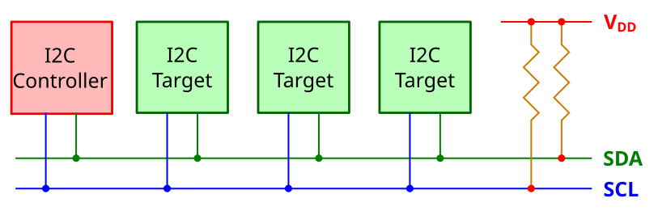

{{#title Протокол связи I2C для embedded Rust на Raspberry Pi Pico 2}}

# Inter-Integrated Circuit (I2C)

До сих пор мы переключали выходные выводы между уровнями High и Low, чтобы управлять светодиодом, и считывали те же два уровня с кнопки. Но для работы с такими интересными устройствами, как модули дисплеев, RFID-считыватели и считыватели SD-карт, этого мало. Простого переключения выводов здесь недостаточно: нужен полноценный механизм связи, и именно для этого существуют протоколы связи. Самые распространённые из них — I2C, SPI и UART. У каждого есть свои плюсы и минусы.

Поскольку в следующей главе мы будем использовать OLED-дисплей, который общается по I2C, именно этот протокол мы изучим первым. OLED-дисплеи — одни из моих любимых модулей. Я использовал их, чтобы делать небольшие игры и множество интересных личных проектов.

## Что такое I2C?

I2C расшифровывается как Inter-Integrated Circuit, его также пишут как I²C. Это один из популярных способов связи, которые микроконтроллеры используют для обмена данными с датчиками, дисплеями (например, OLED) и другими микросхемами. Это последовательный, полудуплексный и синхронный интерфейс. Разберём, что это значит.

- **Последовательный** (serial) означает, что данные передаются по одному биту, один за другим. Каждый бит отправляется отдельно, а не сразу несколько битов. Эти биты передаются по сигнальной линии данных во время обмена.

- **Полудуплексный** (half duplex) означает, что данные передаются только в одном направлении в каждый момент времени. Устройство либо отправляет данные, либо принимает их, но не то и другое одновременно. Направление переключается по мере необходимости во время обмена.

- **Синхронный** (synchronous) означает, что оба устройства опираются на общий сигнал тактирования. Этот тактовый сигнал точно задаёт, когда отправляется и считывается каждый бит данных, и держит оба устройства в согласии во время обмена.

## Контроллер и цель

I2C использует модель «контроллер — цель». Контроллер (раньше его называли master, «ведущий») — это устройство, которое инициирует обмен и формирует тактовый сигнал. Цель (раньше её называли slave, «ведомый») отвечает на команды контроллера.

<em>Рисунок: один контроллер и одна цель</em>

В типичных embedded-проектах микроконтроллер (например, Pico) выступает контроллером, а подключённые устройства, такие как дисплеи (например, OLED) или датчики, — целями.

I2C позволяет легко подключить множество устройств на одни и те же два провода. К одному контроллеру можно подключить несколько целей, и это самая распространённая схема. I2C также поддерживает несколько контроллеров на одной шине, поэтому несколько контроллеров могут обмениваться данными с одной или несколькими целями.

## Шина I2C

Шина I2C использует всего две линии, которые общие для всех подключённых устройств:

- SCL (Serial Clock Line, линия тактирования): передаёт тактовый сигнал от контроллера. Иногда устройства обозначают её как SCK.

- SDA (Serial Data Line, линия данных): передаёт данные в обоих направлениях. Иногда устройства обозначают её как SDI.

<em>Рисунок: один контроллер и несколько целей</em>

Все подключённые устройства используют одни и те же два провода. Контроллер выбирает, с каким устройством общаться, отправляя его уникальный адрес.

## Адреса I2C

У каждой цели I2C есть 7-битный или 10-битный адрес. Чаще всего используется 7-битный, который позволяет получить до 128 возможных адресов.

Многие устройства имеют фиксированный адрес, заданный производителем, но другие позволяют настроить младшие биты адреса с помощью выводов или перемычек. Например, датчик может использовать выводы с подписями A0 и A1, чтобы изменить свой адрес, — так на одной шине можно разместить несколько одинаковых микросхем.

Когда контроллер хочет связаться с целью, он начинает с условия START, затем отправляет адрес устройства и бит чтения/записи. Устройство с подходящим адресом отвечает сигналом ACK (acknowledge, подтверждение), и обмен продолжается.

## Режимы скорости

I2C поддерживает разные режимы скорости в зависимости от того, как быстро нужно передавать данные. Стандартный режим работает до 100 кбит/с, быстрый режим (fast mode) — до 400 кбит/с, а режим Fast Mode Plus — до 1 Мбит/с. Для ещё более быстрой связи есть высокоскоростной режим (High-Speed), который поддерживает до 3,4 Мбит/с. Также есть сверхбыстрый режим (Ultra-Fast) — 5 Мбит/с. Какую скорость можно использовать, зависит от того, какие режимы поддерживаются и I2C-интерфейсом микроконтроллера, и подключёнными целевыми устройствами.

## Почему I2C?

I2C идеален, когда нужно подключить несколько устройств всего двумя проводами. Он хорошо подходит для задач, где скорость не критична, а простота проводки важна.

Хорошая новость в том, что в embedded Rust не нужно реализовывать протокол I2C самостоятельно. Крейт embedded-hal определяет общие трейты I2C, а HAL для вашего чипа берёт на себя низкоуровневые детали. В следующем разделе мы подробнее разберём это.

## Ресурсы

- [Основы протокола связи I2C](https://www.circuitbasics.com/basics-of-the-i2c-communication-protocol/): обратитесь к этой статье, если хотите глубже понять, как контроллер общается с целью.
