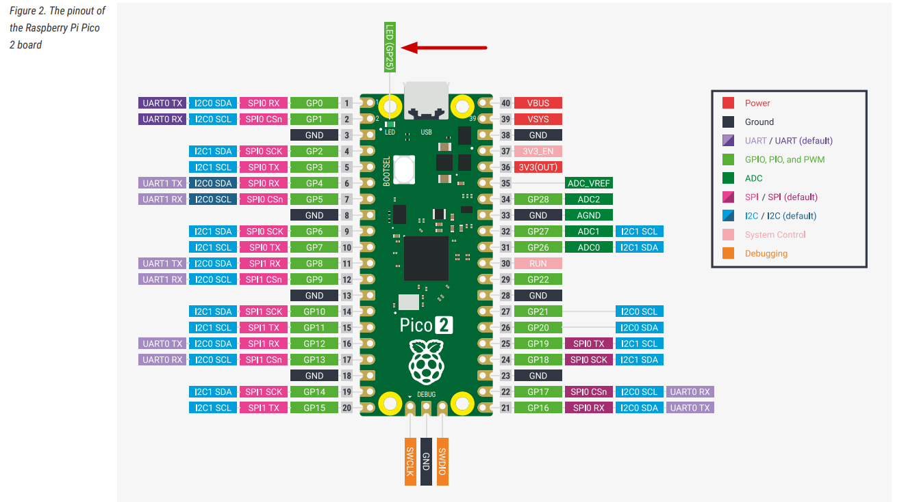

# I2C у Raspberry Pi Pico 2 (RP2350)

Теперь, когда вы понимаете основы протокола I2C, посмотрим, как он работает на Raspberry Pi Pico 2. В RP2350 есть два независимых контроллера I2C, которые называются I2C0 и I2C1. Представьте их как два независимых канала связи, которые могут работать одновременно. Это полезно, когда два устройства имеют одинаковый адрес I2C: их можно подключить к разным контроллерам.

## Доступные выводы I2C

Оба контроллера I2C поддерживают несколько вариантов выводов для SDA и SCL. Для каждого контроллера нужно выбрать только одну пару.

| Контроллер I2C | Выводы GPIO                     |
|----------------|---------------------------------|
| I2C0 - SDA     | GP0, GP4, GP8, GP12, GP16, GP20 |
| I2C0 - SCL     | GP1, GP5, GP9, GP13, GP17, GP21 |
| I2C1 - SDA     | GP2, GP6, GP10, GP14, GP18, GP26|
| I2C1 - SCL     | GP3, GP7, GP11, GP15, GP19, GP27|

 

На схеме платы Pico 2 выводы, которые поддерживают I2C, помечены надписями SDA и SCL, а также выделены синим цветом, чтобы их было легко найти.

## Варианты скорости

Контроллеры I2C в RP2350 поддерживают три режима скорости, что позволяет подобрать их под возможности подключаемых устройств:

- Стандартный режим: до 100 кбит/с (килобит в секунду) — самый медленный, но самый совместимый
- Быстрый режим: до 400 кбит/с — хороший баланс для большинства датчиков и дисплеев
- Режим Fast Mode Plus: до 1000 кбит/с — когда нужна более быстрая передача данных

Стоит отметить, что RP2350 не поддерживает сверхскоростные режимы (высокоскоростной на 3,4 Мбит/с или сверхбыстрый на 5 Мбит/с), которые используются некоторыми специализированными устройствами. Однако большинство распространённых датчиков, дисплеев и периферийных устройств прекрасно работают в поддерживаемом диапазоне скоростей.

## Режим контроллера или цели

RP2350 в любой момент может работать либо как контроллер (master), либо как цель (slave), но не оба одновременно на одном контроллере. В типичных проектах, где Pico 2 управляет датчиками и дисплеями, вы всегда будете использовать режим контроллера.

----

Полные технические характеристики см. на [странице 983](https://pip-assets.raspberrypi.com/categories/1214-rp2350/documents/RP-008373-DS-2-rp2350-datasheet.pdf?disposition=inline#page=984) даташита RP2350.
